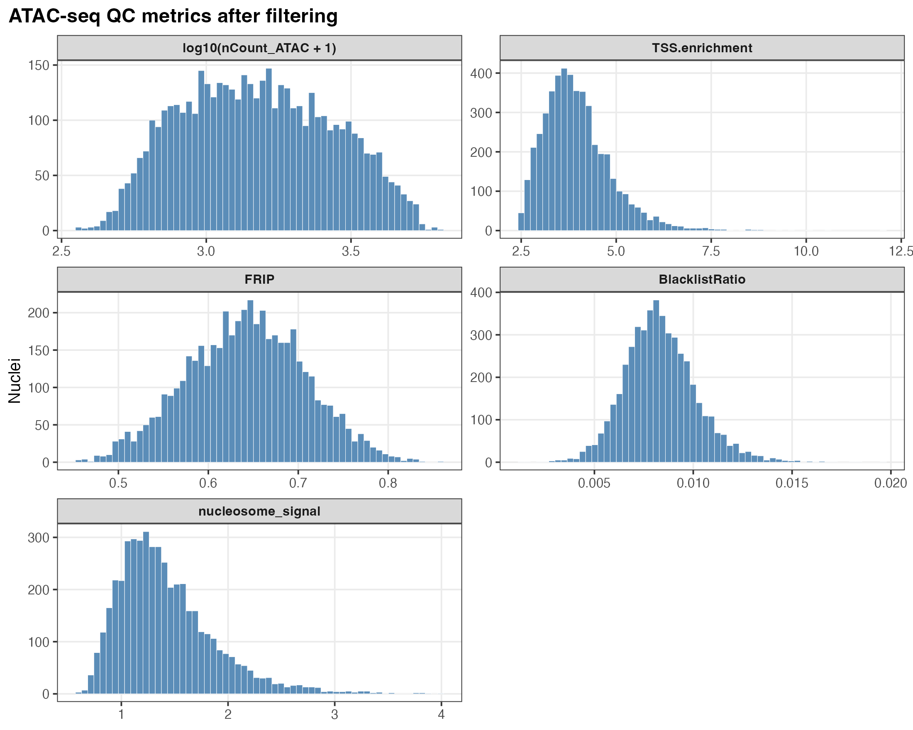
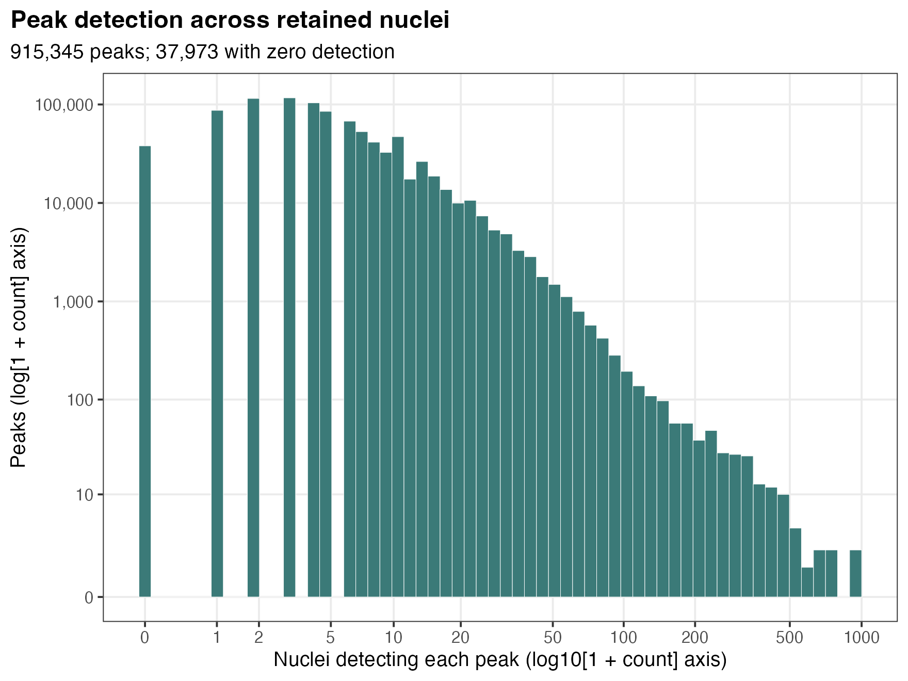
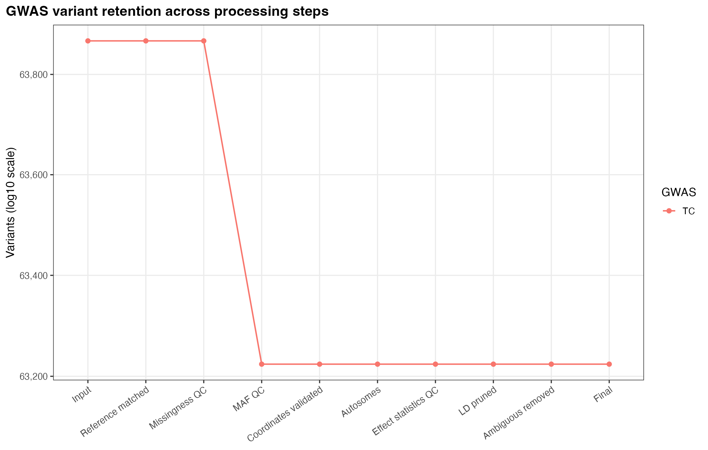
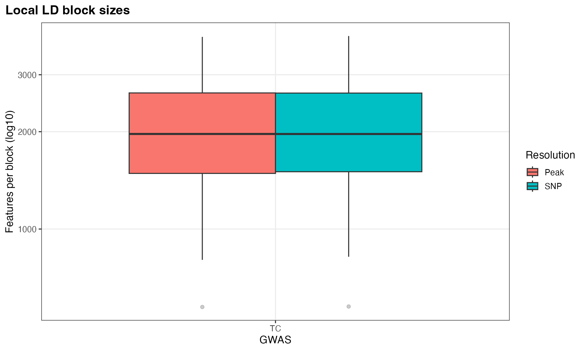
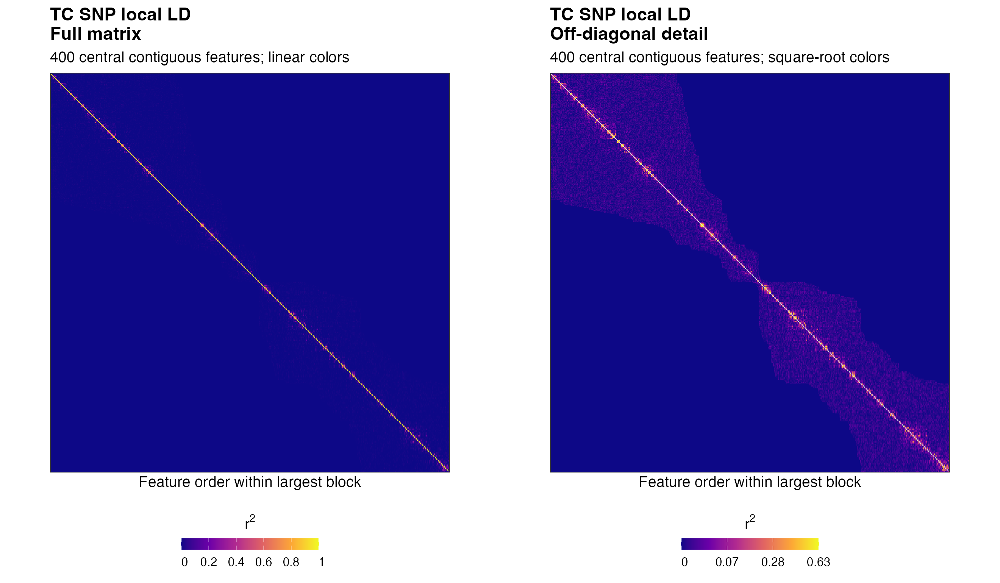
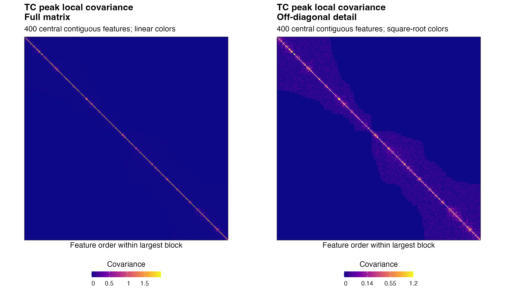
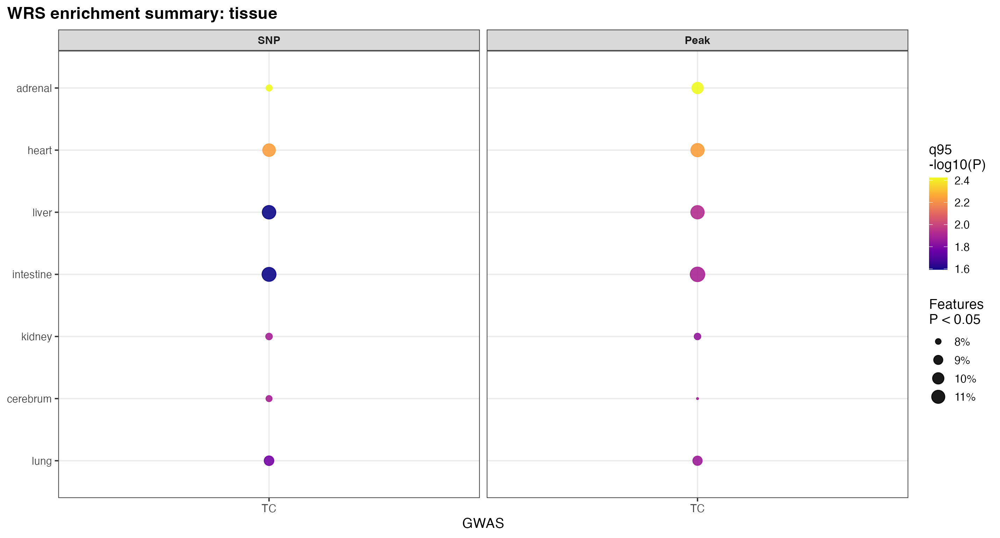

EPIC2: TC all-SNPs vignette
================
Lingxuan Zhu

EPIC2 integrates scATAC-seq accessibility with GWAS summary statistics
to test trait associations in cell groups. This vignette analyzes total
cholesterol (**TC**) using all eligible SNPs in the example inputs.

# Install EPIC2

``` r
install.packages("remotes")
remotes::install_github("LingxuanZ/EPIC2", upgrade = "never", build_vignettes = FALSE)
```

The analysis also requires Seurat, Signac, BiocParallel, Rsamtools and
presto. The repository provides an [analysis dependency
installer](https://github.com/LingxuanZ/EPIC2/blob/main/scripts/install_dependencies.R).

# Example data

[Download the all-SNPs inputs (115.4
MB)](https://www.dropbox.com/scl/fi/waibphblujax44w9h0rvt/EPIC2_inputs_TC_SCZ_all_snps_raw.tar.gz?rlkey=hsg9z8hd94v1s2y4m5a8h8ck1&st=xy9u9vlc&dl=1).

This tutorial uses **a sampled subset of real scATAC-seq data**,
together with real TC GWAS summary statistics and reference genotypes.
The hg19/GRCh37 inputs contain **63,867 eligible TC SNPs** with
reference genotypes from **503 individuals**, and **4,788 cells** in
**24 tissue–cell-type groups** from **7 tissues**. The ATAC object
contains **915,345 post-QC peaks**. Cells were sampled at up to 200 per
group; all eligible TC SNPs were retained without SNP subsampling. The
GWAS inputs have already undergone LD pruning and ambiguous-variant
removal, and include variants with valid statistics, a
reference-genotype match and overlap with accessible autosomal peaks.

The full data used in the manuscript are available on
[Dropbox](https://www.dropbox.com/scl/fo/sryw79ywmy7gcty6pbm45/AOkzY5IFfC20oXzgY2vxoqM?rlkey=drrktk7uumyazina4woawdgl7&st=ino5s6so&dl=0).

| Input | Contents |
|:---|:---|
| `data/atac.rds` | Peak counts, cell annotations and UMAP coordinates |
| `data/gwas/TC.rds` | TC GWAS summary statistics |
| `data/genotypes/TC.rds` | TC reference genotypes |
| `data/fragments.tsv.gz` and its `.tbi` index | Indexed ATAC fragments |

Place the downloaded archive and the supplied [config.yml](config.yml)
in your working directory, then extract the data. This configuration
selects TC only.

``` r
untar("EPIC2_inputs_TC_SCZ_all_snps_raw.tar.gz")
```

# Run the analysis

``` r
library(EPIC2)
config <- EPIC2::read_EPIC2_config("config.yml")
```

The ATAC object has already passed QC. Attach the fragment file and save
the checkpoint used by EPIC2. Fragment barcode validation is disabled
because this file contains fragments only near the example loci.

``` r
atac <- readRDS("data/atac.rds")
fragment <- Signac::CreateFragmentObject(
  path = normalizePath("data/fragments.tsv.gz"),
  cells = setNames(colnames(atac), colnames(atac)),
  validate.fragments = FALSE, verbose = FALSE
)
Signac::Fragments(atac[["ATAC"]]) <- NULL
Signac::Fragments(atac[["ATAC"]]) <- fragment
dir.create("output/01_atac", recursive = TRUE, showWarnings = FALSE)
saveRDS(atac, "output/01_atac/atac.qc.rds")
```

Run GWAS harmonization, accessibility construction, local LD estimation,
Wilcoxon rank-sum (WRS) scoring and the association models:

``` r
EPIC2::run_EPIC2(
  config,
  stages = c("gwas", "accessibility", "ld", "wrs", "model"),
  gwas_name = "TC"
)
```

EPIC2 fits SNP accessibility, SNP WRS, peak accessibility and peak WRS
components, then combines their P-values using ACAT. The run retains all
4,788 supplied cells. GWAS/reference QC retains 63,224 SNPs; the SNP and
peak accessibility branches contain 58,390 and 57,713 features,
respectively.

# Read the results

``` r
results <- read.delim("output/05_models/tissue_cell_type.cauchy_results.tsv")
results[, c("trait", "group", "p_cauchy", "p_cauchy_bh_within_trait")]
```

The six cell groups with the lowest TC ACAT P-values are shown below.

| Cell group                            | ACAT P   | BH-adjusted P |
|:--------------------------------------|:---------|:--------------|
| kidney_Ureteric bud cells             | 0.000138 | 0.00297       |
| liver_Hepatoblasts                    | 0.000247 | 0.00297       |
| heart_Cardiomyocytes                  | 0.0255   | 0.137         |
| adrenal_Adrenocortical cells          | 0.0275   | 0.137         |
| kidney_Vascular endothelial cells     | 0.0286   | 0.137         |
| intestine_Intestinal epithelial cells | 0.139    | 0.556         |

`p_cauchy` is the combined P-value; `p_cauchy_bh_within_trait` adjusts
across cell groups within TC. Individual component estimates are saved
in `tissue_cell_type.component_results.tsv`, and tissue-level results
are in `tissue.cauchy_results.tsv`, under `output/05_models/`.

# Generate and view the figures

``` r
EPIC2::run_plot_stage(config, traits = "TC")
```

EPIC2 writes PNG/PDF figures to `output/figures/`. The **37 figures**
below are copied directly from these outputs. Association P-value color
scales span −log10(P) = 0–5. Each figure has a PDF link. Figures
requiring unavailable inputs, including balanced-WRS and S-LDSC results,
are omitted.

## ATAC data and QC

### ATAC QC metrics

\
Distributions of the available cell-level QC metrics.
[PDF](figures/00_atac_qc/atac_qc_metric_distributions.pdf)

### ATAC counts and TSS enrichment

\
Relationship between ATAC counts and TSS enrichment.
[PDF](figures/00_atac_qc/density_scatter_nCount_TSS.pdf)

### Peak detection

\
All peaks, including zero-detection peaks, are retained. The horizontal
axis uses log10(1 + count) and the vertical axis uses log(1 + count);
tick labels give the original counts.
[PDF](figures/00_atac_qc/peak_coverage_distribution.pdf)

### Cell annotations

\
UMAP of all supplied cells, colored by tissue and tissue–cell-type
group. [PDF](figures/UMAP_tissue_and_tissue_cell_type.cellQC.peakQC.pdf)

## GWAS processing

### TC SNP retention

\
Numbers of TC SNPs retained during GWAS processing.
[PDF](figures/01_gwas_qc/gwas_filtering_waterfall.pdf)

### TC coordinate validation

\
TC has 0 duplicate coordinates removed; the explicit zero is a valid QC
result. [PDF](figures/01_gwas_qc/gwas_coordinate_validation.pdf)

## Accessibility

### Accessibility count distributions

\
Left: all matrix entries, including zeros. Right: counts conditional on
nonzero entries, with a separate denominator; SNP and peak features are
both shown.
[PDF](figures/02_accessibility/accessibility_count_distributions.pdf)

### Feature detection

\
Proportion of TC features detected in at least 1% of cells.
[PDF](figures/02_accessibility/accessibility_coverage_summary.pdf)

### SNP accessibility on UMAP

\
TC SNP accessibility counts on the cell embedding; colors use the
package display scaling.
[PDF](figures/all_traits_GWAS_SNP_count_FeaturePlot.pdf)

### SNP accessibility by cell group

\
Distribution of TC SNP accessibility counts across cell groups.
[PDF](figures/02_accessibility/all_traits_GWAS_SNP_count_VlnPlot.pdf)

### Peak accessibility on UMAP

\
TC peak accessibility counts on the cell embedding; colors use the
package display scaling.
[PDF](figures/all_traits_GWAS_peak_count_FeaturePlot.pdf)

### Peak accessibility by cell group

\
Distribution of TC peak accessibility counts across cell groups.
[PDF](figures/02_accessibility/all_traits_GWAS_peak_count_VlnPlot.pdf)

## LD

### LD block sizes

\
Sizes of the TC SNP and peak LD components.
[PDF](figures/03_ld/ld_block_size_distribution.pdf)

### SNP LD heatmap

\
The same 400 contiguous SNPs, centered in the largest component, are
shown in both panels. Left: full r² with linear colors. Right: diagonal
masked and square-root colors to reveal off-diagonal structure. The full
matrix is used for analysis. [PDF](figures/03_ld/TC.snp_ld_heatmap.pdf)

### Peak covariance heatmap

\
The same 400 contiguous peaks, centered in the largest component, are
shown in both panels. Left: full covariance with linear colors. Right:
diagonal masked and square-root colors. The full matrix is used for
analysis. [PDF](figures/03_ld/TC.peak_ld_heatmap.pdf)

## WRS

### WRS summary by cell group

\
Point size shows the fraction of features with WRS P \< 0.05; color
shows the 95th percentile of −log10(P).
[PDF](figures/04_wrs/wrs_group_summary.tissue_cell_type.pdf)

### WRS summary by tissue

\
Point size shows the fraction of features with WRS P \< 0.05; color
shows the 95th percentile of −log10(P).
[PDF](figures/04_wrs/wrs_group_summary.tissue.pdf)

### SNP WRS P-values by cell group

\
Distribution of one-sided WRS P-values for TC.
[PDF](figures/04_wrs/TC.snp.tissue_cell_type.onesided_pvalue_hist.pdf)

### SNP WRS scores by cell group

\
Distribution of truncated one-sided WRS normal scores for TC.
[PDF](figures/04_wrs/TC.snp.tissue_cell_type.truncated_z_hist.pdf)

### SNP WRS P-values by tissue

\
Distribution of one-sided WRS P-values for TC.
[PDF](figures/04_wrs/TC.snp.tissue.onesided_pvalue_hist.pdf)

### SNP WRS scores by tissue

\
Distribution of truncated one-sided WRS normal scores for TC.
[PDF](figures/04_wrs/TC.snp.tissue.truncated_z_hist.pdf)

### peak WRS P-values by cell group

\
Distribution of one-sided WRS P-values for TC.
[PDF](figures/04_wrs/TC.peak.tissue_cell_type.onesided_pvalue_hist.pdf)

### peak WRS scores by cell group

\
Distribution of truncated one-sided WRS normal scores for TC.
[PDF](figures/04_wrs/TC.peak.tissue_cell_type.truncated_z_hist.pdf)

### peak WRS P-values by tissue

\
Distribution of one-sided WRS P-values for TC.
[PDF](figures/04_wrs/TC.peak.tissue.onesided_pvalue_hist.pdf)

### peak WRS scores by tissue

\
Distribution of truncated one-sided WRS normal scores for TC.
[PDF](figures/04_wrs/TC.peak.tissue.truncated_z_hist.pdf)

### Top SNP features

\
Accessibility of WRS-ranked SNP features for TC, selecting up to three
features per cell group.
[PDF](figures/all_traits.top3_per_group_topSNP_wilcoxon_DotPlot.pdf)

### Top peak features

\
Accessibility of WRS-ranked peak features for TC, selecting up to three
features per cell group.
[PDF](figures/all_traits.top3_per_group_topPeak_wilcoxon_DotPlot.pdf)

## Association results

### ACAT associations by cell group

\
Color shows nominal −log10(P); point size shows the number of combined
tests. \* BH-adjusted P \< 0.05; \*\* Bonferroni-adjusted P \< 0.05.
[PDF](figures/05_models/cauchy_tissue_cell_type_dotplot.pdf)

### Nominal component and ACAT tests by cell group

\
Nominal P-values for the four components and ACAT; stars indicate
displayed P \< 0.05.
[PDF](figures/05_models/cauchy_tissue_cell_type_component_heatmap_nominal.pdf)

### BH-adjusted component and ACAT tests by cell group

\
BH-adjusted P-values for the four components and ACAT; stars indicate
displayed P \< 0.05.
[PDF](figures/05_models/cauchy_tissue_cell_type_component_heatmap_bh.pdf)

### Bonferroni-adjusted component and ACAT tests by cell group

\
Bonferroni-adjusted P-values for the four components and ACAT; stars
indicate displayed P \< 0.05.
[PDF](figures/05_models/cauchy_tissue_cell_type_component_heatmap_bonferroni.pdf)

### Component effect statistics by cell group

\
Colors show beta/SE on the symmetric display scale indicated in the
legend; stars indicate within-trait BH-adjusted P \< 0.05.
[PDF](figures/05_models/component_effects_tissue_cell_type.pdf)

### ACAT associations by tissue

\
Color shows nominal −log10(P); point size shows the number of combined
tests. \* BH-adjusted P \< 0.05; \*\* Bonferroni-adjusted P \< 0.05.
[PDF](figures/05_models/cauchy_tissue_dotplot.pdf)

### Nominal component and ACAT tests by tissue

\
Nominal P-values for the four components and ACAT; stars indicate
displayed P \< 0.05.
[PDF](figures/05_models/cauchy_tissue_component_heatmap_nominal.pdf)

### BH-adjusted component and ACAT tests by tissue

\
BH-adjusted P-values for the four components and ACAT; stars indicate
displayed P \< 0.05.
[PDF](figures/05_models/cauchy_tissue_component_heatmap_bh.pdf)

### Bonferroni-adjusted component and ACAT tests by tissue

\
Bonferroni-adjusted P-values for the four components and ACAT; stars
indicate displayed P \< 0.05.
[PDF](figures/05_models/cauchy_tissue_component_heatmap_bonferroni.pdf)

### Component effect statistics by tissue

\
Colors show beta/SE on the symmetric display scale indicated in the
legend; stars indicate within-trait BH-adjusted P \< 0.05.
[PDF](figures/05_models/component_effects_tissue.pdf)
