```{r setup, include=FALSE}
knitr::opts_chunk$set(echo = TRUE, message = FALSE, warning = FALSE,
                      cache = FALSE, error = FALSE)
dir.create("scripts", showWarnings = FALSE)
dir.create("results", showWarnings = FALSE)
dir.create("figures", showWarnings = FALSE)
```

EPIC2 integrates scATAC-seq accessibility with GWAS summary statistics to test
trait associations in cell groups. This vignette analyzes total cholesterol
(**TC**) using all eligible SNPs in the example inputs.

# Install EPIC2

```{r install, eval=FALSE}
if (!requireNamespace("devtools", quietly = TRUE)) install.packages("devtools")
devtools::install_github(
  "LingxuanZ/EPIC2",
  ref = "17a39bdab7d1f48b6c81fbf3cc4b074aa0a23c6e",
  upgrade = "never", build_vignettes = FALSE
)
```

The analysis also requires Seurat, Signac [@stuart2021signac], BiocParallel, Rsamtools and presto [@korsunsky2022presto].
The repository provides an [analysis dependency installer](https://github.com/LingxuanZ/EPIC2/blob/main/scripts/install_dependencies.R).

# Example data and required inputs

[Download the all-SNPs inputs (115.4 MB)](https://www.dropbox.com/scl/fi/waibphblujax44w9h0rvt/EPIC2_inputs_TC_SCZ_all_snps_raw.tar.gz?rlkey=hsg9z8hd94v1s2y4m5a8h8ck1&st=xy9u9vlc&dl=1).

This tutorial uses **a sampled subset of real scATAC-seq data from human fetal tissues** [@domcke2020human], together with
real TC GWAS summary statistics [@willer2013lipids] and reference genotypes [@auton2015global]. The hg19/GRCh37 inputs
contain **63,867 eligible TC SNPs** with reference genotypes
from **503 individuals**, and **4,788 cells** in **24 tissue–cell-type groups**
from **7 tissues**. The ATAC object contains **915,345 post-QC peaks**.
Cells were sampled at up to 200 per group; all eligible TC SNPs were retained
without SNP subsampling. The GWAS inputs have already undergone LD pruning
and ambiguous-variant removal, and include variants with valid statistics,
a reference-genotype match and overlap with accessible autosomal peaks.

The full data used in the manuscript are available on
[Dropbox](https://www.dropbox.com/scl/fo/sryw79ywmy7gcty6pbm45/AOkzY5IFfC20oXzgY2vxoqM?rlkey=drrktk7uumyazina4woawdgl7&st=ino5s6so&dl=0).

EPIC2 requires GWAS summary statistics, an annotated scATAC-seq object,
indexed fragments for SNP accessibility, and LD reference genotypes:

<div class="epic2-input-table">

| Input | Contents |
|:--|:--|
| `inputs/data/atac.rds` | A Seurat object with a Signac chromatin assay (`ATAC` here), full post-QC peak counts, genomic peak coordinates and per-cell metadata; requirements are detailed below |
| `inputs/data/gwas/TC.rds` | TC GWAS statistics: `rsid`, `chr`, `pos`, `A1`, `A2`, `MAF`, `P`, `beta` and `se` |
| `inputs/data/genotypes/TC.rds` | LD reference genotypes: a 63,867-variant by 503-individual dosage matrix, with variant IDs in row names |
| `inputs/data/fragments.tsv.gz` and its `.tbi` index | Indexed ATAC fragments used to count accessibility at SNPs; fragment barcodes must map to cells in the object |

</div>

Alongside these data files, **the stage-based workflow requires a YAML configuration file (`config.yml`)** to define input paths and analysis settings. The complete file for this tutorial is provided in [Configuration and cell-type annotations](#configuration-and-cell-type-annotations).

**Required ATAC contents**

Keep the full post-QC peak-by-cell counts in the chromatin assay's `counts`
layer, with genomic peak IDs such as `chr1-100-200` and cell names matching
the metadata. EPIC2 derives library-size scaling from the full autosomal
peak counts. The assay is named `ATAC` in this tutorial; another name can
be selected with `atac.assay`, with matching changes to explicit assay names
in the example code.

**Minimum metadata for analysis**

Cell annotations belong in `atac[[]]`, with one row per cell and row names
matching `colnames(atac)`. **Every column listed in `model.groupings` must
exist**: the current configuration requires both `tissue_cell_type` and
`tissue`. These labels define the groups compared by WRS and tested by the
association models. Each grouping needs at least two labelled groups;
cells with missing labels are excluded from that grouping's analysis.

For your own data, one cell-type annotation column is sufficient if it is
the only entry in `model.groupings`. A separate tissue column is not
intrinsically required for cell-type association testing. See
[Choose annotation levels for your own data](#choose-annotation-levels-for-your-own-data).

**Additional metadata depends on the workflow**

<div class="epic2-stage-map">

| Metadata column | Purpose | Needed for (stage) |
|:--|:--|:--|
| `tissue_cell_type` | Defines tissue–cell-type group membership. | ATAC (2.1, optional); WRS (2.5); Models (2.6); Plots (2.7). |
| `tissue` | Identifies tissue membership for tissue-level tests, fragment-file mapping and annotation plots. | WRS (2.5); Models (2.6); Plots (2.7). Also ATAC (2.1) when attaching tissue-mapped fragments. |
| Raw-barcode column, if used | Maps Seurat cell names to the barcodes in fragment files. | ATAC (2.1), when attaching fragments whose raw barcodes differ from Seurat cell names. |
| `nCount_ATAC` | Total peak counts per cell. | ATAC (2.1, optional); QC plots (2.7). |
| `TSS.enrichment` | Enrichment of accessibility around transcription start sites. | ATAC (2.1, optional); QC plots (2.7). |
| `FRIP` | Fraction of fragments within peaks. | ATAC (2.1, optional); QC plots (2.7). |
| `BlacklistRatio` | Fraction of fragments overlapping blacklist regions. | ATAC (2.1, optional); QC plots (2.7). |
| `nucleosome_signal` | Ratio of mononucleosomal to nucleosome-free fragments. | ATAC (2.1, optional); QC plots (2.7). |

</div>

In this tutorial, `atac.group_column` selects `tissue_cell_type`, and
`atac.tissue_column` selects `tissue`. Both columns are also included in
`model.groupings` for the association analyses. Your own column names can differ.

`atac.fragment_barcode_column` selects the raw-barcode column when needed;
no separate column is required if the attached fragment objects already
contain the correct cell-to-barcode mapping. The count column follows the
assay name: `nCount_<assay>` (`nCount_ATAC` here).

**For an already QC-filtered object, these QC metrics are not required by
the downstream accessibility, WRS or association calculations when the ATAC
QC stage is skipped.** Retain them to reproduce the tutorial's QC figures.
If you run ATAC QC, supply the metrics or compute them from the appropriate
inputs as described in [2.1 ATAC processing and QC](#atac-processing-and-qc-optional).
`compute_qc_metrics: false` reuses existing metrics; it does not skip filtering.

**UMAP is optional for statistical analysis.** To reproduce the UMAP figures,
retain the `umap` reduction in the Seurat object. Its coordinates are stored
in the object's reductions, not as required metadata columns.

GWAS, ATAC peaks and fragments **must use the same genome assembly**
(**hg19/GRCh37** here); setting `genome.build` does not convert coordinates.
Reference variant IDs must match GWAS `rsid` values, and genotype dosage must
count the GWAS effect allele (`A1`).

Place the downloaded archive and the supplied [config.yml](config.yml) in your
working directory, then extract the data. This configuration selects TC only.

```{r extract-inputs, eval=params$recompute}
dir.create("inputs", showWarnings = FALSE)
archive <- "inputs/EPIC2_inputs_TC_SCZ_all_snps_raw.tar.gz"
if (!file.exists(archive)) {
  download.file(
    "https://www.dropbox.com/scl/fi/waibphblujax44w9h0rvt/EPIC2_inputs_TC_SCZ_all_snps_raw.tar.gz?rlkey=hsg9z8hd94v1s2y4m5a8h8ck1&st=xy9u9vlc&dl=1",
    archive, mode = "wb"
  )
}
stopifnot(identical(
  digest::digest(file = archive, algo = "sha256"),
  "b6172b11214ad4c43a6dd1d39132a4ca863ed5ebb894234baf70b0039add6275"
))
input_files <- grep("^data/", untar(archive, list = TRUE), value = TRUE)
untar(archive, files = input_files, exdir = "inputs")
```

# Configuration and cell-type annotations

[Download the complete config.yml for this tutorial](config.yml).
The full configuration is shown below. Keep `config.yml` and the
`inputs/` folder in the same working directory. Analysis outputs will
be saved in `output/` under that directory.

The scATAC-seq and GWAS inputs have undergone upstream QC, so this tutorial skips ATAC QC and does not repeat GWAS LD pruning or ambiguous-variant removal; GWAS/reference checks still run. See the [full workflow configuration](https://github.com/LingxuanZ/EPIC2/blob/main/inst/extdata/config.example.yml) for the complete settings. For details on each configuration parameter, see [CONFIGURATION.md](https://github.com/LingxuanZ/EPIC2/blob/main/CONFIGURATION.md).

```yaml
project:
  name: EPIC2 TC all-SNPs vignette
  output_dir: output
parameters:
  seed: 1000
  workers: 1
genome:
  build: hg19
  duplicate_action: drop
atac:
  input: inputs/data/atac.rds
  assay: ATAC
  tissue_column: tissue
  group_column: tissue_cell_type
  attach_fragments: no
  compute_qc_metrics: no
  recompute_embedding: no
gwas:
  columns:
    rsid: rsid
    chr: chr
    pos: pos
    a1: A1
    a2: A2
    maf: MAF
    p: P
    beta: beta
    se: se
  genotype_format: dosage
  genotype_orientation: variants_by_samples
  genotype_ploidy: 2
  maf_min: 0.05
  reference_missing_rate_max: 0.01
  ld_prune: no
  remove_ambiguous: no
  traits:
    TC:
      summary: inputs/data/gwas/TC.rds
      genotype: inputs/data/genotypes/TC.rds
accessibility:
  chunks: 20
ld:
  window_bp: 5000000
  ridge: 0.01
  eigen_tolerance: 1.0e-08
  correlation_block_size: 256
  max_snps_for_chr_ld: 15000
  max_dense_block_size: 6000
wrs:
  truncation_quantiles:
  - 0.02
  - 0.98
  balanced:
    enabled: no
model:
  groupings:
  - tissue_cell_type
  - tissue
  require_all_components: no
plots:
  formats:
  - png
  - pdf
  dpi: 220
  fail_on_error: yes
  max_umap_cells: 4788
  ld_heatmap_max_features: 400
  base_size: 13
  pvalue_cap: 5.0
```

`TC` is the trait name used in the analysis and plotting calls below.
LD pruning and ambiguous-variant removal are disabled here because the
supplied GWAS inputs have already undergone these steps.

## Multiple traits (optional)

**This tutorial runs TC only; all results shown below are for TC.** The input
archive also includes SCZ. To analyze both traits, replace the `traits` block
under `gwas` in `config.yml` with the following entries, keeping the other
GWAS settings:

```yaml
gwas:
  traits:
    TC:
      summary: inputs/data/gwas/TC.rds
      genotype: inputs/data/genotypes/TC.rds
    SCZ:
      summary: inputs/data/gwas/SCZ.rds
      genotype: inputs/data/genotypes/SCZ.rds
```

After preparing the ATAC checkpoint as described below, reload the edited
configuration and use these calls in place of the TC-only analysis and
plotting calls. This optional example is not executed when knitting this
tutorial.

```{r multiple-traits, eval=FALSE}
config <- EPIC2::read_EPIC2_config("config.yml", check_files = TRUE)
EPIC2::run_EPIC2(
  config,
  stages = c("gwas", "accessibility", "ld", "wrs", "model"),
  gwas_name = c("TC", "SCZ")
)
EPIC2::run_plot_stage(config, traits = c("TC", "SCZ"))
```

EPIC2 processes traits **sequentially within each stage**: for example, the
GWAS stage processes TC and then SCZ before the accessibility stage begins.
`parameters.workers` controls parallel SNP-accessibility chunks within a
trait; it does not enable parallel execution across traits.
To run traits in parallel, users must arrange parallel execution themselves, for example by launching one R process or cluster job per trait, each with its own output directory.

## Inspect the cell annotations

Cell annotations must be stored in the Seurat object's metadata, accessed
with `atac[[]]`. Each row corresponds to one cell, with row names matching
the object's cell names. The supplied object contains the annotation columns
`tissue` and `tissue_cell_type`:

```{r inspect-annotations}
library(Seurat)
atac <- readRDS("inputs/data/atac.rds")
head(atac[[]][, c("tissue", "tissue_cell_type")])
```

`tissue_cell_type` combines tissue and cell-type labels, for example
`liver_Hepatoblasts` and `kidney_Ureteric bud cells`. Its 24 groups therefore
represent **cell types within tissues**, rather than cell types pooled across
tissues. Renaming this column does not change its labels or group membership.
To test a different grouping, supply the corresponding per-cell annotations.

<div class="epic2-input-table epic2-annotation-settings">

| Setting | Purpose |
|:--|:--|
| `atac.group_column` | Metadata column used for minimum group-size filtering during ATAC QC. This tutorial uses a post-QC object and skips that stage. |
| `model.groupings` | Metadata columns used for WRS scoring and association tests; each column is analyzed separately. |

</div>

The supplied configuration includes both `tissue_cell_type` and `tissue`;
the association results displayed here use `tissue_cell_type`. To test only
the 24 tissue–cell-type groups, set `model.groupings: [tissue_cell_type]`.
`atac.tissue_column` identifies the tissue metadata used when attaching
fragment files; it does not select the association tests.

## Choose annotation levels for your own data

Store your curated annotations in the metadata of the object saved at
`atac.input`, matching labels to cells by barcode. For example, if your own
object has broad and fine annotations, inspect them with:

```{r inspect-own-annotations, eval=FALSE}
head(atac[[]][, c("cell_type_broad", "cell_type_fine")])
```

These two column names are examples and are **not present in the supplied
object**. Use the actual column names in your data. Replace `model.groupings`
in the complete YAML with the desired selection. For one annotation level:

```yaml
model:
  groupings: [cell_type_broad]
```

For separate analyses of both annotation levels:

```yaml
model:
  groupings: [cell_type_broad, cell_type_fine]
```

Listing both columns runs two separate analyses; it does not combine their
labels into a new grouping. Set `atac.group_column` separately if you also
want to change the grouping used for ATAC QC. After changing annotations or
analysis groupings, use a separate output directory and rerun the analysis.

See the [configuration reference](https://github.com/LingxuanZ/EPIC2/blob/main/CONFIGURATION.md)
for the remaining options.

# Run the analysis

Run the preparation step first, then choose either the single-command route
or the stage-by-stage route. Both use the same EPIC2 stage functions and settings.
The completed outputs are included in `output/`; this document reads those
files by default. Set `recompute: true` in the Rmd's `params` to rerun the
stage-by-stage route when rendering. The single-command example is an
alternative and is not executed automatically.

## Prepare the shared inputs

```{r configuration}
library(EPIC2)
library(Signac)
config <- EPIC2::read_EPIC2_config("config.yml", check_files = TRUE)
set.seed(config$parameters$seed)
```

The ATAC object has already passed QC. For a fresh run, attach the supplied
fragment file and save the checkpoint used by every downstream stage.
Fragment barcode validation is disabled because this example file contains
fragments only near the selected loci. The included checkpoint is already
prepared. [Preparation script](scripts/00_prepare_atac.R).

```{r prepare-atac, eval=params$recompute}
fragment <- Signac::CreateFragmentObject(
  path = normalizePath("inputs/data/fragments.tsv.gz"),
  cells = setNames(colnames(atac), colnames(atac)),
  validate.fragments = FALSE, verbose = FALSE
)
Signac::Fragments(atac[["ATAC"]]) <- NULL
Signac::Fragments(atac[["ATAC"]]) <- fragment
dir.create("output/01_atac", recursive = TRUE, showWarnings = FALSE)
saveRDS(atac, "output/01_atac/atac.qc.rds")
```

Output: `output/01_atac/atac.qc.rds`, containing the 4,788 supplied cells,
915,345 post-QC peaks, annotations and the attached fragment file.

## 1. Run all stages with one command

After preparation, this call runs GWAS processing, accessibility, LD, WRS,
association models and plotting for **TC only**. [Run-all script](scripts/run_all.R).

```{r run-together, eval=FALSE}
EPIC2::run_EPIC2(
  config,
  stages = c("gwas", "accessibility", "ld", "wrs", "model", "plot"),
  gwas_name = "TC"
)
```

Selected messages recorded in the completed analysis:

```text
GWAS stage complete for TC: 63224 variants
Accessibility stage complete for TC: 58390 SNPs and 57713 peaks
LD stage complete for TC
WRS stage complete for TC
Association models complete for TC / tissue_cell_type
Association models complete for TC / tissue
```

The stage outputs and their contents are shown below. Choose the
stage-by-stage route when you want to inspect an intermediate result before
continuing; running both routes would repeat the same calculations.

## 2. Run one stage at a time

Run an individual stage once its upstream results exist; **EPIC2 does not
run missing prerequisite stages**. For stage calls, use the complete `config.yml` and the
matching output directory, with your R working directory set to the folder
containing `config.yml`.

Intermediate paths below are relative to `project.output_dir` (`output/`
here). **LD and WRS can run independently after Accessibility; Models needs
both.** See [Shared requirements for partial runs](#shared-requirements-for-partial-runs)
for completion checks, configuration settings and a single-stage example.

**The Outputs sections below describe files generated and saved by the
stage functions.** Displayed tutorial results were read from these saved
outputs.

The **Core functions without YAML** examples return R objects. Run them
from this tutorial folder using the listed input files. **To keep their
results on disk, create the required output directories and save the
objects yourself**, using `saveRDS()`, `write.table()` or
`ggplot2::ggsave()` as appropriate. Alternatively, pass the returned objects
directly to subsequent functions. These examples do not write stage
completion records and are not executed while knitting.

### 2.1 ATAC processing and QC (optional)

**This step is not run in this tutorial because the supplied ATAC object has
already passed QC.** If your own scATAC-seq object has not been filtered and
you want to follow the EPIC2 QC pipeline, run this stage before accessibility
construction. Use it in place of the post-QC checkpoint preparation above.

#### Required inputs

- The Seurat/Signac object at `atac.input`, containing the configured
  chromatin assay, peak counts and cell annotations.
- To compute QC metrics: complete, deduplicated fragment files with `.tbi`
  indexes; TSS enrichment also requires gene annotations in the chromatin
  assay, using the same genome assembly.

The tutorial's locus-restricted fragments are intended for SNP
accessibility and should not be used to recompute genome-wide QC metrics.

#### Run

**Stage function (with YAML)**

The [EPIC2 QC pipeline](https://github.com/LingxuanZ/EPIC2/blob/main/METHODS.md#quality-control)
uses the following default filters:

1. Retain cells with **TSS enrichment ≥ 2.5** and **FRIP ≥ 0.3**.
2. Calculate the **1st percentile of ATAC counts among cells passing those
   TSS/FRIP filters**. Retain cells at or above this count cutoff, with
   **blacklist ratio < 0.02** and **nucleosome signal ≤ 4**.
3. Retain annotation groups with **at least 50 cells after cell-level QC**,
   using the column selected by `atac.group_column`.
4. After cell filtering, retain **autosomal peaks 100–1,000 bp wide**, with
   **at least one total count in at least one retained cell**, and **no
   overlap with the blacklist** for the declared genome assembly [@amemiya2019encode].

To change these thresholds, edit `atac.qc` in the configuration YAML. For your
own analysis, use a separate working directory and edit the `atac` section
of a complete `config.yml`, for example:

```yaml
atac:
  input: data/atac_before_qc.rds
  assay: ATAC
  tissue_column: tissue
  group_column: tissue_cell_type
  attach_fragments: true
  fragment_files:
    my_tissue: data/fragments.tsv.gz
  fragment_barcode_column: null
  validate_fragments: true
  compute_qc_metrics: true
  recompute_embedding: false
  qc:
    tss_min: 2.5
    frip_min: 0.3
    count_quantile_min: 0.01
    blacklist_max: 0.02
    nucleosome_max: 4
    min_cells_per_group: 50
    peak_width_min: 100
    peak_width_max: 1000
    peak_min_total_counts: 1
    peak_min_cells: 1
    peak_autosomes_only: true
    peak_remove_blacklist: true
```

Replace the paths and metadata column names with those in your data, and set
`genome.build` in the complete configuration to the shared input assembly.
The key `my_tissue` must match a value in the metadata column named by
`atac.tissue_column`; add entries for the other tissues as needed. If cell
names differ from the fragment barcodes, set `fragment_barcode_column` to
the metadata column containing the raw barcodes. If the correct fragment
objects are already attached, use `attach_fragments: false` instead.

With `compute_qc_metrics: true`, EPIC2 computes nucleosome signal, TSS
enrichment, FRIP and blacklist ratio before filtering. If those metrics are
already present, use `false` and supply `TSS.enrichment`, `FRIP`,
`nCount_ATAC`, `BlacklistRatio` and `nucleosome_signal` in the metadata
(`nCount_<assay>` follows the assay name). **Setting this flag to `false`
does not skip cell or peak filtering.** Set `recompute_embedding: true`
if you also want to recompute TF-IDF/LSI, UMAP, neighbors and clusters after
QC. See [ATAC configuration](https://github.com/LingxuanZ/EPIC2/blob/main/CONFIGURATION.md#atac-input-and-qc)
for all options.

For your own data, reload the edited configuration and run only ATAC QC:

```{r optional-atac-qc, eval=FALSE}
config <- EPIC2::read_EPIC2_config("config.yml", check_files = TRUE)
EPIC2::run_EPIC2(config, stages = "atac")
```

This dispatches `run_atac_stage()`, which computes the requested QC metrics,
calls `filter_atac_cells()` and `filter_atac_peaks()`.

**Core functions without YAML**

For your own unfiltered object, replace the paths and `my_tissue` key below.
Use complete indexed fragments and gene annotations in the same assembly.
Omit the fragment-attachment lines if the correct fragments are already attached.

```{r core-atac, eval=FALSE}
atac <- readRDS("data/atac_before_qc.rds") # Unfiltered Seurat/Signac object with cell annotations
assay <- "ATAC"; genome <- "hg19"; qc_group <- "tissue_cell_type" # Assay, assembly and QC grouping
SeuratObject::DefaultAssay(atac) <- assay
fragment_files <- c(my_tissue = "data/fragments.tsv.gz") # Keys match metadata$tissue; each file needs its .tbi
attach_fragment_files <- getFromNamespace("attach_fragment_files", "EPIC2") # Internal stage helper
atac <- attach_fragment_files(atac, fragment_files, tissue_column = "tissue", assay = assay, validate = TRUE, barcode_column = NULL)
atac <- Signac::NucleosomeSignal(atac) # Fragment-length QC
atac <- Signac::TSSEnrichment(atac) # TSS enrichment from the object's gene annotations
atac <- EPIC2::add_frip(atac, assay = assay) # Fraction of fragments in peaks
atac <- EPIC2::add_blacklist_ratio(atac, assay = assay, genome = genome) # Fraction in the assembly's blacklist
cell_qc <- list(tss_min = 2.5, frip_min = 0.3, count_quantile_min = 0.01,
                blacklist_max = 0.02, nucleosome_max = 4, min_cells_per_group = 50)
peak_qc <- list(peak_width_min = 100, peak_width_max = 1000, peak_min_total_counts = 1,
                peak_min_cells = 1, peak_autosomes_only = TRUE, peak_remove_blacklist = TRUE)
atac <- EPIC2::filter_atac_cells(atac, thresholds = cell_qc, group_column = qc_group, assay = assay) # Filter cells, then groups
atac_qc <- EPIC2::filter_atac_peaks(atac, thresholds = peak_qc, assay = assay, genome = genome) # Filter peaks after cells
```

#### Outputs in `output/01_atac/`

- `atac.qc.rds`: the filtered object used by downstream stages.
- `qc_dimensions.tsv`: cell and peak counts before and after QC.
- `qc_thresholds.tsv`: configured thresholds and the calculated count cutoff.
- `group_cell_counts.tsv`: retained cells per QC group.
- `genome_qc.tsv`: genome-assembly and coordinate-validation information.

Continue downstream using the same configuration and output directory.
For a single-command run on your own unfiltered data, include `"atac"`
before `"gwas"` in the `stages` vector. The TC tutorial's supplied
configuration, run commands and saved results continue to skip this stage.

### 2.2 GWAS processing

Match GWAS variants to reference genotypes, apply the configured MAF and
missingness filters, and validate coordinates and effect statistics.
LD pruning and ambiguous-variant removal are disabled for these preprocessed
inputs. [GWAS script](scripts/01_gwas.R).

#### Required inputs

- GWAS summary statistics: `gwas.traits.TC.summary`
  (`inputs/data/gwas/TC.rds` in this tutorial).
- Reference genotypes: `gwas.traits.TC.genotype`
  (`inputs/data/genotypes/TC.rds` in this tutorial).
  Multiple traits can use the same compatible reference genotype file by pointing their `genotype` entries to that file; EPIC2 automatically matches SNP IDs to each trait's GWAS and retains the matched subset, reducing unnecessary downstream computation.

The GWAS calculation does not require an ATAC checkpoint.

#### Run

**Stage function (with YAML)**

```{r stage-gwas, eval=params$recompute}
EPIC2::run_gwas_stage(config, gwas_name = "TC")
```

**Core functions without YAML**

```{r core-gwas, eval=FALSE}
gwas_input <- readRDS("inputs/data/gwas/TC.rds") # GWAS summary statistics
genotype_input <- readRDS("inputs/data/genotypes/TC.rds") # SNP-by-individual reference dosages, named by rsID
columns <- list(rsid = "rsid", chr = "chr", pos = "pos", a1 = "A1", a2 = "A2", maf = "MAF", p = "P", beta = "beta", se = "se")
processed <- EPIC2::harmonize_gwas(gwas_input, genotype_input, columns = columns, gwas_name = "TC", genome_build = "hg19",
  genotype_format = "dosage", genotype_orientation = "variants_by_samples", genotype_ploidy = 2, seed = 1000,
  maf_min = 0.05, reference_missing_rate_max = 0.01, ld_prune = FALSE, remove_ambiguous = FALSE, duplicate_action = "drop")
gwas <- processed$gwas # Matched, filtered GWAS with Z-scores and coord_id
genotype <- processed$genotype # Reference dosages aligned to the retained GWAS
processed$summary # QC counts and settings; upstream pruning/ambiguous-variant removal are not repeated
```

#### Outputs in `output/02_gwas/`

- `TC.gwas.rds`: 63,224 harmonized SNPs, including Z-scores and coordinate IDs.
- `TC.genotype.rds`: matched reference dosages for 503 individuals.
- `TC.gwas_qc.tsv`: counts and effective QC settings. Here, 643 input SNPs
  fail the reference-panel MAF threshold.

```{r check-gwas}
gwas_qc <- read.delim("output/02_gwas/TC.gwas_qc.tsv")
gwas_qc[, c("n_input", "n_reference_matched", "n_after_maf", "n_final")]
```

### 2.3 SNP and peak accessibility

Count fragments at SNPs and obtain peak accessibility from the stored peak
counts. [Accessibility script](scripts/02_accessibility.R).

#### Required inputs

- `01_atac/atac.qc.rds`, containing peak counts and cell metadata.
- The fragment files attached to that object, with their `.tbi` indexes.
- `02_gwas/TC.gwas.rds` and `02_gwas/TC.genotype.rds`.

#### Run

**Stage function (with YAML)**

```{r stage-accessibility, eval=params$recompute}
EPIC2::run_accessibility_stage(config, traits = "TC")
```

**Core functions without YAML**

```{r core-accessibility, eval=FALSE}
atac <- readRDS("output/01_atac/atac.qc.rds") # Peak counts, metadata and attached fragments with .tbi indexes
gwas <- readRDS("output/02_gwas/TC.gwas.rds") # Processed GWAS, including chr, pos, rsid and coord_id
genotype <- readRDS("output/02_gwas/TC.genotype.rds") # Processed reference dosages named by rsID
snp_counts <- EPIC2::build_snp_accessibility(atac, gwas, assay = "ATAC", genome_build = "hg19",
  workers = 1, chunks = 20, duplicate_action = "drop") # Count fragments at SNP positions; remove zero-count SNPs
peak_result <- EPIC2::build_peak_accessibility(atac, gwas, assay = "ATAC", genome_build = "hg19", duplicate_action = "drop")
peak_counts <- peak_result$matrix # Stored counts for GWAS-overlapping peaks
snp_peak_overlap <- peak_result$overlap # SNP-to-peak mapping for peak LD
genotype_coord <- genotype[match(gwas$rsid, rownames(genotype)), , drop = FALSE] # Align reference rows to GWAS
rownames(genotype_coord) <- gwas$coord_id # Use the coordinate IDs of the accessibility matrices
snp_genotype <- genotype_coord[rownames(snp_counts), , drop = FALSE] # Reference genotypes for accessible SNPs
```

#### Outputs in `output/02_accessibility/`

- `TC.snp_by_cell.rds`: SNP-by-cell fragment counts at retained GWAS SNP positions.
- `TC.peak_by_cell.rds`: peak-by-cell counts selected from the ATAC object's stored counts for peaks overlapping retained GWAS SNPs.
- `TC.snp_genotype.rds`: reference genotypes aligned to accessible SNPs.
- `TC.snp_peak_overlap.tsv`: SNP-to-peak mapping used by the LD stage.

Both accessibility matrices retain individual cells; group-level predictors are constructed during model fitting.

```{r check-accessibility}
snp_accessibility <- readRDS("output/02_accessibility/TC.snp_by_cell.rds")
peak_accessibility <- readRDS("output/02_accessibility/TC.peak_by_cell.rds")
data.frame(
  branch = c("SNP", "Peak"),
  features = c(nrow(snp_accessibility), nrow(peak_accessibility)),
  cells = c(ncol(snp_accessibility), ncol(peak_accessibility))
)
```

### 2.4 Local LD and inverse square roots

Construct SNP covariance and peak LD models, including inverse-square-root
transformations. This is the most time-consuming stage in this example;
the completed LD files are supplied so they can be inspected without
recomputing them. [LD script](scripts/03_ld.R).

LD-based working matrices account for dependence between GWAS statistics:

- **SNPs:** The local working matrix has $\Sigma_{jj}=1$ and $\Sigma_{jj'}=R_{jj'}^2$ for distinct SNPs on the same chromosome separated by at most 5 Mb; all remaining entries are set to zero. Here, $R_{jj'}$ is the reference-genotype correlation.
- **Peaks:** within-peak LD determines the peak GWAS statistic; cross-peak
  LD determines covariance between peak statistics.

For each connected LD component $b$, let $\Sigma_b=U_b\operatorname{diag}(d_b)U_b^\mathsf{T}$. The ridge-stabilized inverse square root is

$$
W_b=U_b\operatorname{diag}\!\left[
\{\max(d_{bi},\epsilon)+\lambda\}^{-1/2}
\right]U_b^\mathsf{T}.
$$

Here, $\epsilon$ is the eigenvalue floor (`ld.eigen_tolerance`, $10^{-8}$ in this tutorial), and $\lambda$ is the ridge parameter (`ld.ridge`, $0.01$). These settings stabilize the transformation when eigenvalues are small or non-positive.

The ridge-stabilized inverse square root transforms the **response and
full design matrix (intercept, focal predictor and baseline)** before
ordinary least-squares fitting.

#### Required inputs

- `02_gwas/TC.gwas.rds` and `02_gwas/TC.genotype.rds`.
- `02_accessibility/TC.snp_by_cell.rds` and
  `02_accessibility/TC.peak_by_cell.rds`.
- `02_accessibility/TC.snp_peak_overlap.tsv`.

#### Run

**Stage function (with YAML)**

```{r stage-ld, eval=params$recompute}
EPIC2::run_ld_stage(config, traits = "TC")
```

**Core functions without YAML**

`split_sparse_components()` is the internal EPIC2 helper used by this stage;
it groups SNPs using nonzero off-diagonal covariance entries. The code below
recomputes LD. The model example in 2.6 reads the saved LD objects instead.

```{r core-ld, eval=FALSE}
gwas <- readRDS("output/02_gwas/TC.gwas.rds") # Harmonized GWAS with coord_id and Z-scores
genotype <- readRDS("output/02_gwas/TC.genotype.rds") # Reference dosages named by rsID
snp_counts <- readRDS("output/02_accessibility/TC.snp_by_cell.rds") # Defines the accessible SNP set
peak_counts <- readRDS("output/02_accessibility/TC.peak_by_cell.rds") # Defines the peak set
overlap <- read.delim("output/02_accessibility/TC.snp_peak_overlap.tsv") # Columns: snp and peak
genotype <- genotype[match(gwas$rsid, rownames(genotype)), , drop = FALSE]
rownames(genotype) <- gwas$coord_id # Match LD inputs by genomic coordinate
snp_ids <- Reduce(intersect, list(rownames(snp_counts), gwas$coord_id, rownames(genotype)))
snp_sigma <- EPIC2::compute_snp_ld_covariance(genotype[snp_ids, , drop = FALSE], gwas[match(snp_ids, gwas$coord_id), ],
  window_bp = 5000000, factor_two = FALSE, correlation_block_size = 256) # Local SNP r-squared matrix
split_sparse_components <- getFromNamespace("split_sparse_components", "EPIC2") # Internal stage helper
snp_blocks <- split_sparse_components(snp_sigma) # Independent connected components
inverse_blocks <- lapply(snp_blocks, function(ids) EPIC2::compute_inverse_sqrt(snp_sigma[ids, ids, drop = FALSE],
  ridge = 0.01, eigen_tolerance = 1e-8, max_dense_block_size = 6000)) # Whiten each component separately
snp_inverse <- methods::as(methods::as(Matrix::bdiag(inverse_blocks), "generalMatrix"), "CsparseMatrix")
inverse_ids <- unlist(lapply(inverse_blocks, rownames), use.names = FALSE)
dimnames(snp_inverse) <- list(inverse_ids, inverse_ids) # Restore feature IDs after block assembly
peak_ld <- EPIC2::build_peak_ld_model(gwas, genotype, peak_counts, overlap, window_bp = 5000000,
  ridge = 0.01, eigen_tolerance = 1e-8, max_snps_for_chr_ld = 15000, max_dense_block_size = 6000)
peak_response <- peak_ld$response # LD-adjusted peak GWAS statistic
peak_inverse <- peak_ld$inverse_sqrt # Transformation for the peak models
```

#### Outputs in `output/03_ld/`

- `TC.snp_sigma.rds`: SNP covariance matrix.
- `TC.snp_inverse_sqrt.rds` and `TC.snp_blocks.rds`: SNP transformation and connected-component membership.
- `TC.peak_ld_model.rds`: completed peak LD model; `TC.peak_covariance.rds`
  and `TC.peak_response.rds` are its saved intermediate outputs.
- `TC.ld_runtime.tsv`: completion status and LD settings.

```{r check-ld}
ld_status <- read.delim("output/03_ld/TC.ld_runtime.tsv")
ld_status[ld_status$setting == "status", , drop = FALSE]
snp_blocks <- readRDS("output/03_ld/TC.snp_blocks.rds")
data.frame(
  SNP_blocks = length(snp_blocks),
  largest_block = max(lengths(snp_blocks))
)
```

### 2.5 Wilcoxon rank-sum scores

Calculate SNP and peak WRS statistics for each selected metadata grouping,
then construct and truncate one-sided enrichment scores.
[WRS script](scripts/04_wrs.R).

For each feature, WRS compares the focal group with all other labelled
cells. Here, `liver_Hepatoblasts` is compared with the other 23 groups.
**This measures accessibility specificity, not TC association.**

For each SNP or peak, the one-sided WRS test uses:

- **$H_0$:** Accessibility counts have the same distribution in the focal group and the remaining labelled cells.
- **$H_1$:** Accessibility counts tend to be higher in the focal group than in the remaining labelled cells.

For the two-sided WRS P-value $p_2$ and its AUC:

$$
p^{(+)} =
\begin{cases}
p_2/2, & \mathrm{AUC}\geq 0.5,\\
1-p_2/2, & \mathrm{AUC}<0.5,
\end{cases}
\qquad
Z^{\mathrm{WRS}}=\Phi^{-1}\!\left(1-p^{(+)}\right).
$$

Here, $\Phi$ is the standard normal CDF. Within each trait, resolution and
annotation grouping, scores are capped at the 2nd/98th percentiles of finite
scores pooled across feature–group pairs, then used as predictors.

#### Required inputs

- `01_atac/atac.qc.rds`, including the metadata columns selected by
  `model.groupings`.
- `02_accessibility/TC.snp_by_cell.rds` and
  `02_accessibility/TC.peak_by_cell.rds`.

**LD results are not required.**

#### Run

**Stage function (with YAML)**

```{r stage-wrs, eval=params$recompute}
EPIC2::run_wrs_stage(config, traits = "TC")
```

**Core functions without YAML**

Set `grouping` to the metadata column to test. This example uses
`tissue_cell_type`; use `tissue` to reproduce the other grouping separately.

```{r core-wrs, eval=FALSE}
metadata <- readRDS("output/01_atac/atac.qc.rds")[[]] # Cell annotations from the ATAC object
snp_counts <- readRDS("output/02_accessibility/TC.snp_by_cell.rds") # Raw SNP-by-cell counts
peak_counts <- readRDS("output/02_accessibility/TC.peak_by_cell.rds") # Raw peak-by-cell counts
grouping <- "tissue_cell_type" # Annotation column for the one-versus-rest comparisons
groups <- setNames(as.character(metadata[[grouping]]), rownames(metadata)) # Labels indexed by cell name
snp_cells <- colnames(snp_counts)[!is.na(groups[colnames(snp_counts)])] # Align cells and exclude missing annotations
peak_cells <- colnames(peak_counts)[!is.na(groups[colnames(peak_counts)])]
snp_wrs <- presto::wilcoxauc(X = snp_counts[, snp_cells, drop = FALSE], y = unname(groups[snp_cells])) # SNP WRS and AUC
peak_wrs <- presto::wilcoxauc(X = peak_counts[, peak_cells, drop = FALSE], y = unname(groups[peak_cells])) # Peak WRS and AUC
snp_wrs <- EPIC2::make_one_sided_wrs(snp_wrs, truncation_quantiles = c(0.02, 0.98)) # One-sided P-values and capped Z-scores
peak_wrs <- EPIC2::make_one_sided_wrs(peak_wrs, truncation_quantiles = c(0.02, 0.98)) # Same conversion for peaks
```

#### Outputs in `output/04_wrs/`

- `TC.snp.tissue_cell_type.rds` and matching `.tsv`: 1,401,360 SNP–cell-group comparisons across 24 groups.
- `TC.peak.tissue_cell_type.rds` and matching `.tsv`: 1,385,112 peak–cell-group comparisons across 24 groups.
- Separate outputs are also saved for the configured `tissue` grouping.

Each row represents one feature–cell-group comparison.

`pval_one_sided_enriched` is $p^{(+)}$;
`z_one_sided_enriched_trunc` is the capped WRS score used for model fitting.

```{r check-wrs}
snp_wrs <- readRDS("output/04_wrs/TC.snp.tissue_cell_type.rds")
head(snp_wrs[, c("feature", "group", "pval_one_sided_enriched",
                 "z_one_sided_enriched_trunc")], 3)
```

### 2.6 Association models and ACAT

Fit SNP accessibility, SNP WRS, peak accessibility and peak WRS components,
then combine their P-values using ACAT [@liu2020cauchy; @gui2025aggregating]. [Model script](scripts/05_models.R).

**Four component models**

The SNP and peak responses summarize GWAS association strength:

$$
Y_j=Z_j^2,
\qquad
Y_p=\frac{\mathbf{Z}_p^{\mathsf T}\Omega_p\mathbf{Z}_p}{n_p}.
$$

$Z_j$ is a GWAS Z-score; $\mathbf{Z}_p$ contains the $n_p$ retained SNP
Z-scores in peak $p$, and $\Omega_p$ is their ridge-regularized inverse LD
matrix. The SNP response uses squared Z-scores so either effect direction can contribute.

| Component | Response | Focal predictor | Baseline |
|:-----------------------|:-----------------|:---------------------------------|:-----------------------|
| SNP-count | $Y_j$ | $A_{kj}$ | $A_j$ |
| SNP-WRS | $Y_j$ | $Z^{\mathrm{WRS}}_{kj}$ | $A_j$ |
| Peak-count | $Y_p$ | $A_{kp}$ | $A_p$ |
| Peak-WRS | $Y_p$ | $Z^{\mathrm{WRS}}_{kp}$ | $A_p$ |

**Count predictors and baseline.** For a SNP or peak $f$:

$$
s_c=\frac{L_c}{\operatorname{median}_{c'}L_{c'}},
\qquad
A_{kf}=\sum_{c\in\mathcal{C}_k}\frac{C_{fc}}{s_c},
\qquad
A_f=\frac{1}{K}\sum_{k=1}^{K}A_{kf}.
$$

$C_{fc}$ is the feature count in cell $c$; $L_c$ is its total count across
retained autosomal peaks; $\mathcal{C}_k$ contains cells in group $k$;
$K$ is the number of groups. Thus, accessibility is **summed within groups**
after library-size adjustment, then averaged across groups for the baseline.
**WRS models retain this count-based baseline.**

**Enrichment test.** Each component is fitted separately:

$$
Y_f=\beta_0+\beta_k X_{kf}+\gamma_k A_f+\epsilon_f.
$$

$X_{kf}$ is the focal predictor in the table. Test $H_0:\beta_k\leq0$
against $H_1:\beta_k>0$ using a one-sided t-test with the whitened fit's
residual degrees of freedom. A positive coefficient associates greater
group accessibility or specificity with stronger GWAS signals, adjusting
for baseline accessibility and LD.

**ACAT and multiple testing**

ACAT equally weights the **available nominal, one-sided association-model
P-values**; all four are valid here. It does not combine feature-level WRS
P-values or BH-adjusted P-values. BH correction is applied across the 24 TC
groups to the combined P-values, and separately to each component.

#### Required inputs

- ATAC and GWAS: `01_atac/atac.qc.rds` and `02_gwas/TC.gwas.rds`.
- Accessibility: `02_accessibility/TC.snp_by_cell.rds` and
  `02_accessibility/TC.peak_by_cell.rds`.
- LD: `03_ld/TC.snp_inverse_sqrt.rds` and `03_ld/TC.peak_ld_model.rds`.
- WRS: `04_wrs/TC.snp.<grouping>.rds` and
  `04_wrs/TC.peak.<grouping>.rds` for every column in `model.groupings`.

**Both LD and WRS must be complete.** Their completion records must also
pass the [shared checks](#shared-requirements-for-partial-runs).

#### Run

**Stage function (with YAML)**

```{r stage-model, eval=params$recompute}
EPIC2::run_model_stage(config, traits = "TC")
```

```{r export-results, include=FALSE, eval=params$recompute}
model_files <- list.files("output/05_models", pattern = "\\.tsv$", full.names = TRUE)
file.copy(model_files, "results", overwrite = TRUE)
```

**Core functions without YAML**

This example reads the saved accessibility, WRS and LD results for TC.
Choose `grouping` explicitly; matching WRS files must exist for that column.

```{r core-model, eval=FALSE}
trait <- "TC"; grouping <- "tissue_cell_type" # Trait and metadata column to test
atac <- readRDS("output/01_atac/atac.qc.rds") # Full post-QC counts and cell annotations
metadata <- atac[[]]
gwas <- readRDS("output/02_gwas/TC.gwas.rds") # GWAS Z-scores and coordinate IDs
snp_counts <- readRDS("output/02_accessibility/TC.snp_by_cell.rds")
peak_counts <- readRDS("output/02_accessibility/TC.peak_by_cell.rds")
snp_inverse <- readRDS("output/03_ld/TC.snp_inverse_sqrt.rds") # Complete SNP whitening matrix
peak_ld <- readRDS("output/03_ld/TC.peak_ld_model.rds") # Peak response and complete whitening matrix
snp_wrs <- readRDS(paste0("output/04_wrs/TC.snp.", grouping, ".rds")) # WRS for this annotation column
peak_wrs <- readRDS(paste0("output/04_wrs/TC.peak.", grouping, ".rds"))
groups <- setNames(as.character(metadata[[grouping]]), rownames(metadata)) # Align annotations by cell name
full_counts <- SeuratObject::LayerData(atac[["ATAC"]], layer = "counts") # Library-size background: all retained peaks
ranges <- Signac::StringToGRanges(rownames(full_counts), sep = c("-", "-"))
autosomal <- sub("^chr", "", as.character(GenomicRanges::seqnames(ranges)), ignore.case = TRUE) %in% as.character(1:22)
library_size <- Matrix::colSums(full_counts[autosomal, , drop = FALSE]) # Exclude non-autosomal peaks
library_size[library_size <= 0] <- NA_real_
cell_scale <- median(library_size, na.rm = TRUE) / library_size # Multiplicative library-size adjustment
snp_A <- EPIC2::build_group_accessibility(snp_counts, groups, cell_scale) # Group totals and cross-group baseline
peak_A <- EPIC2::build_group_accessibility(peak_counts, groups, cell_scale)
snp_Z <- lapply(split(snp_wrs, snp_wrs$group), function(x) setNames(as.numeric(x$z_one_sided_enriched_trunc), x$feature))
peak_Z <- lapply(split(peak_wrs, peak_wrs$group), function(x) setNames(as.numeric(x$z_one_sided_enriched_trunc), x$feature))
snp_response <- setNames(as.numeric(gwas$Z)^2, gwas$coord_id) # Squared SNP GWAS Z-scores
snp_count_fit <- EPIC2::fit_whitened_groups(snp_response, snp_A$by_group, snp_A$baseline, snp_inverse, trait, "A_kj")
snp_wrs_fit <- EPIC2::fit_whitened_groups(snp_response, snp_Z, snp_A$baseline, snp_inverse, trait, "Z_kj") # Count-based baseline
peak_count_fit <- EPIC2::fit_whitened_groups(peak_ld$response, peak_A$by_group, peak_A$baseline, peak_ld$inverse_sqrt, trait, "A_kp")
peak_wrs_fit <- EPIC2::fit_whitened_groups(peak_ld$response, peak_Z, peak_A$baseline, peak_ld$inverse_sqrt, trait, "Z_kp")
fits <- list(snp_accessibility = snp_count_fit, snp_wrs = snp_wrs_fit, peak_accessibility = peak_count_fit, peak_wrs = peak_wrs_fit)
component_results <- lapply(fits, EPIC2::adjust_pvalues_within_trait) # Named list of component tables with BH/Bonferroni correction
combined <- EPIC2::combine_component_tests(snp_count_fit, snp_wrs_fit, peak_count_fit, peak_wrs_fit, require_all = FALSE)
# combined contains ACAT P-values and within-trait BH/Bonferroni correction; ACAT uses the nominal component P-values.
```

#### Outputs in `output/05_models/`

- `tissue_cell_type.component_results.tsv`: 96 rows, covering four components for each of 24 groups.
- `tissue_cell_type.cauchy_results.tsv`: 24 combined association results.
- Matching `.rds` files and separate `tissue` tables are also saved.
  Copies of the result tables are provided in `results/`.

```{r read-results, results='hide'}
results <- read.delim("output/05_models/tissue_cell_type.cauchy_results.tsv")
head(results[order(results$p_cauchy),
  c("group", "p_cauchy", "p_cauchy_bh_within_trait")], 6)
```

The six cell groups with the lowest TC ACAT P-values:

```{r result-preview, echo=FALSE}
preview <- head(results[order(results$p_cauchy),
  c("group", "p_cauchy", "p_cauchy_bh_within_trait")], 6)
preview$p_cauchy <- formatC(preview$p_cauchy, format = "g", digits = 3)
preview$p_cauchy_bh_within_trait <- formatC(
  preview$p_cauchy_bh_within_trait, format = "g", digits = 3
)
knitr::kable(preview, row.names = FALSE,
             col.names = c("Cell group", "ACAT P", "BH-adjusted P"))
```

`p_cauchy` is the Cauchy-combined P-value; `p_cauchy_bh_within_trait` is the
Benjamini–Hochberg (BH)-adjusted P-value across tissue–cell-type groups for TC.

Select `liver_Hepatoblasts` from the complete saved table to retain that
24-group BH adjustment:

```{r component-example}
example_result <- results[
  results$trait == "TC" & results$group == "liver_Hepatoblasts",
  c("p_snp_accessibility", "p_snp_wrs",
    "p_peak_accessibility", "p_peak_wrs",
    "p_cauchy", "p_cauchy_bh_within_trait")
]
```

```{r component-example-table, echo=FALSE}
example_summary <- data.frame(
  Test = c("SNP-count nominal P", "SNP-WRS nominal P",
           "Peak-count nominal P", "Peak-WRS nominal P",
           "ACAT combined P", "ACAT BH-adjusted P"),
  P = trimws(formatC(unlist(example_result, use.names = FALSE),
                    format = "g", digits = 6))
)
knitr::kable(example_summary, row.names = FALSE,
             col.names = c("Test", "P-value"))
```

Peak-count provides the strongest evidence here. ACAT significance does
not require every component to be individually significant.

### 2.7 Generate figures

Read the completed analysis outputs and generate the package figures.
[Plotting script](scripts/06_plots.R).

#### Required inputs

- Association P-value plots:
  `05_models/tissue_cell_type.cauchy_results.tsv`.
- Component-effect plots also require:
  `05_models/tissue_cell_type.component_results.tsv`.
- UMAP, LD and WRS figures require their corresponding ATAC checkpoint,
  matrices or WRS outputs from the stages above.

The required files depend on the figure. Plotting reads saved results and
does not rerun statistical analyses.

#### Run

**Stage function (with YAML)**

```{r stage-plots, eval=params$recompute}
EPIC2::run_plot_stage(config, traits = "TC")
```

<details class="epic2-stage-notes" id="executable-examples-by-figure-family">
<summary>Core functions without YAML — show plotting code</summary>

The examples below rebuild the tutorial figures from saved analysis outputs. Run **Inputs and settings** first, then the figure families you need. All examples are excluded from knitting with `eval=FALSE`.

The drawing and data-preparation functions are internal EPIC2 helpers,
retrieved with `getFromNamespace()`. `plot_inputs` is an ordinary R list
of paths and plotting settings; no YAML file is read. The examples store
plot objects in `plots` and their dimensions in `plot_sizes`. Displaying
and saving them are shown after the figure-family code.

**1. Inputs and settings**

```{r core-plot-settings, eval=FALSE}
library(EPIC2)
library(Seurat)
library(Signac)
output_dir <- "output"; traits <- "TC"; groupings <- c("tissue_cell_type", "tissue")
settings <- list(base_size = 13, max_umap_cells = 4788, count_bin_max = 4,
                 ld_heatmap_max_features = 400, wrs_histogram_bins = 50, top_features_per_group = 3, pvalue_cap = 5)
plot_inputs <- list(output_dir = output_dir, genome = list(build = "hg19"),
                    atac = list(group_column = "tissue_cell_type"), model = list(groupings = groupings), plots = settings)
atac <- readRDS(file.path(output_dir, "01_atac/atac.qc.rds")) # Counts, QC metadata, cell labels and existing UMAP
plots <- list(); plot_sizes <- list() # Named plot objects and stage-matched width/height in inches
```

**2. ATAC QC and annotation UMAP**

```{r core-plot-atac, eval=FALSE}
plot_atac_qc_metrics <- getFromNamespace("plot_atac_qc_metrics", "EPIC2")
plot_atac_density_scatter <- getFromNamespace("plot_atac_density_scatter", "EPIC2")
plot_peak_detection_distribution <- getFromNamespace("plot_peak_detection_distribution", "EPIC2")
plot_atac_annotation_umap <- getFromNamespace("plot_atac_annotation_umap", "EPIC2")
plots$atac_qc_metric_distributions <- plot_atac_qc_metrics(atac, settings, assay = "ATAC")
plot_sizes$atac_qc_metric_distributions <- c(10, 8)
plots$density_scatter_nCount_TSS <- plot_atac_density_scatter(atac, settings, assay = "ATAC")
plot_sizes$density_scatter_nCount_TSS <- c(7.5, 6.5)
plots$peak_coverage_distribution <- plot_peak_detection_distribution(atac, assay = "ATAC", base_size = 13)
plot_sizes$peak_coverage_distribution <- c(8, 6)
plots$UMAP_tissue_and_tissue_cell_type.cellQC.peakQC <- plot_atac_annotation_umap(atac, c("tissue", "tissue_cell_type"), settings)
plot_sizes$UMAP_tissue_and_tissue_cell_type.cellQC.peakQC <- c(10, 14) # A grid grob containing two panels
```

**3. GWAS QC**

```{r core-plot-gwas, eval=FALSE}
gwas_qc <- read.delim(file.path(output_dir, "02_gwas/gwas_qc_summary.tsv"))
gwas_qc <- gwas_qc[gwas_qc$gwas_name %in% traits, , drop = FALSE]
plot_gwas_filtering_waterfall <- getFromNamespace("plot_gwas_filtering_waterfall", "EPIC2")
plot_genome_validation_qc <- getFromNamespace("plot_genome_validation_qc", "EPIC2")
plots$gwas_filtering_waterfall <- plot_gwas_filtering_waterfall(gwas_qc, base_size = 13)
plot_sizes$gwas_filtering_waterfall <- c(11, 7)
plots$gwas_coordinate_validation <- plot_genome_validation_qc(gwas_qc, base_size = 13)
plot_sizes$gwas_coordinate_validation <- c(9, 6)
```

**4. Accessibility distributions, UMAPs and violins**

```{r core-plot-accessibility, eval=FALSE}
collect_accessibility_plot_data <- getFromNamespace("collect_accessibility_plot_data", "EPIC2")
plot_accessibility_count_distributions <- getFromNamespace("plot_accessibility_count_distributions", "EPIC2")
plot_accessibility_coverage <- getFromNamespace("plot_accessibility_coverage", "EPIC2")
accessibility <- collect_accessibility_plot_data(plot_inputs, traits) # Reads TC.snp_by_cell.rds and TC.peak_by_cell.rds
plots$accessibility_count_distributions <- plot_accessibility_count_distributions(accessibility$distributions, base_size = 13)
plot_sizes$accessibility_count_distributions <- c(12, 5.5)
plots$accessibility_coverage_summary <- plot_accessibility_coverage(accessibility$coverage, base_size = 13)
plot_sizes$accessibility_coverage_summary <- c(10, 6)
collect_signal_umap_data <- getFromNamespace("collect_signal_umap_data", "EPIC2")
plot_signal_umap <- getFromNamespace("plot_signal_umap", "EPIC2")
plot_signal_group_violin <- getFromNamespace("plot_signal_group_violin", "EPIC2")
for (resolution in c("snp", "peak")) {
  signal <- collect_signal_umap_data(plot_inputs, atac, traits, resolution) # Align counts to UMAP cells; prepare display scale
  label <- if (resolution == "snp") "SNP" else "peak"
  id <- paste0("all_traits_GWAS_", label, "_count_FeaturePlot")
  plots[[id]] <- plot_signal_umap(signal, resolution, base_size = 13)
  plot_sizes[[id]] <- c(8, 7)
  id <- paste0("all_traits_GWAS_", label, "_count_VlnPlot")
  plots[[id]] <- plot_signal_group_violin(signal, resolution, "tissue_cell_type", base_size = 13)
  plot_sizes[[id]] <- c(10, max(5, 0.3 * length(unique(signal$group)) + 2))
}
```

**5. LD diagnostics**

```{r core-plot-ld, eval=FALSE}
collect_ld_block_summary <- getFromNamespace("collect_ld_block_summary", "EPIC2")
plot_ld_block_sizes <- getFromNamespace("plot_ld_block_sizes", "EPIC2")
largest_ld_block <- getFromNamespace("largest_ld_block", "EPIC2")
plot_ld_heatmap <- getFromNamespace("plot_ld_heatmap", "EPIC2")
block_summary <- collect_ld_block_summary(plot_inputs, traits) # SNP blocks and peak-model block_indices
plots$ld_block_size_distribution <- plot_ld_block_sizes(block_summary, base_size = 13)
plot_sizes$ld_block_size_distribution <- c(10, 6)
snp_sigma <- readRDS(file.path(output_dir, "03_ld/TC.snp_sigma.rds"))
snp_blocks <- readRDS(file.path(output_dir, "03_ld/TC.snp_blocks.rds"))
snp_view <- largest_ld_block(snp_sigma, snp_blocks, maximum = 400) # Central window in the largest connected component
plots$TC.snp_ld_heatmap <- plot_ld_heatmap(snp_view, "TC SNP local LD", base_size = 13, fill_label = expression(r^2))
plot_sizes$TC.snp_ld_heatmap <- c(12, 7)
rm(snp_sigma)
peak_ld <- readRDS(file.path(output_dir, "03_ld/TC.peak_ld_model.rds"))
peak_view <- largest_ld_block(peak_ld$sigma, peak_ld$block_indices, maximum = 400)
plots$TC.peak_ld_heatmap <- plot_ld_heatmap(peak_view, "TC peak local covariance", base_size = 13)
plot_sizes$TC.peak_ld_heatmap <- c(12, 7)
rm(peak_ld) # Both heatmaps are grid grobs containing full-matrix and off-diagonal panels
```

**6. WRS summaries and histograms**

```{r core-plot-wrs, eval=FALSE}
collect_wrs_plot_data <- getFromNamespace("collect_wrs_plot_data", "EPIC2")
plot_wrs_group_summary <- getFromNamespace("plot_wrs_group_summary", "EPIC2")
plot_wrs_histogram <- getFromNamespace("plot_wrs_histogram", "EPIC2")
wrs <- collect_wrs_plot_data(plot_inputs, traits) # Reads both resolutions and both annotation groupings under 04_wrs/
for (grouping in groupings) {
  id <- paste0("wrs_group_summary.", grouping)
  plots[[id]] <- plot_wrs_group_summary(wrs$summary, grouping, base_size = 13)
  n_groups <- length(unique(wrs$summary$group[wrs$summary$grouping == grouping]))
  plot_sizes[[id]] <- c(13, max(7, 0.28 * n_groups + 3))
}
for (key in names(wrs$tables)) {
  item <- wrs$tables[[key]]; table <- item$data # Columns include group, pval_one_sided_enriched and z_one_sided_enriched_trunc
  title <- paste(item$trait, item$resolution, item$grouping)
  height <- max(6, 2.1 * ceiling(length(unique(table$group)) / 3))
  id <- paste0(key, ".onesided_pvalue_hist")
  plots[[id]] <- plot_wrs_histogram(table, "pval_one_sided_enriched", paste(title, "one-sided WRS P-values"),
                                  "One-sided enriched WRS P-value", bins = 50, base_size = 13)
  plot_sizes[[id]] <- c(11, height)
  id <- paste0(key, ".truncated_z_hist")
  plots[[id]] <- plot_wrs_histogram(table, "z_one_sided_enriched_trunc", paste(title, "truncated WRS Z-scores"),
                                  "One-sided enriched truncated Z", bins = 50, base_size = 13)
  plot_sizes[[id]] <- c(11, height)
}
rm(wrs, table, item)
```

**7. Top WRS-ranked SNP/peak dotplots**

```{r core-plot-top-features, eval=FALSE}
collect_top_wrs_dot_data <- getFromNamespace("collect_top_wrs_dot_data", "EPIC2")
plot_top_wrs_dotplot <- getFromNamespace("plot_top_wrs_dotplot", "EPIC2")
for (resolution in c("snp", "peak")) {
  top_data <- collect_top_wrs_dot_data(plot_inputs, atac, traits, resolution, "tissue_cell_type")
  label <- if (resolution == "snp") "SNP" else "Peak"
  id <- paste0("all_traits.top3_per_group_top", label, "_wilcoxon_DotPlot")
  plots[[id]] <- plot_top_wrs_dotplot(top_data, resolution, "tissue_cell_type", base_size = 13)
  plot_sizes[[id]] <- c(14, 8) # Top three positive-direction WRS features per group
}
```

**8. Model association plots**

```{r core-plot-models, eval=FALSE}
plot_cauchy_dotplot <- getFromNamespace("plot_cauchy_dotplot", "EPIC2")
plot_component_heatmap <- getFromNamespace("plot_component_heatmap", "EPIC2")
plot_component_effect_heatmap <- getFromNamespace("plot_component_effect_heatmap", "EPIC2")
for (grouping in groupings) {
  results <- read.delim(file.path(output_dir, "05_models", paste0(grouping, ".cauchy_results.tsv")))
  results <- results[results$trait %in% traits, , drop = FALSE]
  height <- max(5, 0.3 * length(unique(results$group)) + 3)
  id <- paste0("cauchy_", grouping, "_dotplot")
  plots[[id]] <- plot_cauchy_dotplot(results, grouping, cap = 5, base_size = 13)
  plot_sizes[[id]] <- c(10, height)
  for (adjustment in c("nominal", "bh", "bonferroni")) {
    id <- paste0("cauchy_", grouping, "_component_heatmap_", adjustment)
    plots[[id]] <- plot_component_heatmap(results, grouping, adjustment, cap = 5, base_size = 13)
    plot_sizes[[id]] <- c(15, height)
  }
  components <- read.delim(file.path(output_dir, "05_models", paste0(grouping, ".component_results.tsv")))
  components <- components[components$trait %in% traits, , drop = FALSE]
  id <- paste0("component_effects_", grouping)
  plots[[id]] <- plot_component_effect_heatmap(components, grouping, base_size = 13)
  plot_sizes[[id]] <- c(10, max(6, 0.3 * length(unique(components$group)) + 3))
}
```

**9. Display and save figures**

Use `print()` for ggplots. The combined annotation UMAP and LD heatmaps
are grid grobs and use `grid::grid.draw()`. The loop below displays all
available plot objects. The saving commands write PNG/PDF files to
`figures_manual/`, using the same dimensions and PNG resolution as the
stage output; run only the display or saving commands you need.

```{r core-plot-display-save, eval=FALSE}
print(plots$cauchy_tissue_cell_type_dotplot) # A single ggplot
grid::grid.newpage(); grid::grid.draw(plots$TC.snp_ld_heatmap) # A combined grid grob
for (p in plots) {
  if (inherits(p, "grob")) { grid::grid.newpage(); grid::grid.draw(p) } else print(p)
}
dir.create("figures_manual", showWarnings = FALSE, recursive = TRUE)
for (id in names(plots)) {
  size <- plot_sizes[[id]]
  ggplot2::ggsave(file.path("figures_manual", paste0(id, ".png")), plots[[id]], width = size[1], height = size[2],
                 units = "in", dpi = 220, bg = "white", limitsize = FALSE)
  ggplot2::ggsave(file.path("figures_manual", paste0(id, ".pdf")), plots[[id]], width = size[1], height = size[2],
                 units = "in", bg = "white", limitsize = FALSE)
}
```

</details>

<details class="epic2-stage-notes" id="mapping-generated-figures">
<summary>Mapping generated figures — show functions and filenames</summary>

Files listed in the same row use the same drawing function; each filename stem has both PNG and PDF versions.

<div class="epic2-figure-map">

###### ATAC QC and annotations

| Figure | Drawing function | Filename stems |
|:--|:--|:--|
| QC metric distributions | `plot_atac_qc_metrics()` | `atac_qc_metric_distributions` |
| Depth and TSS enrichment | `plot_atac_density_scatter()` | `density_scatter_nCount_TSS` |
| Peak detection | `plot_peak_detection_distribution()` | `peak_coverage_distribution` |
| Annotation UMAP | `plot_atac_annotation_umap()` | `UMAP_tissue_and_tissue_cell_type.cellQC.peakQC` |

###### GWAS QC

| Figure | Drawing function | Filename stems |
|:--|:--|:--|
| SNP retention | `plot_gwas_filtering_waterfall()` | `gwas_filtering_waterfall` |
| Coordinate validation | `plot_genome_validation_qc()` | `gwas_coordinate_validation` |

###### Accessibility

| Figure | Drawing function | Filename stems |
|:--|:--|:--|
| Count distributions | `plot_accessibility_count_distributions()` | `accessibility_count_distributions` |
| Feature detection | `plot_accessibility_coverage()` | `accessibility_coverage_summary` |
| SNP / peak UMAP | `plot_signal_umap()` | `all_traits_GWAS_SNP_count_FeaturePlot`<br>`all_traits_GWAS_peak_count_FeaturePlot` |
| SNP / peak group violins | `plot_signal_group_violin()` | `all_traits_GWAS_SNP_count_VlnPlot`<br>`all_traits_GWAS_peak_count_VlnPlot` |

###### LD diagnostics

| Figure | Drawing function | Filename stems |
|:--|:--|:--|
| Block sizes | `plot_ld_block_sizes()` | `ld_block_size_distribution` |
| SNP / peak heatmaps | `plot_ld_heatmap()` | `TC.snp_ld_heatmap`<br>`TC.peak_ld_heatmap` |

###### WRS

| Figure | Drawing function | Filename stems |
|:--|:--|:--|
| Group summaries | `plot_wrs_group_summary()` | `wrs_group_summary.tissue_cell_type`<br>`wrs_group_summary.tissue` |
| One-sided P-value histograms | `plot_wrs_histogram()` | `TC.snp.tissue_cell_type.onesided_pvalue_hist`<br>`TC.snp.tissue.onesided_pvalue_hist`<br>`TC.peak.tissue_cell_type.onesided_pvalue_hist`<br>`TC.peak.tissue.onesided_pvalue_hist` |
| Truncated-score histograms | `plot_wrs_histogram()` | `TC.snp.tissue_cell_type.truncated_z_hist`<br>`TC.snp.tissue.truncated_z_hist`<br>`TC.peak.tissue_cell_type.truncated_z_hist`<br>`TC.peak.tissue.truncated_z_hist` |
| Top-ranked feature dotplots | `plot_top_wrs_dotplot()` | `all_traits.top3_per_group_topSNP_wilcoxon_DotPlot`<br>`all_traits.top3_per_group_topPeak_wilcoxon_DotPlot` |

###### Association models

| Figure | Drawing function | Filename stems |
|:--|:--|:--|
| ACAT dotplots | `plot_cauchy_dotplot()` | `cauchy_tissue_cell_type_dotplot`<br>`cauchy_tissue_dotplot` |
| Nominal P-value heatmaps | `plot_component_heatmap()` | `cauchy_tissue_cell_type_component_heatmap_nominal`<br>`cauchy_tissue_component_heatmap_nominal` |
| BH-adjusted heatmaps | `plot_component_heatmap()` | `cauchy_tissue_cell_type_component_heatmap_bh`<br>`cauchy_tissue_component_heatmap_bh` |
| Bonferroni-adjusted heatmaps | `plot_component_heatmap()` | `cauchy_tissue_cell_type_component_heatmap_bonferroni`<br>`cauchy_tissue_component_heatmap_bonferroni` |
| Component effect statistics | `plot_component_effect_heatmap()` | `component_effects_tissue_cell_type`<br>`component_effects_tissue` |

</div>

</details>

#### Outputs in `output/figures/`

PNG/PDF figures are saved in `output/figures/`. `figure_manifest.tsv` records generated and skipped figures.

```{r check-plots}
figure_manifest <- read.delim("output/figures/figure_manifest.tsv")
table(figure_manifest$status)
```

### Shared requirements for partial runs

<details>
<summary>Configuration, completion records and a partial-run example</summary>

**Keep completion records and their associated files**

The supplied results include `*.receipt.rds` completion records. Downstream
stages validate recorded file paths, checksums, software versions and
relevant settings. These checks may require files beyond the direct inputs
listed at each stage:

- GWAS records include the original GWAS and reference-genotype files as
  well as their processed outputs.
- Accessibility records include the ATAC checkpoint, processed GWAS and
  genotypes, accessibility matrices, SNP–peak mapping and aligned genotypes.
- Models requires `03_ld/TC.ld_receipt.rds`, `04_wrs/TC.wrs_receipt.rds` and
  a `COMPLETED` status in `03_ld/TC.ld_runtime.tsv`. The LD receipt also
  checks the saved SNP covariance and blocks files.

**Keep the complete `inputs/` and `output/` directories when reusing these
results.** An isolated LD matrix or WRS table is generally insufficient to
resume Models. Preserve the paths recorded in the receipts; simply moving
files does not update those records.

**Configure a partial run**

Continue using the complete [config.yml](config.yml); do not remove the
configuration blocks for stages you want to skip.

1. Keep `project.output_dir` pointed at the directory containing the saved
   intermediate results (`output` here). An empty directory has no upstream
   results to reuse.
2. Keep the original input paths. For example, do not replace
   `gwas.traits.TC.summary` with `output/02_gwas/TC.gwas.rds` to skip GWAS
   processing; later stages read intermediate files from their fixed
   subdirectories under the output directory.
3. Keep settings consistent with the saved results, including genome
   assembly, assay, LD parameters and WRS settings. If inputs or settings
   change, rerun the affected stage and its downstream stages. Changing
   `model.groupings` requires matching WRS results before rerunning Models.
4. Select stages in the R command rather than deleting YAML blocks.

For example, run only WRS using existing inputs:

```{r rerun-single-stage, eval=FALSE}
config <- EPIC2::read_EPIC2_config("config.yml", check_files = TRUE)

EPIC2::run_EPIC2(
  config,
  stages = "wrs",
  gwas_name = "TC"
)
```

This recalculates WRS without running GWAS, Accessibility or LD. Replace
`"wrs"` with `"ld"`, `"model"`, `"plot"` or `c("model", "plot")` to select
other stages. This example is not executed when knitting the tutorial.
Using `run_EPIC2()` also updates `run_manifest.txt`, `config.used.yml`,
`config.used.rds` and `run_history/`. Calling the individual `run_*_stage()`
functions shown above does not update these global run records.

`check_files = TRUE` checks the original input files listed in the
configuration, even when the selected stage does not directly read them.
For plotting from saved outputs when the original inputs are unavailable,
you can use `check_files = FALSE`. **This only disables the configuration's
file-existence check; it does not bypass stage completion-record checks or
make missing plotting inputs available.**

To **inspect existing results without recalculating them**, run the
`readRDS()`, `read.delim()` and inspection code provided with each stage.
Calling `run_*_stage()` actually reruns that stage.

</details>

## Which EPIC2 functions run here?

The table below maps the stage functions to the core calls shown above.

<div class="epic2-stage-map">

| Stage / entry point | Main core calls | Purpose |
|:--|:--|:--|
| **ATAC (optional)**<br>`run_atac_stage()` | QC-metric helpers<br>`filter_atac_cells()`<br>`filter_atac_peaks()` | Compute QC metrics; filter cells and peaks. The stage can also recompute embeddings. |
| **GWAS**<br>`run_gwas_stage()` | `harmonize_gwas()` | Match GWAS variants to reference genotypes and apply the configured checks. |
| **Accessibility**<br>`run_accessibility_stage()` | `build_snp_accessibility()`<br>`build_peak_accessibility()` | Count fragments at SNPs and obtain counts for GWAS-overlapping peaks. |
| **LD**<br>`run_ld_stage()` | `compute_snp_ld_covariance()`<br>`split_sparse_components()`<br>`compute_inverse_sqrt()`<br>`build_peak_ld_model()` | Construct local covariance matrices and blockwise inverse square roots. |
| **WRS**<br>`run_wrs_stage()` | `presto::wilcoxauc()`<br>`make_one_sided_wrs()` | Compare each cell group with the remaining cells; construct one-sided WRS scores. |
| **Models**<br>`run_model_stage()` | `build_group_accessibility()`<br>`fit_whitened_groups()`<br>`adjust_pvalues_within_trait()`<br>`combine_component_tests()` | Build predictors and fit four components. Combine nominal P-values with ACAT; report adjusted P-values. |
| **Plots**<br>`run_plot_stage()` | 18 drawing functions: see the [figure-family examples](#executable-examples-by-figure-family) and [figure mapping](#mapping-generated-figures). | Generate figures from saved results and save PNG/PDF files and a manifest. |

</div>

<details class="epic2-stage-notes">
<summary>How the internal stage helpers map to the core calls</summary>

- **LD:** internal `inverse_sqrt_components()` calls
  `split_sparse_components()` and `compute_inverse_sqrt()`. The core
  example performs these block calls explicitly. Public
  `build_peak_ld_model()` calls the same internal
  `build_peak_ld_model_impl()` used by the stage.
- **WRS:** internal `run_wrs_matrix()` calls `presto::wilcoxauc()` and
  `make_one_sided_wrs()`; the core example calls these functions directly.
- **Models:** the stage uses internal `add_component_adjustment()` to
  apply `adjust_pvalues_within_trait()` to each component. The core example
  applies it to the four component tables directly. `combine_component_tests()`
  combines the nominal component P-values and adjusts the resulting ACAT
  P-values within each trait.
- **Plots:** the drawing and data-preparation functions are internal
  helpers obtained with `getFromNamespace()` in section 2.7.

</details>

```{r export-figures, include=FALSE, eval=params$recompute}
figure_root <- file.path(config$output_dir, "figures")
generated <- figure_manifest[figure_manifest$status == "generated", , drop = FALSE]
for (i in seq_len(nrow(generated))) {
  paths <- strsplit(generated$files[[i]], ";", fixed = TRUE)[[1L]]
  relative <- substring(paths, nchar(figure_root) + 2L)
  targets <- file.path("figures", relative)
  for (j in seq_along(paths)) {
    dir.create(dirname(targets[[j]]), recursive = TRUE, showWarnings = FALSE)
    stopifnot(file.copy(paths[[j]], targets[[j]], overwrite = TRUE))
  }
  generated$files[[i]] <- paste(targets, collapse = ";")
}
write.table(generated, "figures/figure_manifest.tsv", sep = "\t",
            quote = TRUE, row.names = FALSE)
writeLines(capture.output(sessionInfo()), "scripts/sessionInfo.txt")
stopifnot(nrow(generated) == 37L, !any(figure_manifest$status == "error"))
```

# Selected figures

The completed TC analysis generated **37 figures**, saved as **37 PNG/PDF
pairs (74 files in total)**. The table summarizes the complete figure set.

| Figure category | Count | Overview |
|:-----------------------|--------:|:------------------------------------------------------------------|
| ATAC QC and annotations | 4 | Cell-level QC metrics, peak detection and annotation UMAPs. |
| GWAS QC | 2 | SNP retention and coordinate validation. |
| Accessibility | 6 | Count distributions, feature detection, and SNP/peak accessibility on UMAPs and across cell groups. |
| Local LD | 3 | LD block sizes, SNP LD and peak covariance heatmaps. |
| WRS | 12 | SNP/peak P-value and score distributions, cell-group and tissue summaries, and top-ranked features. |
| Association results | 10 | ACAT associations, nominal and adjusted component-test P-values, and component effect statistics for cell groups and tissues. |

**14 selected figures are shown below**, with a PDF link for each figure.
Displayed images use files from `figures/`. All generated PNG/PDF files are saved in `output/figures/`.

Association P-value color scales span −log10(P) = 0–5.


## ATAC data and QC

### ATAC QC metrics

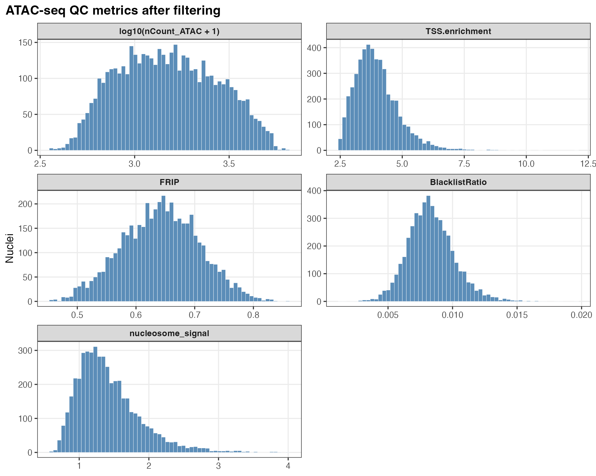  
Distributions of the available cell-level QC metrics. [PDF](figures/00_atac_qc/atac_qc_metric_distributions.pdf)

### ATAC counts and TSS enrichment

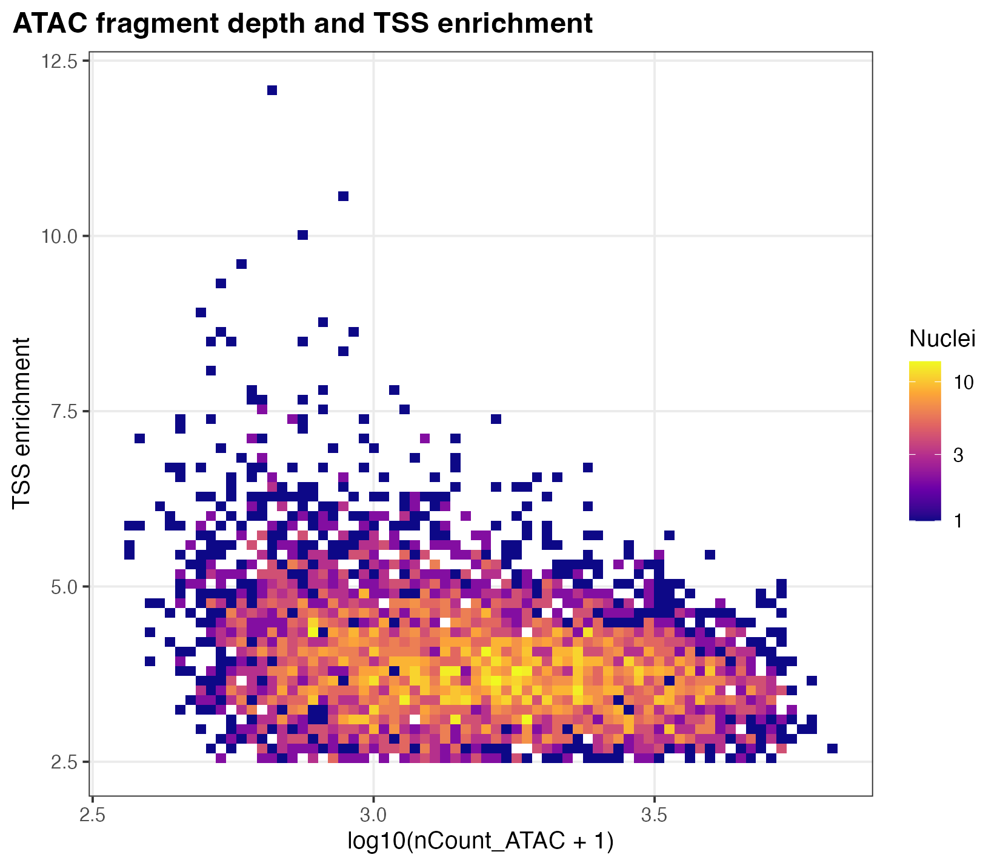  
Relationship between ATAC counts and TSS enrichment. [PDF](figures/00_atac_qc/density_scatter_nCount_TSS.pdf)

### Cell annotations

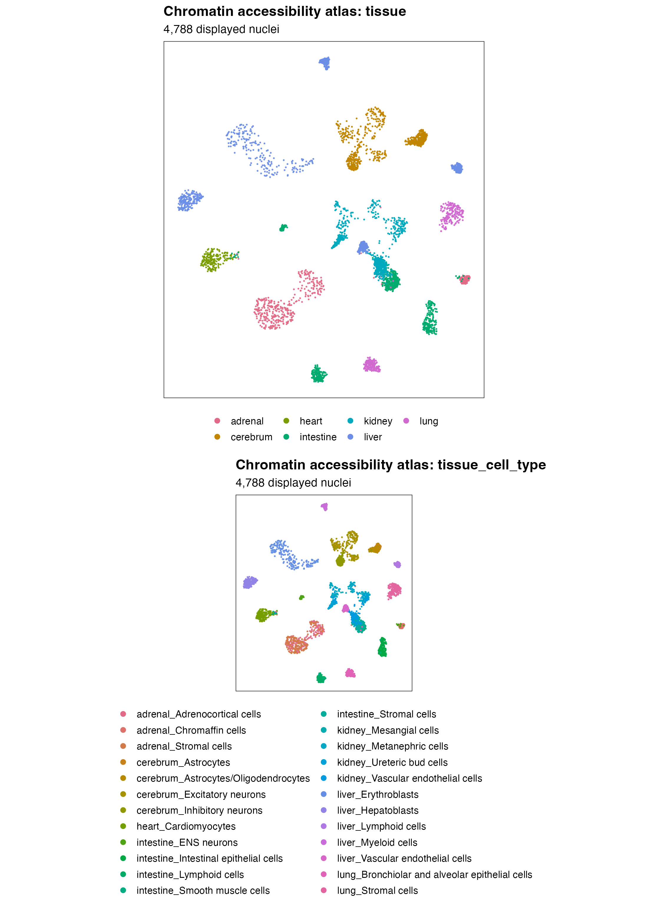  
UMAP of all supplied cells, colored by tissue and tissue–cell-type group. [PDF](figures/UMAP_tissue_and_tissue_cell_type.cellQC.peakQC.pdf)

## Accessibility

### SNP accessibility on UMAP

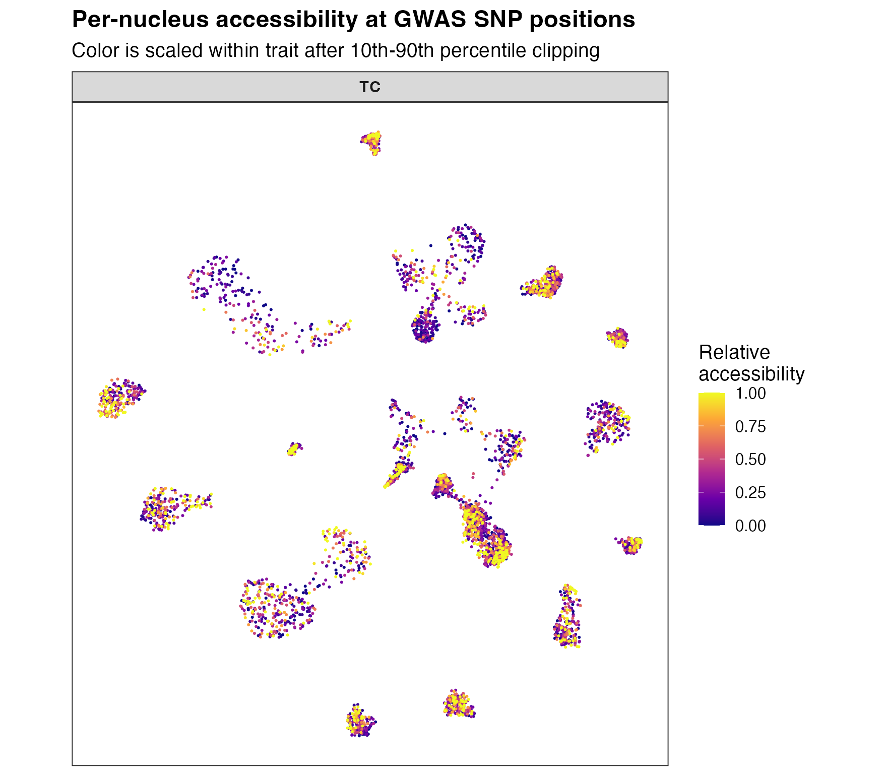  
TC SNP accessibility counts on the cell embedding; colors use the package display scaling. [PDF](figures/all_traits_GWAS_SNP_count_FeaturePlot.pdf)

### Peak accessibility on UMAP

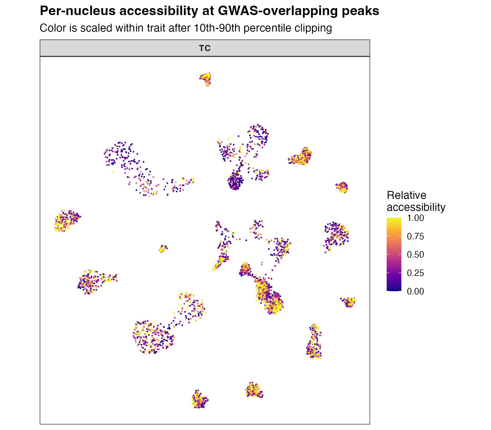  
TC peak accessibility counts on the cell embedding; colors use the package display scaling. [PDF](figures/all_traits_GWAS_peak_count_FeaturePlot.pdf)

## LD

### LD block sizes

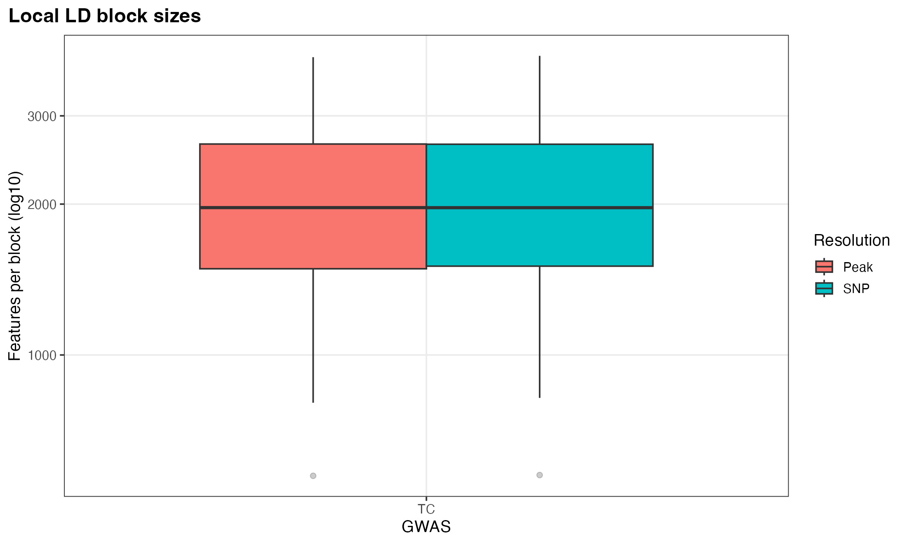  
Sizes of the TC SNP and peak LD components. [PDF](figures/03_ld/ld_block_size_distribution.pdf)

### SNP LD heatmap

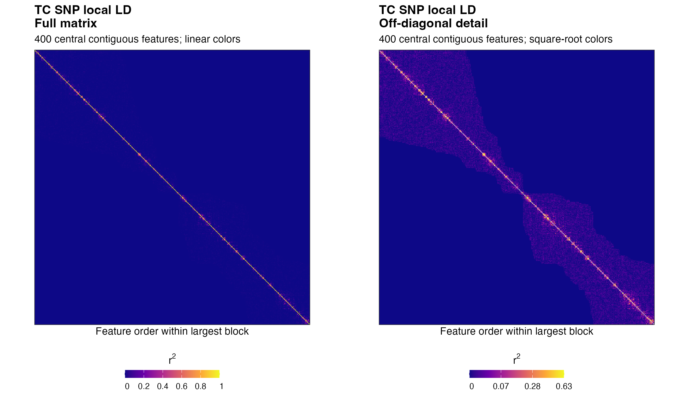  
The same 400 contiguous SNPs, centered in the largest component, are shown in both panels. Left: full r² with linear colors. Right: diagonal masked and square-root colors to reveal off-diagonal structure. The full matrix is used for analysis. [PDF](figures/03_ld/TC.snp_ld_heatmap.pdf)

### Peak covariance heatmap

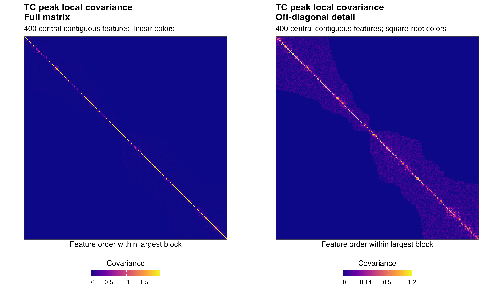  
The same 400 contiguous peaks, centered in the largest component, are shown in both panels. Left: full covariance with linear colors. Right: diagonal masked and square-root colors. The full matrix is used for analysis. [PDF](figures/03_ld/TC.peak_ld_heatmap.pdf)

## WRS

### WRS summary by cell group

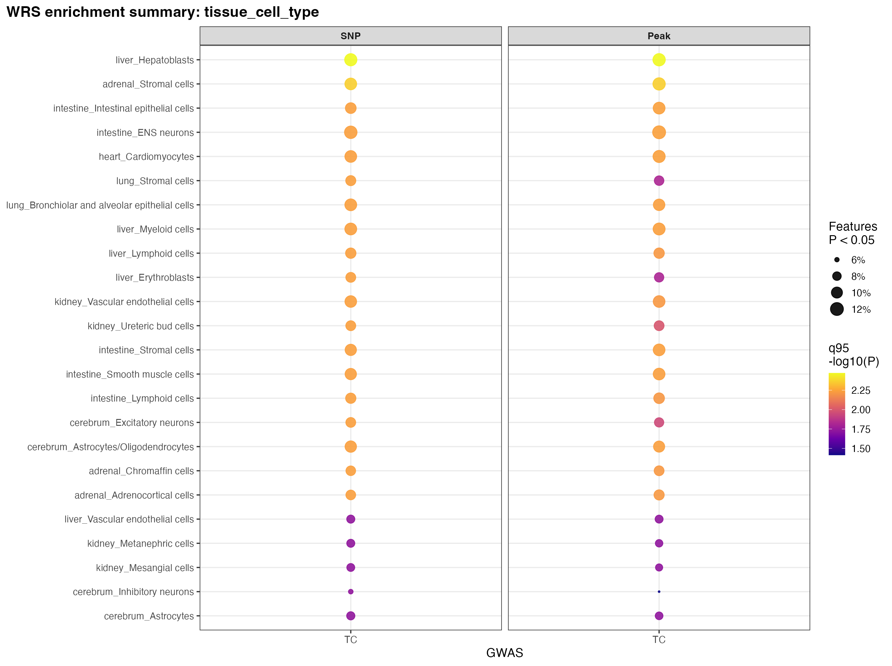  
Point size shows the fraction of features with WRS P < 0.05; color shows the 95th percentile of −log10(P). [PDF](figures/04_wrs/wrs_group_summary.tissue_cell_type.pdf)

### Top SNP features

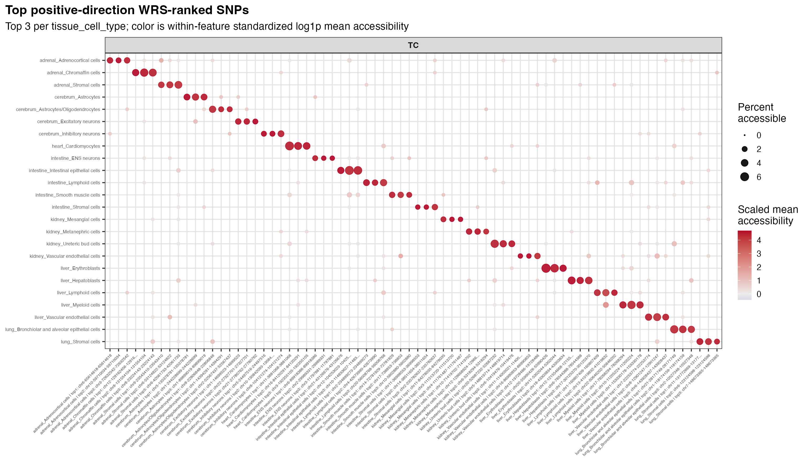  
Accessibility of WRS-ranked SNP features for TC, selecting up to three features per cell group. [PDF](figures/all_traits.top3_per_group_topSNP_wilcoxon_DotPlot.pdf)

### Top peak features

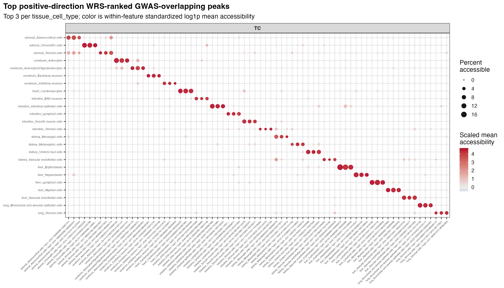  
Accessibility of WRS-ranked peak features for TC, selecting up to three features per cell group. [PDF](figures/all_traits.top3_per_group_topPeak_wilcoxon_DotPlot.pdf)

## Association results

### ACAT associations by cell group

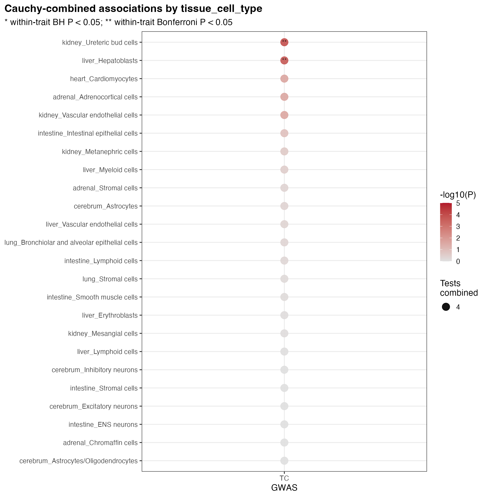  
Color shows nominal −log10(P); point size shows the number of combined tests. * BH-adjusted P < 0.05; ** Bonferroni-adjusted P < 0.05. [PDF](figures/05_models/cauchy_tissue_cell_type_dotplot.pdf)

### Nominal component and ACAT tests by cell group

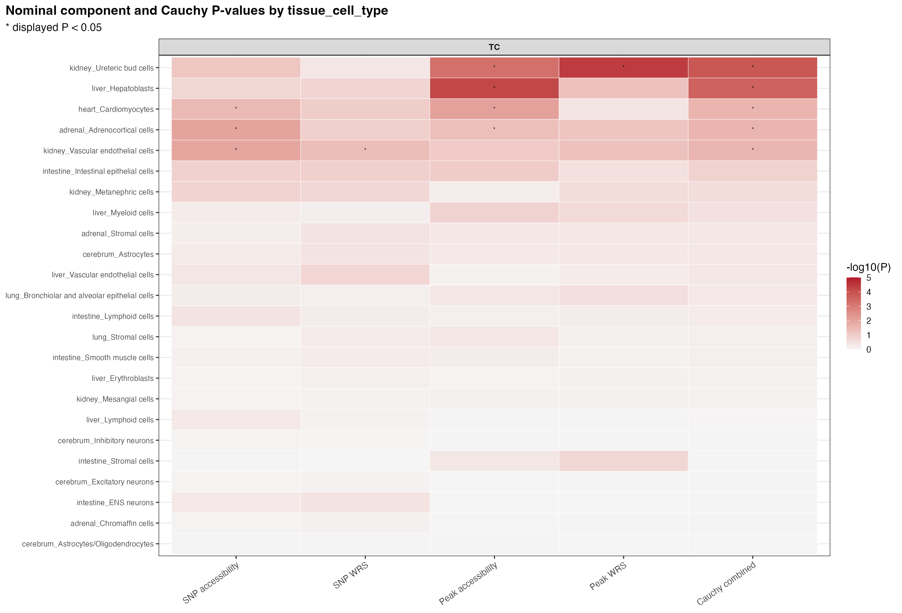  
Nominal P-values for the four components and ACAT; stars indicate displayed P < 0.05. [PDF](figures/05_models/cauchy_tissue_cell_type_component_heatmap_nominal.pdf)

### BH-adjusted component and ACAT tests by cell group

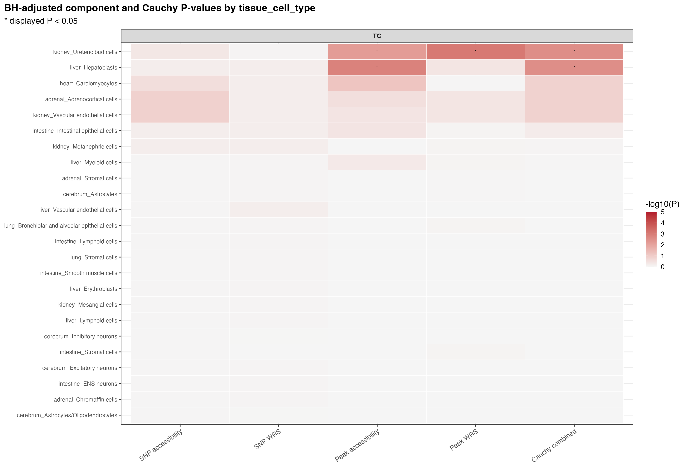  
BH-adjusted P-values for the four components and ACAT; stars indicate displayed P < 0.05. [PDF](figures/05_models/cauchy_tissue_cell_type_component_heatmap_bh.pdf)

Because this tutorial uses a sampled subset of real scATAC-seq data, with up to 200 cells per tissue–cell-type group, the nominal and BH-adjusted results may differ slightly from the manuscript results obtained using the complete dataset. The main enrichment signals remain consistent.

# References

<div id="refs"></div>
