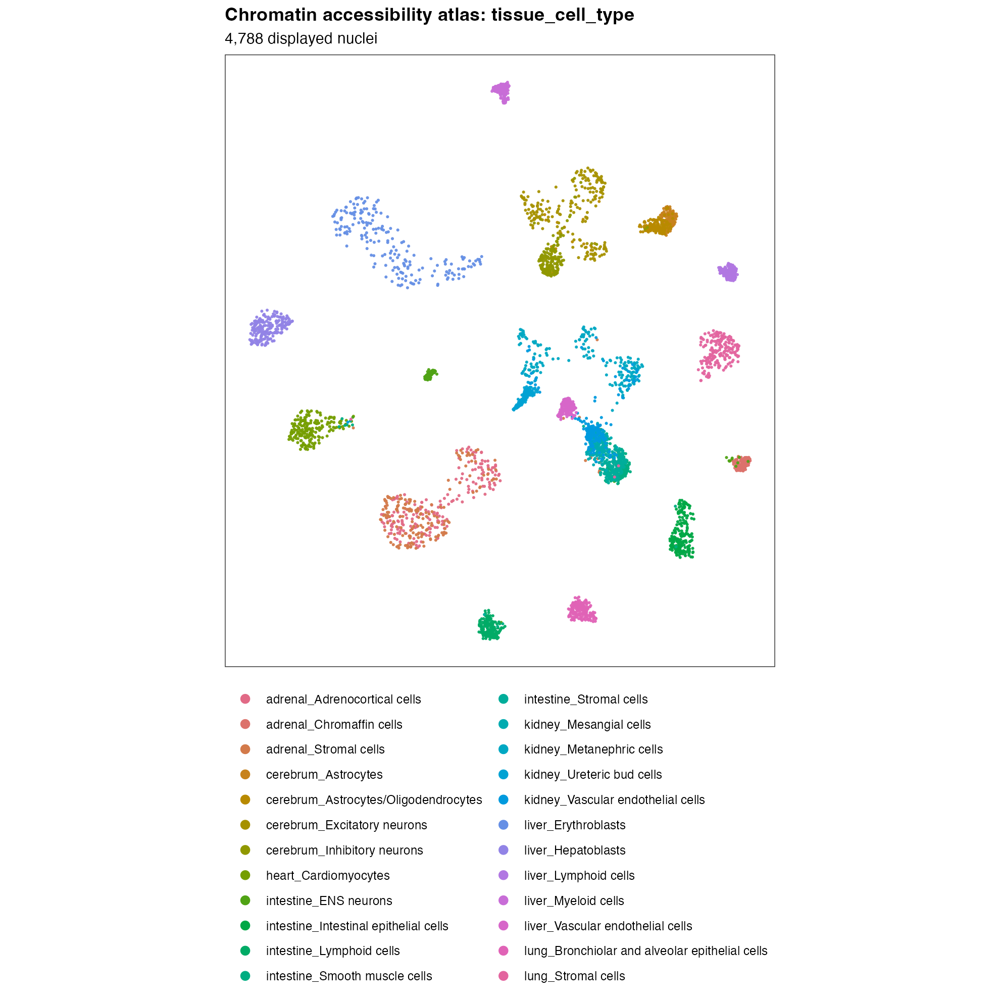

EPIC2: TC all-SNPs vignette
================
Lingxuan Zhu, Yuchao Jiang

<script>
$(function () { $("#header .author, #header .date").addClass("toc-ignore"); });
</script>

<style>
#refs .csl-entry { margin-bottom: 0.75em; }
</style>

EPIC2 integrates scATAC-seq accessibility with GWAS summary statistics to test trait associations in cell groups. This vignette analyzes total cholesterol (**TC**) using all eligible SNPs in the example inputs. To reproduce this example, use the supplied `config.yml` and follow the data preparation steps below.

# Install EPIC2

``` r
if (!requireNamespace("devtools", quietly = TRUE)) install.packages("devtools")
devtools::install_github(
  "LingxuanZ/EPIC2",
  ref = "8d901581e7a8a57379bfa785b0e872fa24120f49",
  upgrade = "never", build_vignettes = FALSE
)
```

The analysis also requires Seurat, Signac ([Stuart et al. 2021](#ref-stuart2021signac)), BiocParallel, Rsamtools and presto ([Korsunsky et al. 2022](#ref-korsunsky2022presto)). The repository provides an [analysis dependency installer](https://github.com/LingxuanZ/EPIC2/blob/main/scripts/install_dependencies.R).

# Example data and required inputs

[Download the all-SNPs inputs (115.4 MB)](https://www.dropbox.com/scl/fi/waibphblujax44w9h0rvt/EPIC2_inputs_TC_SCZ_all_snps_raw.tar.gz?rlkey=hsg9z8hd94v1s2y4m5a8h8ck1&st=xy9u9vlc&dl=1).

This tutorial uses **a sampled subset of real scATAC-seq data from human fetal tissues** ([Domcke et al. 2020](#ref-domcke2020human)), together with real TC GWAS summary statistics ([<span class="nocase">Willer et al.</span> 2013](#ref-willer2013lipids)) and reference genotypes ([1000 Genomes Project Consortium 2015](#ref-auton2015global)). The tutorial combines TC GWAS summary statistics for **63,867 input SNPs** with LD-reference genotypes for these SNPs from **503 individuals**. The scATAC-seq dataset contains **4,788 sampled cells** in **24 tissue–cell-type groups** across **seven human fetal tissues**, with **915,345 post-QC peaks**. All genomic coordinates use **hg19/GRCh37**. For the scATAC-seq inputs, both cells and peaks had undergone QC. Cells were sampled at **up to 200 per group**. All SNPs meeting the GWAS input-selection criteria were retained without SNP subsampling. The GWAS inputs have already undergone LD pruning and ambiguous-variant removal, and include variants with valid statistics, a reference-genotype match and overlap with accessible autosomal peaks.

The full data used in the manuscript are available on [Dropbox](https://www.dropbox.com/scl/fo/sryw79ywmy7gcty6pbm45/AOkzY5IFfC20oXzgY2vxoqM?rlkey=drrktk7uumyazina4woawdgl7&st=ino5s6so&dl=0).

EPIC2 requires GWAS summary statistics, an annotated scATAC-seq object, indexed fragments for SNP accessibility, and LD reference genotypes:

<div class="epic2-input-categories">

<table>

<colgroup>

<col class="input-group-col" />

<col class="input-type-col" />

<col class="input-file-col" />
<col class="input-formats-col" />

<col class="input-contents-col" />

</colgroup>

<thead>

<tr>

<th colspan="2" scope="colgroup">

Input category
</th>

<th scope="col">

Example file
</th>
<th scope="col">Supported file formats</th>

<th scope="col">

Contents
</th>

</tr>

</thead>

<tbody>

<tr>

<th rowspan="4" scope="rowgroup">

Data input
</th>

<th scope="row">

ATAC object
</th>

<td>

<code>inputs/<wbr>data/<wbr>atac.rds</code>
</td>
<td class="input-formats"><code>.rds</code>, <code>.rda</code>, <code>.RData</code></td>

<td>

A Seurat/Signac object with a chromatin assay (<code>ATAC</code> here), full post-QC peak counts in the <code>counts</code> layer, genomic peak coordinates and per-cell grouping annotations; requirements are detailed below.
</td>

</tr>

<tr>

<th scope="row">

Fragments
</th>

<td>

<code>inputs/<wbr>data/<wbr>fragments.tsv.gz</code> and its <code>.tbi</code> index
</td>
<td class="input-formats">BGZF-compressed fragments (usually <code>.tsv.gz</code>) with a <code>.tbi</code> or <code>.csi</code> index.</td>

<td>

Indexed ATAC fragments used to count accessibility at SNPs, attached to the assay or supplied through configuration. Files must be accessible, and fragment barcodes must map to cells in the object.
</td>

</tr>

<tr>

<th scope="row">

GWAS
</th>

<td>

<code>inputs/<wbr>data/<wbr>gwas/<wbr>TC.rds</code>
</td>
<td class="input-formats"><code>.rds</code>, <code>.rda</code>, <code>.RData</code><br><code>.csv</code>, <code>.csv.gz</code><br><code>.tsv</code>, <code>.tsv.gz</code><br><code>.txt</code>, <code>.txt.gz</code></td>

<td>

TC GWAS statistics: <code>rsid</code>, <code>chr</code>, <code>pos</code>, <code>A1</code>, <code>A2</code>, <code>MAF</code>, <code>P</code>, <code>beta</code> and <code>se</code>. Column names are configurable.
</td>

</tr>

<tr>

<th scope="row">

Reference genotypes
</th>

<td>

<code>inputs/<wbr>data/<wbr>genotypes/<wbr>TC.rds</code>
</td>
<td class="input-formats"><code>.rds</code>, <code>.rda</code>, <code>.RData</code><br><code>.csv</code>, <code>.csv.gz</code><br><code>.tsv</code>, <code>.tsv.gz</code><br><code>.txt</code>, <code>.txt.gz</code></td>

<td>

A 63,867-variant by 503-individual dosage matrix, with unique variant IDs in row names matching the GWAS. Dosage must count the GWAS effect allele (<code>A1</code>).
</td>

</tr>

</tbody>

<tbody>

<tr>

<th colspan="2" scope="row">

Configuration
</th>

<td>

<a href="config.yml"><code>config.yml</code></a>
</td>
<td class="input-formats">YAML text (usually <code>.yml</code> or <code>.yaml</code>).</td>

<td>

A YAML file required for the stage-based workflow, defining input paths and analysis settings. See <a href="#configuration-and-cell-type-annotations">Configuration and cell-type annotations</a> for this tutorial’s complete settings.
</td>

</tr>

</tbody>

</table>

</div>

<details class="epic2-stage-notes">
<summary>File-format notes</summary>

<ul>
<li>Use comma-delimited CSV or tab-delimited TSV/TXT files with column headers. For <code>.csv.gz</code>, <code>.tsv.gz</code> and <code>.txt.gz</code>, reading through <code>data.table::fread()</code> requires <code>R.utils</code>; install it or decompress the files first.</li>
<li>For multi-object <code>.rda</code>/<code>.RData</code> files, specify <code>atac.object_name</code>, <code>gwas.traits.&lt;trait&gt;.summary_object</code> or <code>gwas.traits.&lt;trait&gt;.genotype_object</code>, as appropriate.</li>
<li>For genotype tables with variant IDs in a column, set <code>gwas.genotype_variant_id_column</code> to that column name. Use unique variant IDs so EPIC2 can match them to the GWAS.</li>
<li>PLINK, VCF, BGEN and GDS files are not read directly; export their genotypes to a supported matrix or table first.</li>
</ul>

</details>

**Required ATAC contents**

Keep the full post-QC peak-by-cell counts in the chromatin assay’s `counts` layer, with genomic peak IDs such as `chr1-100-200` and cell names matching the metadata. EPIC2 derives library-size scaling from the full autosomal peak counts. The assay is named `ATAC` in this tutorial; another name can be selected with `atac.assay`, with matching changes to explicit assay names in the example code.

**Minimum metadata for analysis**

Cell annotations belong in `atac[[]]`, with one row per cell and row names matching `colnames(atac)`. **Every column listed in `model.groupings` must exist**. This tutorial selects only `tissue_cell_type`; its labels define the groups compared by WRS and tested by the association models. Each grouping needs at least two labelled groups; cells with missing labels are excluded from that grouping’s analysis.

A single cell-type annotation column is sufficient for cell-type association testing. In this example, the column is named `tissue_cell_type`, and its labels include tissue of origin. A separate tissue annotation column is not required. Analyses are performed using the cell-type groups defined by this column. See [Choose annotation levels for your own data](#choose-annotation-levels-for-your-own-data) for additional annotation levels.

<details class="epic2-stage-notes">
<summary>Additional metadata depends on the workflow</summary>

<div class="epic2-stage-map">

| Metadata column | Purpose | Needed for (stage) |
|:---|:---|:---|
| `tissue_cell_type` | Defines tissue–cell-type group membership. | ATAC (2.1, optional); WRS (2.5); Models (2.6); Plots (2.7). |
| Raw-barcode column, if used | Maps Seurat cell names to the barcodes in fragment files. | ATAC (2.1), when attaching fragments whose raw barcodes differ from Seurat cell names. |
| `nCount_ATAC` | Total peak counts per cell. | ATAC (2.1, optional); QC plots (2.7). |
| `TSS.enrichment` | Enrichment of accessibility around transcription start sites. | ATAC (2.1, optional); QC plots (2.7). |
| `FRIP` | Fraction of fragments within peaks. | ATAC (2.1, optional); QC plots (2.7). |
| `BlacklistRatio` | Fraction of fragments overlapping blacklist regions. | ATAC (2.1, optional); QC plots (2.7). |
| `nucleosome_signal` | Ratio of mononucleosomal to nucleosome-free fragments. | ATAC (2.1, optional); QC plots (2.7). |

</div>

In this tutorial, both `atac.group_column` and `model.groupings` select `tissue_cell_type`. Your own annotation column can have a different name.

`atac.fragment_barcode_column` selects the raw-barcode column when needed; no separate column is required if the attached fragment objects already contain the correct cell-to-barcode mapping. The count column follows the assay name: `nCount_<assay>` (`nCount_ATAC` here).

**For an already QC-filtered object, these QC metrics are not required by the downstream accessibility, WRS or association calculations when the ATAC QC stage is skipped.** Retain them to reproduce the tutorial’s QC figures. If you run ATAC QC, supply the metrics or compute them from the appropriate inputs as described in [2.1 ATAC processing and QC](#atac-qc). `compute_qc_metrics: false` reuses existing metrics; it does not skip filtering.

</details>

UMAP coordinates are only needed for plotting. Retain the Seurat object's `umap` reduction to reproduce this figure.

GWAS, ATAC peaks and fragments **must use the same genome assembly** (**hg19/GRCh37** here); setting `genome.build` does not convert coordinates. Reference variant IDs must match GWAS `rsid` values, and genotype dosage must count the GWAS effect allele (`A1`).

Place the downloaded archive and the supplied [config.yml](config.yml) in your working directory, then extract the data. This configuration selects TC only.

``` r
dir.create("inputs", showWarnings = FALSE)
archive <- "inputs/EPIC2_inputs_TC_SCZ_all_snps_raw.tar.gz"
if (!file.exists(archive)) {
  download.file(
    "https://www.dropbox.com/scl/fi/waibphblujax44w9h0rvt/EPIC2_inputs_TC_SCZ_all_snps_raw.tar.gz?rlkey=hsg9z8hd94v1s2y4m5a8h8ck1&st=xy9u9vlc&dl=1",
    archive, mode = "wb"
  )
}
stopifnot(identical(
  digest::digest(file = archive, algo = "sha256"),
  "b6172b11214ad4c43a6dd1d39132a4ca863ed5ebb894234baf70b0039add6275"
))
input_files <- grep("^data/", untar(archive, list = TRUE), value = TRUE)
untar(archive, files = input_files, exdir = "inputs")
```

# Configuration and cell-type annotations

[Download the complete config.yml for this tutorial](config.yml). The full configuration is shown below. Keep `config.yml` and the `inputs/` folder in the same working directory. Analysis outputs will be saved in `output/` under that directory.

The scATAC-seq and GWAS inputs have undergone upstream QC, so this tutorial skips ATAC QC and does not repeat GWAS LD pruning or ambiguous-variant removal; GWAS/reference checks still run. See the [full workflow configuration](https://github.com/LingxuanZ/EPIC2/blob/main/inst/extdata/config.example.yml) for the complete settings. For details on each configuration parameter, see [CONFIGURATION.md](https://github.com/LingxuanZ/EPIC2/blob/main/CONFIGURATION.md).

``` yaml
project:
  name: EPIC2 TC all-SNPs vignette
  output_dir: output
parameters:
  seed: 1000
  workers: 1
genome:
  build: hg19
  duplicate_action: drop
atac:
  input: inputs/data/atac.rds
  assay: ATAC
  tissue_column: null
  group_column: tissue_cell_type
  attach_fragments: no
  compute_qc_metrics: no
  recompute_embedding: no
gwas:
  columns:
    rsid: rsid
    chr: chr
    pos: pos
    a1: A1
    a2: A2
    maf: MAF
    p: P
    beta: beta
    se: se
  genotype_format: dosage
  genotype_orientation: variants_by_samples
  genotype_ploidy: 2
  maf_min: 0.05
  reference_missing_rate_max: 0.01
  ld_prune: no
  remove_ambiguous: no
  traits:
    TC:
      summary: inputs/data/gwas/TC.rds
      genotype: inputs/data/genotypes/TC.rds
accessibility:
  chunks: 20
ld:
  window_bp: 5000000
  ridge: 0.01
  eigen_tolerance: 1.0e-08
  correlation_block_size: 256
  max_snps_for_chr_ld: 15000
  max_dense_block_size: 6000
wrs:
  truncation_quantiles:
  - 0.02
  - 0.98
  balanced:
    enabled: no
model:
  groupings:
  - tissue_cell_type
  require_all_components: no
plots:
  formats:
  - png
  - pdf
  dpi: 220
  fail_on_error: yes
  max_umap_cells: 4788
  ld_heatmap_max_features: 400
  base_size: 13
  pvalue_cap: 5.0
```

`TC` is the trait name used in the analysis and plotting calls below. LD pruning and ambiguous-variant removal are disabled here because the supplied GWAS inputs have already undergone these steps.

## Multiple traits (optional)

**This tutorial runs TC only; all results shown below are for TC.** The input archive also includes schizophrenia (SCZ) GWAS summary statistics from the 2014 Psychiatric Genomics Consortium study ([Schizophrenia Working Group of the Psychiatric Genomics Consortium 2014](#ref-ripke2014biological)). To analyze both traits, replace the `traits` block under `gwas` in `config.yml` with the following entries, keeping the other GWAS settings:

``` yaml
gwas:
  traits:
    TC:
      summary: inputs/data/gwas/TC.rds
      genotype: inputs/data/genotypes/TC.rds
    SCZ:
      summary: inputs/data/gwas/SCZ.rds
      genotype: inputs/data/genotypes/SCZ.rds
```

After preparing the ATAC checkpoint as described below, reload the edited configuration and use these calls in place of the TC-only analysis and plotting calls. This optional example is not executed when knitting this tutorial.

``` r
config <- EPIC2::read_EPIC2_config("config.yml", check_files = TRUE)
EPIC2::run_EPIC2(
  config,
  stages = c("gwas", "accessibility", "ld", "wrs", "model"),
  gwas_name = c("TC", "SCZ")
)
EPIC2::run_plot_stage(config, traits = c("TC", "SCZ"))
```

EPIC2 processes traits **sequentially within each stage**: for example, the GWAS stage processes TC and then SCZ before the accessibility stage begins. `parameters.workers` controls parallel SNP-accessibility chunks within a trait; it does not enable parallel execution across traits. To run traits in parallel, users must arrange parallel execution themselves, for example by launching one R process or cluster job per trait, each with its own output directory.

## Inspect the cell annotations

Cell annotations must be stored in the Seurat object’s metadata, accessed with `atac[[]]`. Each row corresponds to one cell, with row names matching the object’s cell names. This tutorial uses the `tissue_cell_type` annotation:

``` r
library(Seurat)
atac <- readRDS("inputs/data/atac.rds")
head(atac[[]][, "tissue_cell_type", drop = FALSE])
```

    ##                    tissue_cell_type
    ## C00001 adrenal_Adrenocortical cells
    ## C00002 adrenal_Adrenocortical cells
    ## C00003 adrenal_Adrenocortical cells
    ## C00004 adrenal_Adrenocortical cells
    ## C00005 adrenal_Adrenocortical cells
    ## C00006 adrenal_Adrenocortical cells

`tissue_cell_type` combines tissue and cell-type labels, for example `liver_Hepatoblasts` and `kidney_Ureteric bud cells`. Its 24 groups therefore represent **cell types within tissues**, rather than cell types pooled across tissues. Renaming this column does not change its labels or group membership. To test a different grouping, supply the corresponding per-cell annotations.

<div class="epic2-input-table epic2-annotation-settings">

| Setting | Purpose |
|:---|:---|
| `atac.group_column` | Metadata column used for minimum group-size filtering during ATAC QC. This tutorial uses a post-QC object and skips that stage. |
| `model.groupings` | Metadata columns used for WRS scoring and association tests; each column is analyzed separately. |

</div>

The supplied configuration uses `model.groupings: [tissue_cell_type]` and `atac.tissue_column: null`. Only the 24 cell-type groups are tested and shown; no separate tissue-level analysis is run.

## Choose annotation levels for your own data

Add another metadata column to test a broader annotation level. For example, the following **optional illustration** merges two liver immune-cell groups while retaining the other labels. Choose biologically appropriate groupings for your own data; this example is not executed when knitting the TC tutorial.

``` r
atac <- readRDS("inputs/data/atac.rds")
atac$broader_cell_type <- as.character(atac$tissue_cell_type)
immune <- atac$tissue_cell_type %in% c("liver_Lymphoid cells", "liver_Myeloid cells")
atac$broader_cell_type[immune] <- "liver_Immune cells" # Merge selected cell types into a broader group
head(atac[[]][, c("tissue_cell_type", "broader_cell_type")])
saveRDS(atac, "inputs/data/atac_with_levels.rds")
```

For a single annotation level, keep `model.groupings: [tissue_cell_type]`. To analyze both levels in one run, update these fields in a copy of the complete configuration, keeping its remaining settings:

``` yaml
project:
  output_dir: output_annotation_levels
atac:
  input: inputs/data/atac_with_levels.rds
  tissue_column: null
  group_column: tissue_cell_type
model:
  groupings: [tissue_cell_type, broader_cell_type]
```

Save the complete file as `config_annotation_levels.yml`, load it, and prepare its ATAC checkpoint using **Prepare the shared inputs** below. Then one call runs both annotation levels:

``` r
config <- EPIC2::read_EPIC2_config("config_annotation_levels.yml", check_files = TRUE)
# Prepare the shared inputs below with this config before running the stages.
EPIC2::run_EPIC2(config, stages = c("gwas", "accessibility", "ld", "wrs", "model", "plot"), gwas_name = "TC")
```

EPIC2 processes the annotation levels **sequentially within each WRS and model stage**. Each level is analyzed separately: WRS files include the annotation name, and Models saves separate `<annotation>.component_results.*` and `<annotation>.cauchy_results.*` files. Results are **not combined across annotation levels**.

To run levels in parallel, launch a separate R session for each level, using complete configurations with **different output directories**. For example, keep `tissue_cell_type` in one configuration and use the following fields in `config_broader.yml` for the other session:

``` yaml
project:
  output_dir: output_broader_cell_type
atac:
  input: inputs/data/atac_with_levels.rds
  tissue_column: null
  group_column: broader_cell_type
model:
  groupings: [broader_cell_type]
```

In that session, read `config_broader.yml`, prepare its checkpoint, and run the same full-stage command. Input files may be shared read-only; do not have the sessions write to the same output directory. EPIC2 does not parallelize annotation levels automatically. `atac.group_column` separately controls ATAC QC grouping and the primary grouping in accessibility plots.

See the [configuration reference](https://github.com/LingxuanZ/EPIC2/blob/main/CONFIGURATION.md) for the remaining options.

# Expected outputs

Stage outputs are saved beneath `project.output_dir` (`output/` in this tutorial).
Directory contents depend on the stages run and options enabled. See
[Run one stage at a time](#stage-inputs-and-outputs) for each stage's required inputs and detailed outputs.

```text
output/
├── 01_atac/             # ATAC checkpoint; QC summaries if QC is run
├── 02_gwas/             # Matched GWAS, genotypes and QC records
├── 02_accessibility/    # SNP/peak matrices and overlap tables
├── 03_ld/               # LD covariance models and inverse square roots
├── 04_wrs/              # WRS scores; stability summaries if enabled
├── 05_models/           # Component and ACAT results
├── figures/             # Figures, supporting tables and figure_manifest.tsv
├── run_manifest.txt
├── config.used.yml
├── config.used.rds
└── run_history/         # Per-invocation settings and session manifests
```

**Run records:** The final four entries are written by `run_EPIC2()`.
The individual `run_*_stage()` calls used during this knit do not create these global run records.

In the filenames below, `<grouping>` is `tissue_cell_type` for this tutorial.

<div class="epic2-input-table">

| Main file | Contents |
|:--|:--|
| [`05_models/<grouping>.component_results.tsv`](#outputs-in-output05_models) | Focal coefficient estimates, standard errors, P-values and model statuses. |
| [`05_models/<grouping>.cauchy_results.tsv`](#outputs-in-output05_models) | Component P-values, `p_cauchy`, number of tests combined and adjusted P-values. |
| [`figures/figure_manifest.tsv`](#outputs-in-outputfigures) | Figure paths and `generated`, `skipped` or `error` status. |
| [`config.used.yml` / `config.used.rds`](#shared-requirements-for-partial-runs) | Effective configuration, including in-memory overrides; written by `run_EPIC2()`. |
| [`run_manifest.txt`](#shared-requirements-for-partial-runs) | Software environment, selected stages and traits, assembly, seed and worker settings; written by `run_EPIC2()`. |

</div>

The tutorial's separate `results/` and `figures/` folders contain copies of result tables and figures.

# Run the analysis

Run the preparation step first, then choose either the single-command route or the stage-by-stage route. Both use the same EPIC2 stage functions and settings.

Use separate output directories for independent or concurrent analyses. See [Methods](https://github.com/LingxuanZ/EPIC2/blob/main/METHODS.md#saved-results-and-reproducibility) for saved-result checks and recovery, and the [configuration reference](https://github.com/LingxuanZ/EPIC2/blob/main/CONFIGURATION.md) for parallelism and LD memory settings.

With `recompute: true` (the default), knitting executes the preparation and stage-by-stage calls, then reads their saved outputs to produce the tables and figures. Core-function and optional examples are displayed with `eval=FALSE` and are not executed. The single-command example is an alternative, so it is not also run during knitting. Set `recompute: false` only to render from a complete set of existing outputs.

## Prepare the shared inputs

``` r
library(EPIC2)
library(Signac)
config <- EPIC2::read_EPIC2_config("config.yml", check_files = TRUE)
set.seed(config$parameters$seed)
```

The ATAC object has already passed QC. For a fresh run, attach the supplied fragment file and save the checkpoint used by every downstream stage. Fragment barcode validation is disabled because this example file contains fragments only near the selected loci. [Preparation script](scripts/00_prepare_atac.R).

``` r
atac <- readRDS(config$atac$input)
fragment <- Signac::CreateFragmentObject(
  path = normalizePath("inputs/data/fragments.tsv.gz"),
  cells = setNames(colnames(atac), colnames(atac)),
  validate.fragments = FALSE, verbose = FALSE
)
Signac::Fragments(atac[["ATAC"]]) <- NULL
Signac::Fragments(atac[["ATAC"]]) <- fragment
checkpoint_dir <- file.path(config$output_dir, "01_atac")
dir.create(checkpoint_dir, recursive = TRUE, showWarnings = FALSE)
saveRDS(atac, file.path(checkpoint_dir, "atac.qc.rds"))
```

Output: `output/01_atac/atac.qc.rds`, containing the 4,788 supplied cells, 915,345 post-QC peaks, annotations and the attached fragment file.

## 1. Run all stages with one command

**For scATAC-seq inputs requiring cell and peak filtering:** download the [complete-settings YAML template](https://github.com/LingxuanZ/EPIC2/blob/main/inst/extdata/config.example.yml), save it as `config.yml`, and edit it for your input files and analysis settings. This full workflow includes ATAC preprocessing and is **not run in this tutorial**.

``` r
config <- EPIC2::read_EPIC2_config("config.yml", check_files = TRUE)
EPIC2::run_EPIC2(config, gwas_name = "TC")
```

**For a post-QC checkpoint prepared as described above, use this instead:** this is the workflow used in this tutorial, with the supplied [config.yml](config.yml). After preparation, this call runs GWAS processing, accessibility, LD, WRS, association models and plotting for TC only. [Run-all script](scripts/run_all.R).

``` r
config <- EPIC2::read_EPIC2_config("config.yml", check_files = TRUE)
EPIC2::run_EPIC2(
  config,
  stages = c("gwas", "accessibility", "ld", "wrs", "model", "plot"),
  gwas_name = "TC"
)
```

The stage outputs and their contents are shown below. Choose the stage-by-stage route when you want to inspect an intermediate result before continuing; running both routes would repeat the same calculations.

Replace `TC` with a dataset name in your configuration. Omit `gwas_name` to process all configured datasets.

The full workflow runs `atac → gwas → accessibility → ld → wrs → model → plot`.

<a id="stage-inputs-and-outputs"></a>

## 2. Run one stage at a time

Run an individual stage once its upstream results exist; **EPIC2 does not run missing prerequisite stages**. For stage calls, use the complete `config.yml` and the matching output directory, with your R working directory set to the folder containing `config.yml`.

Intermediate paths below are relative to `project.output_dir` (`output/` here). **LD and WRS can run independently after Accessibility; Models needs both.** See [Shared requirements for partial runs](#shared-requirements-for-partial-runs) for completion checks, configuration settings and a single-stage example.

For routine analyses, use the **stage functions with YAML**, which automatically save the files described under **Outputs**. Displayed tutorial results were read from these saved files.

Use the **core functions without YAML** examples to debug or inspect intermediate calculations within a stage. They return R objects. Run them from this tutorial folder using the listed input files. **To keep their results on disk, create the required output directories and save the objects yourself**, using `saveRDS()`, `write.table()` or `ggplot2::ggsave()` as appropriate. Alternatively, pass the returned objects directly to subsequent functions. These examples do not write stage completion records and are not executed while knitting.

<a id="atac-qc"></a>

### 2.1 ATAC processing and QC (optional)

**This step is not run in this tutorial because the supplied ATAC object has already passed QC.** If your own scATAC-seq object has not been filtered and you want to follow the EPIC2 QC pipeline, run this stage before accessibility construction. Use it in place of the post-QC checkpoint preparation above. **Review your dataset’s QC metrics and adjust the filtering criteria and thresholds as needed, taking into account the biological context, experimental protocol and data quality.**

#### Required inputs

- The Seurat/Signac object at `atac.input`, containing the configured chromatin assay, peak counts and cell annotations.
- To compute QC metrics: complete, deduplicated fragment files with `.tbi` indexes; TSS enrichment also requires gene annotations in the chromatin assay, using the same genome assembly.

The tutorial’s locus-restricted fragments are intended for SNP accessibility and should not be used to recompute genome-wide QC metrics.

#### Run

**Stage function (with YAML)**

The [EPIC2 QC pipeline](https://github.com/LingxuanZ/EPIC2/blob/main/METHODS.md#quality-control) uses the following default filters:

1.  Retain cells with **TSS enrichment ≥ 2.5** and **FRIP ≥ 0.3**.
2.  Calculate the **1st percentile of ATAC counts among cells passing those TSS/FRIP filters**. Retain cells at or above this count cutoff, with **blacklist ratio \< 0.02** and **nucleosome signal ≤ 4**.
3.  Retain annotation groups with **at least 50 cells after cell-level QC**, using the column selected by `atac.group_column`.
4.  After cell filtering, retain **autosomal peaks 100–1,000 bp wide**, with **at least one total count in at least one retained cell**, and **no overlap with the blacklist** for the declared genome assembly ([Amemiya et al. 2019](#ref-amemiya2019encode)).

To change these thresholds, edit `atac.qc` in the configuration YAML. For your own analysis, use a separate working directory and edit the `atac` section of a complete `config.yml`, for example:

``` yaml
atac:
  input: data/atac_before_qc.rds
  assay: ATAC
  tissue_column: null
  group_column: tissue_cell_type
  attach_fragments: false
  fragment_barcode_column: null
  validate_fragments: true
  compute_qc_metrics: true
  recompute_embedding: false
  qc:
    tss_min: 2.5
    frip_min: 0.3
    count_quantile_min: 0.01
    blacklist_max: 0.02
    nucleosome_max: 4
    min_cells_per_group: 50
    peak_width_min: 100
    peak_width_max: 1000
    peak_min_total_counts: 1
    peak_min_cells: 1
    peak_autosomes_only: true
    peak_remove_blacklist: true
```

Replace the paths and metadata column names with those in your data, and set `genome.build` in the complete configuration to the shared input assembly. This example expects complete fragment files already attached to the chromatin assay with the correct cell-to-barcode mappings; no separate tissue annotation is needed. The core example below shows attachment for one fragment file. If raw barcodes differ from cell names, use the raw barcode metadata in the mapping instead.

With `compute_qc_metrics: true`, EPIC2 computes nucleosome signal, TSS enrichment, FRIP and blacklist ratio before filtering. If those metrics are already present, use `false` and supply `TSS.enrichment`, `FRIP`, `nCount_ATAC`, `BlacklistRatio` and `nucleosome_signal` in the metadata (`nCount_<assay>` follows the assay name). **Setting this flag to `false` does not skip cell or peak filtering.** Set `recompute_embedding: true` if you also want to recompute TF-IDF/LSI, UMAP, neighbors and clusters after QC. See [ATAC configuration](https://github.com/LingxuanZ/EPIC2/blob/main/CONFIGURATION.md#atac-input-and-qc) for all options.

For your own data, reload the edited configuration and run only ATAC QC:

``` r
config <- EPIC2::read_EPIC2_config("config.yml", check_files = TRUE)
EPIC2::run_EPIC2(config, stages = "atac")
```

This dispatches `run_atac_stage()`, which computes the requested QC metrics, calls `filter_atac_cells()` and `filter_atac_peaks()`.

**Core functions (without YAML)**

For your own unfiltered object, replace the input paths below. Use complete indexed fragments and gene annotations in the same assembly. Omit the fragment-attachment lines if the correct fragments are already attached.

``` r
atac <- readRDS("data/atac_before_qc.rds") # Unfiltered Seurat/Signac object with cell annotations
assay <- "ATAC"; genome <- "hg19"; qc_group <- "tissue_cell_type" # Assay, assembly and QC grouping
SeuratObject::DefaultAssay(atac) <- assay
cell_map <- setNames(colnames(atac), colnames(atac)) # Raw fragment barcodes as values, Seurat cell names as names
fragment <- Signac::CreateFragmentObject("data/fragments.tsv.gz", cells = cell_map, validate.fragments = TRUE)
Signac::Fragments(atac[[assay]]) <- NULL
Signac::Fragments(atac[[assay]]) <- fragment # Attach indexed fragments without a tissue metadata column
atac <- Signac::NucleosomeSignal(atac) # Fragment-length QC
atac <- Signac::TSSEnrichment(atac) # TSS enrichment from the object's gene annotations
atac <- EPIC2::add_frip(atac, assay = assay) # Fraction of fragments in peaks
atac <- EPIC2::add_blacklist_ratio(atac, assay = assay, genome = genome) # Fraction in the assembly's blacklist
cell_qc <- list(tss_min = 2.5, frip_min = 0.3, count_quantile_min = 0.01,
                blacklist_max = 0.02, nucleosome_max = 4, min_cells_per_group = 50)
peak_qc <- list(peak_width_min = 100, peak_width_max = 1000, peak_min_total_counts = 1,
                peak_min_cells = 1, peak_autosomes_only = TRUE, peak_remove_blacklist = TRUE)
atac <- EPIC2::filter_atac_cells(atac, thresholds = cell_qc, group_column = qc_group, assay = assay) # Filter cells, then groups
atac_qc <- EPIC2::filter_atac_peaks(atac, thresholds = peak_qc, assay = assay, genome = genome) # Filter peaks after cells
```

#### Outputs in `output/01_atac/`

- `atac.qc.rds`: the filtered object used by downstream stages.
- `qc_dimensions.tsv`: cell and peak counts before and after QC.
- `qc_thresholds.tsv`: configured thresholds and the calculated count cutoff.
- `group_cell_counts.tsv`: retained cells per QC group.
- `genome_qc.tsv`: genome-assembly and coordinate-validation information.

Continue downstream using the same configuration and output directory. For a single-command run on your own unfiltered data, include `"atac"` before `"gwas"` in the `stages` vector. The TC tutorial’s supplied configuration, run commands and saved results continue to skip this stage.

### 2.2 GWAS processing

Match GWAS variants to reference genotypes, apply the configured MAF and missingness filters, and validate coordinates and effect statistics. LD pruning and ambiguous-variant removal are disabled for these preprocessed inputs. [GWAS script](scripts/01_gwas.R).

#### Required inputs

- GWAS summary statistics: `gwas.traits.TC.summary` (`inputs/data/gwas/TC.rds` in this tutorial).
- Reference genotypes: `gwas.traits.TC.genotype` (`inputs/data/genotypes/TC.rds` in this tutorial). Multiple traits can use the same compatible reference genotype file by pointing their `genotype` entries to that file; EPIC2 automatically matches SNP IDs to each trait’s GWAS and retains the matched subset, reducing unnecessary downstream computation.

The GWAS calculation does not require an ATAC checkpoint.

#### Run

**Stage function (with YAML)**

``` r
EPIC2::run_gwas_stage(config, gwas_name = "TC")
```

    ## $TC
    ## $TC$gwas
    ## [1] "/Users/zhulx/Desktop/Lab/Fetal Tissue/Vignette_final/output/02_gwas/TC.gwas.rds"
    ## 
    ## $TC$genotype
    ## [1] "/Users/zhulx/Desktop/Lab/Fetal Tissue/Vignette_final/output/02_gwas/TC.genotype.rds"

**Core functions (without YAML)**

``` r
gwas_input <- readRDS("inputs/data/gwas/TC.rds") # GWAS summary statistics
genotype_input <- readRDS("inputs/data/genotypes/TC.rds") # SNP-by-individual reference dosages, named by rsID
columns <- list(rsid = "rsid", chr = "chr", pos = "pos", a1 = "A1", a2 = "A2", maf = "MAF", p = "P", beta = "beta", se = "se")
processed <- EPIC2::harmonize_gwas(gwas_input, genotype_input, columns = columns, gwas_name = "TC", genome_build = "hg19",
  genotype_format = "dosage", genotype_orientation = "variants_by_samples", genotype_ploidy = 2, seed = 1000,
  maf_min = 0.05, reference_missing_rate_max = 0.01, ld_prune = FALSE, remove_ambiguous = FALSE, duplicate_action = "drop")
gwas <- processed$gwas # Matched, filtered GWAS with Z-scores and coord_id
genotype <- processed$genotype # Reference dosages aligned to the retained GWAS
processed$summary # QC counts and settings; upstream pruning/ambiguous-variant removal are not repeated
```

#### Outputs in `output/02_gwas/`

- `TC.gwas.rds`: 63,224 harmonized SNPs, including Z-scores and coordinate IDs.
- `TC.genotype.rds`: matched reference dosages for 503 individuals.
- `TC.gwas_qc.tsv`: counts and effective QC settings. Here, 643 input SNPs fail the reference-panel MAF threshold.

``` r
gwas_qc <- read.delim("output/02_gwas/TC.gwas_qc.tsv")
gwas_qc[, c("n_input", "n_reference_matched", "n_after_maf", "n_final")]
```

    ##   n_input n_reference_matched n_after_maf n_final
    ## 1   63867               63867       63224   63224

### 2.3 SNP and peak accessibility

Count fragments at SNPs and obtain peak accessibility from the stored peak counts. [Accessibility script](scripts/02_accessibility.R).

#### Required inputs

- `01_atac/atac.qc.rds`, containing peak counts and cell metadata.
- The fragment files attached to that object, with their `.tbi` indexes.
- `02_gwas/TC.gwas.rds` and `02_gwas/TC.genotype.rds`.

#### Run

**Stage function (with YAML)**

``` r
EPIC2::run_accessibility_stage(config, traits = "TC")
```

    ## $TC
    ## $TC$snp
    ## [1] "/Users/zhulx/Desktop/Lab/Fetal Tissue/Vignette_final/output/02_accessibility/TC.snp_by_cell.rds"
    ## 
    ## $TC$peak
    ## [1] "/Users/zhulx/Desktop/Lab/Fetal Tissue/Vignette_final/output/02_accessibility/TC.peak_by_cell.rds"
    ## 
    ## $TC$overlap
    ## [1] "/Users/zhulx/Desktop/Lab/Fetal Tissue/Vignette_final/output/02_accessibility/TC.snp_peak_overlap.tsv"
    ## 
    ## $TC$genotype
    ## [1] "/Users/zhulx/Desktop/Lab/Fetal Tissue/Vignette_final/output/02_accessibility/TC.snp_genotype.rds"
    ## 
    ## $TC$genome_qc
    ## [1] "/Users/zhulx/Desktop/Lab/Fetal Tissue/Vignette_final/output/02_accessibility/TC.genome_qc.tsv"

**Core functions (without YAML)**

``` r
atac <- readRDS("output/01_atac/atac.qc.rds") # Peak counts, metadata and attached fragments with .tbi indexes
gwas <- readRDS("output/02_gwas/TC.gwas.rds") # Processed GWAS, including chr, pos, rsid and coord_id
genotype <- readRDS("output/02_gwas/TC.genotype.rds") # Processed reference dosages named by rsID
snp_counts <- EPIC2::build_snp_accessibility(atac, gwas, assay = "ATAC", genome_build = "hg19",
  workers = 1, chunks = 20, duplicate_action = "drop") # Count fragments at SNP positions; remove zero-count SNPs
peak_result <- EPIC2::build_peak_accessibility(atac, gwas, assay = "ATAC", genome_build = "hg19", duplicate_action = "drop")
peak_counts <- peak_result$matrix # Stored counts for GWAS-overlapping peaks
snp_peak_overlap <- peak_result$overlap # SNP-to-peak mapping for peak LD
genotype_coord <- genotype[match(gwas$rsid, rownames(genotype)), , drop = FALSE] # Align reference rows to GWAS
rownames(genotype_coord) <- gwas$coord_id # Use the coordinate IDs of the accessibility matrices
snp_genotype <- genotype_coord[rownames(snp_counts), , drop = FALSE] # Reference genotypes for accessible SNPs
```

#### Outputs in `output/02_accessibility/`

- `TC.snp_by_cell.rds`: SNP-by-cell fragment counts at retained GWAS SNP positions.
- `TC.peak_by_cell.rds`: peak-by-cell counts selected from the ATAC object’s stored counts for peaks overlapping retained GWAS SNPs.
- `TC.snp_genotype.rds`: reference genotypes aligned to accessible SNPs.
- `TC.snp_peak_overlap.tsv`: SNP-to-peak mapping used by the LD stage.

Both accessibility matrices retain individual cells; group-level predictors are constructed during model fitting.

``` r
snp_accessibility <- readRDS("output/02_accessibility/TC.snp_by_cell.rds")
peak_accessibility <- readRDS("output/02_accessibility/TC.peak_by_cell.rds")
data.frame(
  branch = c("SNP", "Peak"),
  features = c(nrow(snp_accessibility), nrow(peak_accessibility)),
  cells = c(ncol(snp_accessibility), ncol(peak_accessibility))
)
```

    ##   branch features cells
    ## 1    SNP    58390  4788
    ## 2   Peak    57713  4788

### 2.4 Local LD and inverse square roots

Construct SNP covariance and peak LD models, including inverse-square-root transformations. This is the most time-consuming stage in this example; the completed LD files are supplied so they can be inspected without recomputing them. [LD script](scripts/03_ld.R).

LD-based working matrices account for dependence between GWAS statistics:

- **SNPs:** The local working matrix has $`\Sigma_{jj}=1`$ and $`\Sigma_{jj'}=R_{jj'}^2`$ for distinct SNPs on the same chromosome separated by at most 5 Mb; all remaining entries are set to zero. Here, $`j`$ and $`j'`$ index retained SNPs, and $`R_{jj'}`$ is their reference-genotype correlation.
- **Peaks:** within-peak LD determines the peak GWAS statistic; cross-peak LD determines covariance between peak statistics.

For each connected LD component $`b`$, let $`\Sigma_b=U_b\operatorname{diag}(d_b)U_b^\mathsf{T}`$. The columns of $`U_b`$ are eigenvectors, and $`d_b`$ contains the eigenvalues; $`d_{bi}`$ is the $`i`$th eigenvalue in component $`b`$. The superscript $`\mathsf{T}`$ denotes transpose. The ridge-stabilized inverse square root is

``` math
W_b=U_b\operatorname{diag}\!\left[
\{\max(d_{bi},\epsilon)+\lambda\}^{-1/2}
\right]U_b^\mathsf{T}.
```

Here, $`\epsilon`$ is the eigenvalue floor (`ld.eigen_tolerance`, $`10^{-8}`$ in this tutorial), and $`\lambda`$ is the ridge parameter (`ld.ridge`, $`0.01`$). These settings stabilize the transformation when eigenvalues are small or non-positive.

The ridge-stabilized inverse square root transforms the **response and full design matrix (intercept, focal predictor and baseline)** before ordinary least-squares fitting.

#### Required inputs

- `02_gwas/TC.gwas.rds` and `02_gwas/TC.genotype.rds`.
- `02_accessibility/TC.snp_by_cell.rds` and `02_accessibility/TC.peak_by_cell.rds`.
- `02_accessibility/TC.snp_peak_overlap.tsv`.

#### Run

**Stage function (with YAML)**

``` r
EPIC2::run_ld_stage(config, traits = "TC")
```

    ## $TC
    ## $TC$snp_sigma
    ## [1] "/Users/zhulx/Desktop/Lab/Fetal Tissue/Vignette_final/output/03_ld/TC.snp_sigma.rds"
    ## 
    ## $TC$snp_inverse
    ## [1] "/Users/zhulx/Desktop/Lab/Fetal Tissue/Vignette_final/output/03_ld/TC.snp_inverse_sqrt.rds"
    ## 
    ## $TC$snp_blocks
    ## [1] "/Users/zhulx/Desktop/Lab/Fetal Tissue/Vignette_final/output/03_ld/TC.snp_blocks.rds"
    ## 
    ## $TC$peak_model
    ## [1] "/Users/zhulx/Desktop/Lab/Fetal Tissue/Vignette_final/output/03_ld/TC.peak_ld_model.rds"

**Core functions (without YAML)**

`split_sparse_components()` is the internal EPIC2 helper used by this stage; it groups SNPs using nonzero off-diagonal covariance entries. The code below recomputes LD. The model example in 2.6 reads the saved LD objects instead.

``` r
gwas <- readRDS("output/02_gwas/TC.gwas.rds") # Harmonized GWAS with coord_id and Z-scores
genotype <- readRDS("output/02_gwas/TC.genotype.rds") # Reference dosages named by rsID
snp_counts <- readRDS("output/02_accessibility/TC.snp_by_cell.rds") # Defines the accessible SNP set
peak_counts <- readRDS("output/02_accessibility/TC.peak_by_cell.rds") # Defines the peak set
overlap <- read.delim("output/02_accessibility/TC.snp_peak_overlap.tsv") # Columns: snp and peak
genotype <- genotype[match(gwas$rsid, rownames(genotype)), , drop = FALSE]
rownames(genotype) <- gwas$coord_id # Match LD inputs by genomic coordinate
snp_ids <- Reduce(intersect, list(rownames(snp_counts), gwas$coord_id, rownames(genotype)))
snp_sigma <- EPIC2::compute_snp_ld_covariance(genotype[snp_ids, , drop = FALSE], gwas[match(snp_ids, gwas$coord_id), ],
  window_bp = 5000000, factor_two = FALSE, correlation_block_size = 256) # Local SNP r-squared matrix
split_sparse_components <- getFromNamespace("split_sparse_components", "EPIC2") # Internal stage helper
snp_blocks <- split_sparse_components(snp_sigma) # Independent connected components
inverse_blocks <- lapply(snp_blocks, function(ids) EPIC2::compute_inverse_sqrt(snp_sigma[ids, ids, drop = FALSE],
  ridge = 0.01, eigen_tolerance = 1e-8, max_dense_block_size = 6000)) # Whiten each component separately
snp_inverse <- methods::as(methods::as(Matrix::bdiag(inverse_blocks), "generalMatrix"), "CsparseMatrix")
inverse_ids <- unlist(lapply(inverse_blocks, rownames), use.names = FALSE)
dimnames(snp_inverse) <- list(inverse_ids, inverse_ids) # Restore feature IDs after block assembly
peak_ld <- EPIC2::build_peak_ld_model(gwas, genotype, peak_counts, overlap, window_bp = 5000000,
  ridge = 0.01, eigen_tolerance = 1e-8, max_snps_for_chr_ld = 15000, max_dense_block_size = 6000)
peak_response <- peak_ld$response # LD-adjusted peak GWAS statistic
peak_inverse <- peak_ld$inverse_sqrt # Transformation for the peak models
```

#### Outputs in `output/03_ld/`

- `TC.snp_sigma.rds`: SNP covariance matrix.
- `TC.snp_inverse_sqrt.rds` and `TC.snp_blocks.rds`: SNP transformation and connected-component membership.
- `TC.peak_ld_model.rds`: completed peak LD model; `TC.peak_covariance.rds` and `TC.peak_response.rds` are its saved intermediate outputs.
- `TC.ld_runtime.tsv`: completion status and LD settings.

``` r
ld_status <- read.delim("output/03_ld/TC.ld_runtime.tsv")
ld_status[ld_status$setting == "status", , drop = FALSE]
```

    ##   setting     value
    ## 2  status COMPLETED

``` r
snp_blocks <- readRDS("output/03_ld/TC.snp_blocks.rds")
data.frame(
  SNP_blocks = length(snp_blocks),
  largest_block = max(lengths(snp_blocks))
)
```

    ##   SNP_blocks largest_block
    ## 1         28          3952

### 2.5 Wilcoxon rank-sum scores

Calculate SNP and peak WRS statistics for each selected metadata grouping, then construct and truncate one-sided enrichment scores. [WRS script](scripts/04_wrs.R).

For each feature, WRS compares the focal group with all other labelled cells. For example, `liver_Hepatoblasts` is compared with cells pooled from the other 23 groups. **This measures accessibility specificity, not TC association.**

For each SNP or peak, the one-sided WRS test uses:

- **$`H_0`$:** Accessibility counts have the same distribution in the focal group and the remaining labelled cells.
- **$`H_1`$:** Accessibility counts tend to be higher in the focal group than in the remaining labelled cells.

For each feature–group comparison (indices omitted), let $`p_2`$ denote the two-sided WRS P-value and AUC the area under the receiver operating characteristic curve:

``` math
p^{(+)} =
\begin{cases}
p_2/2, & \mathrm{AUC}\geq 0.5,\\
1-p_2/2, & \mathrm{AUC}<0.5,
\end{cases}
\qquad
Z^{\mathrm{WRS}}=\Phi^{-1}\!\left(1-p^{(+)}\right).
```

Here, $`p^{(+)}`$ is the one-sided P-value for greater accessibility in the focal group, and $`\Phi`$ is the standard normal CDF. Within each trait, resolution and annotation grouping, scores are capped at the 2nd/98th percentiles of finite scores pooled across feature–group pairs, then used as predictors.

#### Required inputs

- `01_atac/atac.qc.rds`, including the metadata columns selected by `model.groupings`.
- `02_accessibility/TC.snp_by_cell.rds` and `02_accessibility/TC.peak_by_cell.rds`.

**LD results are not required.**

#### Run

**Stage function (with YAML)**

``` r
EPIC2::run_wrs_stage(config, traits = "TC")
```

    ## $TC.snp.tissue_cell_type
    ## [1] "/Users/zhulx/Desktop/Lab/Fetal Tissue/Vignette_final/output/04_wrs/TC.snp.tissue_cell_type.rds"
    ## 
    ## $TC.peak.tissue_cell_type
    ## [1] "/Users/zhulx/Desktop/Lab/Fetal Tissue/Vignette_final/output/04_wrs/TC.peak.tissue_cell_type.rds"

**Core functions (without YAML)**

Set `grouping` to the metadata column to test. This example uses `tissue_cell_type`; choose another metadata column to test a different annotation level.

``` r
metadata <- readRDS("output/01_atac/atac.qc.rds")[[]] # Cell annotations from the ATAC object
snp_counts <- readRDS("output/02_accessibility/TC.snp_by_cell.rds") # Raw SNP-by-cell counts
peak_counts <- readRDS("output/02_accessibility/TC.peak_by_cell.rds") # Raw peak-by-cell counts
grouping <- "tissue_cell_type" # Annotation column for the one-versus-rest comparisons
groups <- setNames(as.character(metadata[[grouping]]), rownames(metadata)) # Labels indexed by cell name
snp_cells <- colnames(snp_counts)[!is.na(groups[colnames(snp_counts)])] # Align cells and exclude missing annotations
peak_cells <- colnames(peak_counts)[!is.na(groups[colnames(peak_counts)])]
snp_wrs <- presto::wilcoxauc(X = snp_counts[, snp_cells, drop = FALSE], y = unname(groups[snp_cells])) # SNP WRS and AUC
peak_wrs <- presto::wilcoxauc(X = peak_counts[, peak_cells, drop = FALSE], y = unname(groups[peak_cells])) # Peak WRS and AUC
snp_wrs <- EPIC2::make_one_sided_wrs(snp_wrs, truncation_quantiles = c(0.02, 0.98)) # One-sided P-values and capped Z-scores
peak_wrs <- EPIC2::make_one_sided_wrs(peak_wrs, truncation_quantiles = c(0.02, 0.98)) # Same conversion for peaks
```

#### Outputs in `output/04_wrs/`

- `TC.snp.tissue_cell_type.rds` and matching `.tsv`: 1,401,360 SNP–cell-group comparisons across 24 groups.
- `TC.peak.tissue_cell_type.rds` and matching `.tsv`: 1,385,112 peak–cell-group comparisons across 24 groups.

Each row represents one feature–cell-group comparison.

`pval_one_sided_enriched` is $`p^{(+)}`$; `z_one_sided_enriched_trunc` is the capped WRS score used for model fitting.

``` r
snp_wrs <- readRDS("output/04_wrs/TC.snp.tissue_cell_type.rds")
head(snp_wrs[, c("feature", "group", "pval_one_sided_enriched",
                 "z_one_sided_enriched_trunc")], 3)
```

    ##                feature                        group pval_one_sided_enriched
    ## 1 chr1-1021583-1021583 adrenal_Adrenocortical cells            0.0006003699
    ## 2 chr1-1064979-1064979 adrenal_Adrenocortical cells            0.7096456993
    ## 3 chr1-1066029-1066029 adrenal_Adrenocortical cells            0.7744094396
    ##   z_one_sided_enriched_trunc
    ## 1                  3.2387043
    ## 2                 -0.5523500
    ## 3                 -0.6928772

### 2.6 Association models and ACAT

Fit SNP accessibility, SNP WRS, peak accessibility and peak WRS components, then combine their P-values using ACAT ([Liu and Xie 2020](#ref-liu2020cauchy); [Gui et al. 2025](#ref-gui2025aggregating)). [Model script](scripts/05_models.R).

**Four component models**

Let $`j`$ index retained SNPs, $`p`$ peaks and $`k`$ cell groups. The SNP and peak responses summarize GWAS association strength:

``` math
Y_j=Z_j^2,
\qquad
Y_p=\frac{\mathbf{Z}_p^{\mathsf T}\Omega_p\mathbf{Z}_p}{n_p}.
```

$`Z_j`$ is the GWAS Z-score for SNP $`j`$; $`\mathbf{Z}_p`$ contains the $`n_p`$ retained SNP Z-scores in peak $`p`$, and $`\Omega_p`$ is their ridge-regularized inverse LD matrix. The SNP response uses squared Z-scores so either effect direction can contribute.

| Component  | Response | Focal predictor           | Baseline |
|:-----------|:---------|:--------------------------|:---------|
| SNP-count  | $`Y_j`$  | $`A_{kj}`$                | $`A_j`$  |
| SNP-WRS    | $`Y_j`$  | $`Z^{\mathrm{WRS}}_{kj}`$ | $`A_j`$  |
| Peak-count | $`Y_p`$  | $`A_{kp}`$                | $`A_p`$  |
| Peak-WRS   | $`Y_p`$  | $`Z^{\mathrm{WRS}}_{kp}`$ | $`A_p`$  |

**Count predictors and baseline.** Let $`f`$ index features (SNPs or peaks) and $`c,c'`$ index cells; $`c'`$ runs over cells in the median below:

``` math
s_c=\frac{L_c}{\operatorname{median}_{c'}L_{c'}},
\qquad
A_{kf}=\sum_{c\in\mathcal{C}_k}\frac{C_{fc}}{s_c},
\qquad
A_f=\frac{1}{K}\sum_{k=1}^{K}A_{kf}.
```

$`C_{fc}`$ is the count for feature $`f`$ in cell $`c`$; $`L_c`$ is that cell’s total count across retained autosomal peaks; $`s_c`$ is its library-size factor. $`\mathcal{C}_k`$ contains cells in group $`k`$, and $`K`$ is the number of groups. Thus, accessibility is **summed within groups** after library-size adjustment, then averaged across groups for the baseline. **WRS models retain this count-based baseline.**

**Enrichment test.** Each component is fitted separately for each cell group $`k`$:

``` math
Y_f=\beta_0+\beta_k X_{kf}+\gamma_k A_f+\epsilon_f.
```

$`X_{kf}`$ is the focal predictor for group $`k`$ and feature $`f`$ in the table. $`\beta_0`$ is the intercept; $`\beta_k`$ and $`\gamma_k`$ are the focal and baseline coefficients for group $`k`$, respectively; $`\epsilon_f`$ is the residual for feature $`f`$. Test $`H_0:\beta_k\leq0`$ against $`H_1:\beta_k>0`$ using a one-sided t-test with the whitened fit’s residual degrees of freedom. A positive coefficient associates greater group accessibility or specificity with stronger GWAS signals, adjusting for baseline accessibility and LD.

**ACAT and multiple testing**

ACAT equally weights the **available nominal, one-sided association-model P-values**; all four are valid here. It does not combine feature-level WRS P-values or BH-adjusted P-values. BH correction is applied across the 24 TC groups to the combined P-values, and separately to each component.

#### Required inputs

- ATAC and GWAS: `01_atac/atac.qc.rds` and `02_gwas/TC.gwas.rds`.
- Accessibility: `02_accessibility/TC.snp_by_cell.rds` and `02_accessibility/TC.peak_by_cell.rds`.
- LD: `03_ld/TC.snp_inverse_sqrt.rds` and `03_ld/TC.peak_ld_model.rds`.
- WRS: `04_wrs/TC.snp.<grouping>.rds` and `04_wrs/TC.peak.<grouping>.rds` for every column in `model.groupings`.

**Both LD and WRS must be complete.** Their completion records must also pass the [shared checks](#shared-requirements-for-partial-runs).

#### Run

**Stage function (with YAML)**

<style>
#epic2-model-stage-results > pre:not(.r):not(.sourceCode) {
  max-height: 360px;
  max-width: 100%;
  overflow: auto;
  white-space: pre;
  word-break: normal;
  overflow-wrap: normal;
}
#epic2-model-stage-results > pre:not(.r):not(.sourceCode) code {
  white-space: inherit;
  word-break: normal;
  overflow-wrap: normal;
}
</style>

<div id="epic2-model-stage-results">

``` r
EPIC2::run_model_stage(config, traits = "TC")
```

    ## $tissue_cell_type
    ## $tissue_cell_type$components
    ##                                             trait
    ## peak_accessibility.TC.peak_accessibility.1     TC
    ## peak_accessibility.TC.peak_accessibility.2     TC
    ## peak_accessibility.TC.peak_accessibility.3     TC
    ## peak_accessibility.TC.peak_accessibility.4     TC
    ## peak_accessibility.TC.peak_accessibility.5     TC
    ## peak_accessibility.TC.peak_accessibility.6     TC
    ## peak_accessibility.TC.peak_accessibility.7     TC
    ## peak_accessibility.TC.peak_accessibility.8     TC
    ## peak_accessibility.TC.peak_accessibility.9     TC
    ## peak_accessibility.TC.peak_accessibility.10    TC
    ## peak_accessibility.TC.peak_accessibility.11    TC
    ## peak_accessibility.TC.peak_accessibility.12    TC
    ## peak_accessibility.TC.peak_accessibility.13    TC
    ## peak_accessibility.TC.peak_accessibility.14    TC
    ## peak_accessibility.TC.peak_accessibility.15    TC
    ## peak_accessibility.TC.peak_accessibility.16    TC
    ## peak_accessibility.TC.peak_accessibility.17    TC
    ## peak_accessibility.TC.peak_accessibility.18    TC
    ## peak_accessibility.TC.peak_accessibility.19    TC
    ## peak_accessibility.TC.peak_accessibility.20    TC
    ## peak_accessibility.TC.peak_accessibility.21    TC
    ## peak_accessibility.TC.peak_accessibility.22    TC
    ## peak_accessibility.TC.peak_accessibility.23    TC
    ## peak_accessibility.TC.peak_accessibility.24    TC
    ## peak_wrs.TC.peak_wrs.1                         TC
    ## peak_wrs.TC.peak_wrs.2                         TC
    ## peak_wrs.TC.peak_wrs.3                         TC
    ## peak_wrs.TC.peak_wrs.4                         TC
    ## peak_wrs.TC.peak_wrs.5                         TC
    ## peak_wrs.TC.peak_wrs.6                         TC
    ## peak_wrs.TC.peak_wrs.7                         TC
    ## peak_wrs.TC.peak_wrs.8                         TC
    ## peak_wrs.TC.peak_wrs.9                         TC
    ## peak_wrs.TC.peak_wrs.10                        TC
    ## peak_wrs.TC.peak_wrs.11                        TC
    ## peak_wrs.TC.peak_wrs.12                        TC
    ## peak_wrs.TC.peak_wrs.13                        TC
    ## peak_wrs.TC.peak_wrs.14                        TC
    ## peak_wrs.TC.peak_wrs.15                        TC
    ## peak_wrs.TC.peak_wrs.16                        TC
    ## peak_wrs.TC.peak_wrs.17                        TC
    ## peak_wrs.TC.peak_wrs.18                        TC
    ## peak_wrs.TC.peak_wrs.19                        TC
    ## peak_wrs.TC.peak_wrs.20                        TC
    ## peak_wrs.TC.peak_wrs.21                        TC
    ## peak_wrs.TC.peak_wrs.22                        TC
    ## peak_wrs.TC.peak_wrs.23                        TC
    ## peak_wrs.TC.peak_wrs.24                        TC
    ## snp_accessibility.TC.snp_accessibility.1       TC
    ## snp_accessibility.TC.snp_accessibility.2       TC
    ## snp_accessibility.TC.snp_accessibility.3       TC
    ## snp_accessibility.TC.snp_accessibility.4       TC
    ## snp_accessibility.TC.snp_accessibility.5       TC
    ## snp_accessibility.TC.snp_accessibility.6       TC
    ## snp_accessibility.TC.snp_accessibility.7       TC
    ## snp_accessibility.TC.snp_accessibility.8       TC
    ## snp_accessibility.TC.snp_accessibility.9       TC
    ## snp_accessibility.TC.snp_accessibility.10      TC
    ## snp_accessibility.TC.snp_accessibility.11      TC
    ## snp_accessibility.TC.snp_accessibility.12      TC
    ## snp_accessibility.TC.snp_accessibility.13      TC
    ## snp_accessibility.TC.snp_accessibility.14      TC
    ## snp_accessibility.TC.snp_accessibility.15      TC
    ## snp_accessibility.TC.snp_accessibility.16      TC
    ## snp_accessibility.TC.snp_accessibility.17      TC
    ## snp_accessibility.TC.snp_accessibility.18      TC
    ## snp_accessibility.TC.snp_accessibility.19      TC
    ## snp_accessibility.TC.snp_accessibility.20      TC
    ## snp_accessibility.TC.snp_accessibility.21      TC
    ## snp_accessibility.TC.snp_accessibility.22      TC
    ## snp_accessibility.TC.snp_accessibility.23      TC
    ## snp_accessibility.TC.snp_accessibility.24      TC
    ## snp_wrs.TC.snp_wrs.1                           TC
    ## snp_wrs.TC.snp_wrs.2                           TC
    ## snp_wrs.TC.snp_wrs.3                           TC
    ## snp_wrs.TC.snp_wrs.4                           TC
    ## snp_wrs.TC.snp_wrs.5                           TC
    ## snp_wrs.TC.snp_wrs.6                           TC
    ## snp_wrs.TC.snp_wrs.7                           TC
    ## snp_wrs.TC.snp_wrs.8                           TC
    ## snp_wrs.TC.snp_wrs.9                           TC
    ## snp_wrs.TC.snp_wrs.10                          TC
    ## snp_wrs.TC.snp_wrs.11                          TC
    ## snp_wrs.TC.snp_wrs.12                          TC
    ## snp_wrs.TC.snp_wrs.13                          TC
    ## snp_wrs.TC.snp_wrs.14                          TC
    ## snp_wrs.TC.snp_wrs.15                          TC
    ## snp_wrs.TC.snp_wrs.16                          TC
    ## snp_wrs.TC.snp_wrs.17                          TC
    ## snp_wrs.TC.snp_wrs.18                          TC
    ## snp_wrs.TC.snp_wrs.19                          TC
    ## snp_wrs.TC.snp_wrs.20                          TC
    ## snp_wrs.TC.snp_wrs.21                          TC
    ## snp_wrs.TC.snp_wrs.22                          TC
    ## snp_wrs.TC.snp_wrs.23                          TC
    ## snp_wrs.TC.snp_wrs.24                          TC
    ##                                                                                      group
    ## peak_accessibility.TC.peak_accessibility.1                    adrenal_Adrenocortical cells
    ## peak_accessibility.TC.peak_accessibility.2                        adrenal_Chromaffin cells
    ## peak_accessibility.TC.peak_accessibility.3                           adrenal_Stromal cells
    ## peak_accessibility.TC.peak_accessibility.4                             cerebrum_Astrocytes
    ## peak_accessibility.TC.peak_accessibility.5            cerebrum_Astrocytes/Oligodendrocytes
    ## peak_accessibility.TC.peak_accessibility.6                     cerebrum_Excitatory neurons
    ## peak_accessibility.TC.peak_accessibility.7                     cerebrum_Inhibitory neurons
    ## peak_accessibility.TC.peak_accessibility.8                            heart_Cardiomyocytes
    ## peak_accessibility.TC.peak_accessibility.9                           intestine_ENS neurons
    ## peak_accessibility.TC.peak_accessibility.10          intestine_Intestinal epithelial cells
    ## peak_accessibility.TC.peak_accessibility.11                       intestine_Lymphoid cells
    ## peak_accessibility.TC.peak_accessibility.12                  intestine_Smooth muscle cells
    ## peak_accessibility.TC.peak_accessibility.13                        intestine_Stromal cells
    ## peak_accessibility.TC.peak_accessibility.14                         kidney_Mesangial cells
    ## peak_accessibility.TC.peak_accessibility.15                       kidney_Metanephric cells
    ## peak_accessibility.TC.peak_accessibility.16                      kidney_Ureteric bud cells
    ## peak_accessibility.TC.peak_accessibility.17              kidney_Vascular endothelial cells
    ## peak_accessibility.TC.peak_accessibility.18                            liver_Erythroblasts
    ## peak_accessibility.TC.peak_accessibility.19                             liver_Hepatoblasts
    ## peak_accessibility.TC.peak_accessibility.20                           liver_Lymphoid cells
    ## peak_accessibility.TC.peak_accessibility.21                            liver_Myeloid cells
    ## peak_accessibility.TC.peak_accessibility.22               liver_Vascular endothelial cells
    ## peak_accessibility.TC.peak_accessibility.23 lung_Bronchiolar and alveolar epithelial cells
    ## peak_accessibility.TC.peak_accessibility.24                             lung_Stromal cells
    ## peak_wrs.TC.peak_wrs.1                                        adrenal_Adrenocortical cells
    ## peak_wrs.TC.peak_wrs.2                                            adrenal_Chromaffin cells
    ## peak_wrs.TC.peak_wrs.3                                               adrenal_Stromal cells
    ## peak_wrs.TC.peak_wrs.4                                                 cerebrum_Astrocytes
    ## peak_wrs.TC.peak_wrs.5                                cerebrum_Astrocytes/Oligodendrocytes
    ## peak_wrs.TC.peak_wrs.6                                         cerebrum_Excitatory neurons
    ## peak_wrs.TC.peak_wrs.7                                         cerebrum_Inhibitory neurons
    ## peak_wrs.TC.peak_wrs.8                                                heart_Cardiomyocytes
    ## peak_wrs.TC.peak_wrs.9                                               intestine_ENS neurons
    ## peak_wrs.TC.peak_wrs.10                              intestine_Intestinal epithelial cells
    ## peak_wrs.TC.peak_wrs.11                                           intestine_Lymphoid cells
    ## peak_wrs.TC.peak_wrs.12                                      intestine_Smooth muscle cells
    ## peak_wrs.TC.peak_wrs.13                                            intestine_Stromal cells
    ## peak_wrs.TC.peak_wrs.14                                             kidney_Mesangial cells
    ## peak_wrs.TC.peak_wrs.15                                           kidney_Metanephric cells
    ## peak_wrs.TC.peak_wrs.16                                          kidney_Ureteric bud cells
    ## peak_wrs.TC.peak_wrs.17                                  kidney_Vascular endothelial cells
    ## peak_wrs.TC.peak_wrs.18                                                liver_Erythroblasts
    ## peak_wrs.TC.peak_wrs.19                                                 liver_Hepatoblasts
    ## peak_wrs.TC.peak_wrs.20                                               liver_Lymphoid cells
    ## peak_wrs.TC.peak_wrs.21                                                liver_Myeloid cells
    ## peak_wrs.TC.peak_wrs.22                                   liver_Vascular endothelial cells
    ## peak_wrs.TC.peak_wrs.23                     lung_Bronchiolar and alveolar epithelial cells
    ## peak_wrs.TC.peak_wrs.24                                                 lung_Stromal cells
    ## snp_accessibility.TC.snp_accessibility.1                      adrenal_Adrenocortical cells
    ## snp_accessibility.TC.snp_accessibility.2                          adrenal_Chromaffin cells
    ## snp_accessibility.TC.snp_accessibility.3                             adrenal_Stromal cells
    ## snp_accessibility.TC.snp_accessibility.4                               cerebrum_Astrocytes
    ## snp_accessibility.TC.snp_accessibility.5              cerebrum_Astrocytes/Oligodendrocytes
    ## snp_accessibility.TC.snp_accessibility.6                       cerebrum_Excitatory neurons
    ## snp_accessibility.TC.snp_accessibility.7                       cerebrum_Inhibitory neurons
    ## snp_accessibility.TC.snp_accessibility.8                              heart_Cardiomyocytes
    ## snp_accessibility.TC.snp_accessibility.9                             intestine_ENS neurons
    ## snp_accessibility.TC.snp_accessibility.10            intestine_Intestinal epithelial cells
    ## snp_accessibility.TC.snp_accessibility.11                         intestine_Lymphoid cells
    ## snp_accessibility.TC.snp_accessibility.12                    intestine_Smooth muscle cells
    ## snp_accessibility.TC.snp_accessibility.13                          intestine_Stromal cells
    ## snp_accessibility.TC.snp_accessibility.14                           kidney_Mesangial cells
    ## snp_accessibility.TC.snp_accessibility.15                         kidney_Metanephric cells
    ## snp_accessibility.TC.snp_accessibility.16                        kidney_Ureteric bud cells
    ## snp_accessibility.TC.snp_accessibility.17                kidney_Vascular endothelial cells
    ## snp_accessibility.TC.snp_accessibility.18                              liver_Erythroblasts
    ## snp_accessibility.TC.snp_accessibility.19                               liver_Hepatoblasts
    ## snp_accessibility.TC.snp_accessibility.20                             liver_Lymphoid cells
    ## snp_accessibility.TC.snp_accessibility.21                              liver_Myeloid cells
    ## snp_accessibility.TC.snp_accessibility.22                 liver_Vascular endothelial cells
    ## snp_accessibility.TC.snp_accessibility.23   lung_Bronchiolar and alveolar epithelial cells
    ## snp_accessibility.TC.snp_accessibility.24                               lung_Stromal cells
    ## snp_wrs.TC.snp_wrs.1                                          adrenal_Adrenocortical cells
    ## snp_wrs.TC.snp_wrs.2                                              adrenal_Chromaffin cells
    ## snp_wrs.TC.snp_wrs.3                                                 adrenal_Stromal cells
    ## snp_wrs.TC.snp_wrs.4                                                   cerebrum_Astrocytes
    ## snp_wrs.TC.snp_wrs.5                                  cerebrum_Astrocytes/Oligodendrocytes
    ## snp_wrs.TC.snp_wrs.6                                           cerebrum_Excitatory neurons
    ## snp_wrs.TC.snp_wrs.7                                           cerebrum_Inhibitory neurons
    ## snp_wrs.TC.snp_wrs.8                                                  heart_Cardiomyocytes
    ## snp_wrs.TC.snp_wrs.9                                                 intestine_ENS neurons
    ## snp_wrs.TC.snp_wrs.10                                intestine_Intestinal epithelial cells
    ## snp_wrs.TC.snp_wrs.11                                             intestine_Lymphoid cells
    ## snp_wrs.TC.snp_wrs.12                                        intestine_Smooth muscle cells
    ## snp_wrs.TC.snp_wrs.13                                              intestine_Stromal cells
    ## snp_wrs.TC.snp_wrs.14                                               kidney_Mesangial cells
    ## snp_wrs.TC.snp_wrs.15                                             kidney_Metanephric cells
    ## snp_wrs.TC.snp_wrs.16                                            kidney_Ureteric bud cells
    ## snp_wrs.TC.snp_wrs.17                                    kidney_Vascular endothelial cells
    ## snp_wrs.TC.snp_wrs.18                                                  liver_Erythroblasts
    ## snp_wrs.TC.snp_wrs.19                                                   liver_Hepatoblasts
    ## snp_wrs.TC.snp_wrs.20                                                 liver_Lymphoid cells
    ## snp_wrs.TC.snp_wrs.21                                                  liver_Myeloid cells
    ## snp_wrs.TC.snp_wrs.22                                     liver_Vascular endothelial cells
    ## snp_wrs.TC.snp_wrs.23                       lung_Bronchiolar and alveolar epithelial cells
    ## snp_wrs.TC.snp_wrs.24                                                   lung_Stromal cells
    ##                                             term          beta         se           t
    ## peak_accessibility.TC.peak_accessibility.1  A_kp  0.0227149569 0.01370699  1.65718076
    ## peak_accessibility.TC.peak_accessibility.2  A_kp -0.0250721110 0.01106605 -2.26567814
    ## peak_accessibility.TC.peak_accessibility.3  A_kp  0.0015684713 0.01796723  0.08729621
    ## peak_accessibility.TC.peak_accessibility.4  A_kp -0.0004747492 0.01161568 -0.04087142
    ## peak_accessibility.TC.peak_accessibility.5  A_kp -0.0212178446 0.01459796 -1.45348018
    ## peak_accessibility.TC.peak_accessibility.6  A_kp -0.0282967744 0.01384155 -2.04433580
    ## peak_accessibility.TC.peak_accessibility.7  A_kp -0.0212260438 0.01225804 -1.73160123
    ## peak_accessibility.TC.peak_accessibility.8  A_kp  0.0315790269 0.01322910  2.38708806
    ## peak_accessibility.TC.peak_accessibility.9  A_kp -0.0321619326 0.01549676 -2.07539702
    ## peak_accessibility.TC.peak_accessibility.10 A_kp  0.0163234087 0.01263885  1.29152629
    ## peak_accessibility.TC.peak_accessibility.11 A_kp -0.0066039533 0.01491121 -0.44288512
    ## peak_accessibility.TC.peak_accessibility.12 A_kp -0.0047999728 0.01618777 -0.29651855
    ## peak_accessibility.TC.peak_accessibility.13 A_kp  0.0020282002 0.01629320  0.12448143
    ## peak_accessibility.TC.peak_accessibility.14 A_kp -0.0100667432 0.01369652 -0.73498574
    ## peak_accessibility.TC.peak_accessibility.15 A_kp -0.0043755657 0.01403097 -0.31185047
    ## peak_accessibility.TC.peak_accessibility.16 A_kp  0.0454337225 0.01392641  3.26241532
    ## peak_accessibility.TC.peak_accessibility.17 A_kp  0.0225975709 0.01692703  1.33499904
    ## peak_accessibility.TC.peak_accessibility.18 A_kp -0.0111900651 0.01145209 -0.97712026
    ## peak_accessibility.TC.peak_accessibility.19 A_kp  0.0496502996 0.01293386  3.83878569
    ## peak_accessibility.TC.peak_accessibility.20 A_kp -0.0196830406 0.01318113 -1.49327364
    ## peak_accessibility.TC.peak_accessibility.21 A_kp  0.0142721473 0.01360225  1.04924870
    ## peak_accessibility.TC.peak_accessibility.22 A_kp -0.0104957339 0.01227757 -0.85487062
    ## peak_accessibility.TC.peak_accessibility.23 A_kp  0.0019371308 0.01400937  0.13827396
    ## peak_accessibility.TC.peak_accessibility.24 A_kp  0.0020999402 0.01450399  0.14478365
    ## peak_wrs.TC.peak_wrs.1                      Z_kp  0.0257076288 0.01716103  1.49802391
    ## peak_wrs.TC.peak_wrs.2                      Z_kp -0.0283940400 0.01731694 -1.63966860
    ## peak_wrs.TC.peak_wrs.3                      Z_kp  0.0028289519 0.01602779  0.17650291
    ## peak_wrs.TC.peak_wrs.4                      Z_kp  0.0011308442 0.01878216  0.06020841
    ## peak_wrs.TC.peak_wrs.5                      Z_kp -0.0410444081 0.01689845 -2.42888569
    ## peak_wrs.TC.peak_wrs.6                      Z_kp -0.0321861843 0.01762503 -1.82616377
    ## peak_wrs.TC.peak_wrs.7                      Z_kp -0.0333618611 0.02093727 -1.59341988
    ## peak_wrs.TC.peak_wrs.8                      Z_kp  0.0039697600 0.01624402  0.24438288
    ## peak_wrs.TC.peak_wrs.9                      Z_kp -0.0330495099 0.01588627 -2.08038139
    ## peak_wrs.TC.peak_wrs.10                     Z_kp  0.0072129699 0.01615504  0.44648430
    ## peak_wrs.TC.peak_wrs.11                     Z_kp -0.0048513313 0.01703899 -0.28471939
    ## peak_wrs.TC.peak_wrs.12                     Z_kp -0.0141906395 0.01664287 -0.85265598
    ## peak_wrs.TC.peak_wrs.13                     Z_kp  0.0150473459 0.01660452  0.90621964
    ## peak_wrs.TC.peak_wrs.14                     Z_kp -0.0126587776 0.01914599 -0.66117116
    ## peak_wrs.TC.peak_wrs.15                     Z_kp  0.0119661411 0.01887334  0.63402357
    ## peak_wrs.TC.peak_wrs.16                     Z_kp  0.0699136405 0.01763624  3.96420332
    ## peak_wrs.TC.peak_wrs.17                     Z_kp  0.0266113786 0.01682536  1.58162290
    ## peak_wrs.TC.peak_wrs.18                     Z_kp -0.0114194494 0.01773724 -0.64381200
    ## peak_wrs.TC.peak_wrs.19                     Z_kp  0.0249068434 0.01581905  1.57448452
    ## peak_wrs.TC.peak_wrs.20                     Z_kp -0.0288149779 0.01707396 -1.68765602
    ## peak_wrs.TC.peak_wrs.21                     Z_kp  0.0123844772 0.01619296  0.76480634
    ## peak_wrs.TC.peak_wrs.22                     Z_kp -0.0028582227 0.01841888 -0.15517899
    ## peak_wrs.TC.peak_wrs.23                     Z_kp  0.0088332606 0.01646123  0.53661000
    ## peak_wrs.TC.peak_wrs.24                     Z_kp -0.0112695356 0.01766281 -0.63803750
    ## snp_accessibility.TC.snp_accessibility.1    A_kj  0.1148288640 0.04918240  2.33475542
    ## snp_accessibility.TC.snp_accessibility.2    A_kj -0.0456784538 0.04202885 -1.08683576
    ## snp_accessibility.TC.snp_accessibility.3    A_kj -0.0187902401 0.05790111 -0.32452299
    ## snp_accessibility.TC.snp_accessibility.4    A_kj -0.0028743469 0.04513829 -0.06367868
    ## snp_accessibility.TC.snp_accessibility.5    A_kj -0.0722087019 0.04973976 -1.45173000
    ## snp_accessibility.TC.snp_accessibility.6    A_kj -0.0454857533 0.04611122 -0.98643578
    ## snp_accessibility.TC.snp_accessibility.7    A_kj -0.0413533723 0.03986909 -1.03722884
    ## snp_accessibility.TC.snp_accessibility.8    A_kj  0.0874362110 0.04831901  1.80956148
    ## snp_accessibility.TC.snp_accessibility.9    A_kj -0.0011031038 0.04935182 -0.02235183
    ## snp_accessibility.TC.snp_accessibility.10   A_kj  0.0551752107 0.04899393  1.12616426
    ## snp_accessibility.TC.snp_accessibility.11   A_kj  0.0132936134 0.04831675  0.27513469
    ## snp_accessibility.TC.snp_accessibility.12   A_kj -0.0345979921 0.05142991 -0.67272118
    ## snp_accessibility.TC.snp_accessibility.13   A_kj -0.0832019126 0.05001852 -1.66342212
    ## snp_accessibility.TC.snp_accessibility.14   A_kj -0.0431758501 0.04411938 -0.97861418
    ## snp_accessibility.TC.snp_accessibility.15   A_kj  0.0467281297 0.04704831  0.99319458
    ## snp_accessibility.TC.snp_accessibility.16   A_kj  0.0729751650 0.05063491  1.44120252
    ## snp_accessibility.TC.snp_accessibility.17   A_kj  0.1208758859 0.05291066  2.28452817
    ## snp_accessibility.TC.snp_accessibility.18   A_kj -0.0418188169 0.04443876 -0.94104368
    ## snp_accessibility.TC.snp_accessibility.19   A_kj  0.0441406760 0.04916989  0.89771761
    ## snp_accessibility.TC.snp_accessibility.20   A_kj -0.0016154308 0.04737384 -0.03409964
    ## snp_accessibility.TC.snp_accessibility.21   A_kj -0.0081970365 0.05063634 -0.16188050
    ## snp_accessibility.TC.snp_accessibility.22   A_kj  0.0076755012 0.04554896  0.16851100
    ## snp_accessibility.TC.snp_accessibility.23   A_kj -0.0126431539 0.04860715 -0.26010893
    ## snp_accessibility.TC.snp_accessibility.24   A_kj -0.0441796769 0.04770027 -0.92619348
    ## snp_wrs.TC.snp_wrs.1                        Z_kj  0.0260091060 0.02238666  1.16181262
    ## snp_wrs.TC.snp_wrs.2                        Z_kj -0.0142322782 0.02264050 -0.62862037
    ## snp_wrs.TC.snp_wrs.3                        Z_kj  0.0068795624 0.02049624  0.33564992
    ## snp_wrs.TC.snp_wrs.4                        Z_kj  0.0068770754 0.02388927  0.28787301
    ## snp_wrs.TC.snp_wrs.5                        Z_kj -0.0314183663 0.02102725 -1.49417416
    ## snp_wrs.TC.snp_wrs.6                        Z_kj -0.0181859723 0.02237218 -0.81288332
    ## snp_wrs.TC.snp_wrs.7                        Z_kj -0.0378414942 0.02649888 -1.42804130
    ## snp_wrs.TC.snp_wrs.8                        Z_kj  0.0260637778 0.02074227  1.25655364
    ## snp_wrs.TC.snp_wrs.9                        Z_kj  0.0068244454 0.02012900  0.33903554
    ## snp_wrs.TC.snp_wrs.10                       Z_kj  0.0250733831 0.02135302  1.17423107
    ## snp_wrs.TC.snp_wrs.11                       Z_kj -0.0048524458 0.02196437 -0.22092355
    ## snp_wrs.TC.snp_wrs.12                       Z_kj -0.0043692955 0.02110920 -0.20698540
    ## snp_wrs.TC.snp_wrs.13                       Z_kj -0.0438209021 0.02111331 -2.07551068
    ## snp_wrs.TC.snp_wrs.14                       Z_kj -0.0206801941 0.02417724 -0.85535783
    ## snp_wrs.TC.snp_wrs.15                       Z_kj  0.0215245048 0.02422915  0.88837230
    ## snp_wrs.TC.snp_wrs.16                       Z_kj  0.0037915069 0.02238874  0.16934886
    ## snp_wrs.TC.snp_wrs.17                       Z_kj  0.0353713047 0.02086274  1.69542938
    ## snp_wrs.TC.snp_wrs.18                       Z_kj -0.0114309716 0.02220200 -0.51486231
    ## snp_wrs.TC.snp_wrs.19                       Z_kj  0.0196078655 0.02013144  0.97399215
    ## snp_wrs.TC.snp_wrs.20                       Z_kj -0.0176358834 0.02190904 -0.80495913
    ## snp_wrs.TC.snp_wrs.21                       Z_kj -0.0079581391 0.02051881 -0.38784595
    ## snp_wrs.TC.snp_wrs.22                       Z_kj  0.0217311425 0.02369296  0.91719828
    ## snp_wrs.TC.snp_wrs.23                       Z_kj -0.0108624276 0.02051086 -0.52959395
    ## snp_wrs.TC.snp_wrs.24                       Z_kj -0.0034214486 0.02230014 -0.15342723
    ##                                              p_two_sided            p     n    df status
    ## peak_accessibility.TC.peak_accessibility.1  9.748837e-02 4.874419e-02 57713 57710     ok
    ## peak_accessibility.TC.peak_accessibility.2  2.347479e-02 9.882626e-01 57713 57710     ok
    ## peak_accessibility.TC.peak_accessibility.3  9.304364e-01 4.652182e-01 57713 57710     ok
    ## peak_accessibility.TC.peak_accessibility.4  9.673985e-01 5.163007e-01 57713 57710     ok
    ## peak_accessibility.TC.peak_accessibility.5  1.460959e-01 9.269520e-01 57713 57710     ok
    ## peak_accessibility.TC.peak_accessibility.6  4.092491e-02 9.795375e-01 57713 57710     ok
    ## peak_accessibility.TC.peak_accessibility.7  8.334993e-02 9.583250e-01 57713 57710     ok
    ## peak_accessibility.TC.peak_accessibility.8  1.698562e-02 8.492811e-03 57713 57710     ok
    ## peak_accessibility.TC.peak_accessibility.9  3.795417e-02 9.810229e-01 57713 57710     ok
    ## peak_accessibility.TC.peak_accessibility.10 1.965264e-01 9.826321e-02 57713 57710     ok
    ## peak_accessibility.TC.peak_accessibility.11 6.578505e-01 6.710748e-01 57713 57710     ok
    ## peak_accessibility.TC.peak_accessibility.12 7.668352e-01 6.165824e-01 57713 57710     ok
    ## peak_accessibility.TC.peak_accessibility.13 9.009345e-01 4.504673e-01 57713 57710     ok
    ## peak_accessibility.TC.peak_accessibility.14 4.623512e-01 7.688244e-01 57713 57710     ok
    ## peak_accessibility.TC.peak_accessibility.15 7.551553e-01 6.224224e-01 57713 57710     ok
    ## peak_accessibility.TC.peak_accessibility.16 1.105313e-03 5.526566e-04 57713 57710     ok
    ## peak_accessibility.TC.peak_accessibility.17 1.818819e-01 9.094096e-02 57713 57710     ok
    ## peak_accessibility.TC.peak_accessibility.18 3.285137e-01 8.357431e-01 57713 57710     ok
    ## peak_accessibility.TC.peak_accessibility.19 1.237761e-04 6.188805e-05 57713 57710     ok
    ## peak_accessibility.TC.peak_accessibility.20 1.353710e-01 9.323145e-01 57713 57710     ok
    ## peak_accessibility.TC.peak_accessibility.21 2.940681e-01 1.470340e-01 57713 57710     ok
    ## peak_accessibility.TC.peak_accessibility.22 3.926263e-01 8.036868e-01 57713 57710     ok
    ## peak_accessibility.TC.peak_accessibility.23 8.900244e-01 4.450122e-01 57713 57710     ok
    ## peak_accessibility.TC.peak_accessibility.24 8.848822e-01 4.424411e-01 57713 57710     ok
    ## peak_wrs.TC.peak_wrs.1                      1.341325e-01 6.706625e-02 57713 57710     ok
    ## peak_wrs.TC.peak_wrs.2                      1.010795e-01 9.494602e-01 57713 57710     ok
    ## peak_wrs.TC.peak_wrs.3                      8.598995e-01 4.299497e-01 57713 57710     ok
    ## peak_wrs.TC.peak_wrs.4                      9.519899e-01 4.759949e-01 57713 57710     ok
    ## peak_wrs.TC.peak_wrs.5                      1.514834e-02 9.924258e-01 57713 57710     ok
    ## peak_wrs.TC.peak_wrs.6                      6.783076e-02 9.660846e-01 57713 57710     ok
    ## peak_wrs.TC.peak_wrs.7                      1.110715e-01 9.444642e-01 57713 57710     ok
    ## peak_wrs.TC.peak_wrs.8                      8.069352e-01 4.034676e-01 57713 57710     ok
    ## peak_wrs.TC.peak_wrs.9                      3.749497e-02 9.812525e-01 57713 57710     ok
    ## peak_wrs.TC.peak_wrs.10                     6.552491e-01 3.276246e-01 57713 57710     ok
    ## peak_wrs.TC.peak_wrs.11                     7.758602e-01 6.120699e-01 57713 57710     ok
    ## peak_wrs.TC.peak_wrs.12                     3.938536e-01 8.030732e-01 57713 57710     ok
    ## peak_wrs.TC.peak_wrs.13                     3.648234e-01 1.824117e-01 57713 57710     ok
    ## peak_wrs.TC.peak_wrs.14                     5.085052e-01 7.457474e-01 57713 57710     ok
    ## peak_wrs.TC.peak_wrs.15                     5.260680e-01 2.630340e-01 57713 57710     ok
    ## peak_wrs.TC.peak_wrs.16                     7.373011e-05 3.686505e-05 57713 57710     ok
    ## peak_wrs.TC.peak_wrs.17                     1.137412e-01 5.687058e-02 57713 57710     ok
    ## peak_wrs.TC.peak_wrs.18                     5.196999e-01 7.401500e-01 57713 57710     ok
    ## peak_wrs.TC.peak_wrs.19                     1.153810e-01 5.769048e-02 57713 57710     ok
    ## peak_wrs.TC.peak_wrs.20                     9.148268e-02 9.542587e-01 57713 57710     ok
    ## peak_wrs.TC.peak_wrs.21                     4.443900e-01 2.221950e-01 57713 57710     ok
    ## peak_wrs.TC.peak_wrs.22                     8.766808e-01 5.616596e-01 57713 57710     ok
    ## peak_wrs.TC.peak_wrs.23                     5.915391e-01 2.957696e-01 57713 57710     ok
    ## peak_wrs.TC.peak_wrs.24                     5.234518e-01 7.382741e-01 57713 57710     ok
    ## snp_accessibility.TC.snp_accessibility.1    1.955957e-02 9.779786e-03 58390 58387     ok
    ## snp_accessibility.TC.snp_accessibility.2    2.771139e-01 8.614431e-01 58390 58387     ok
    ## snp_accessibility.TC.snp_accessibility.3    7.455433e-01 6.272284e-01 58390 58387     ok
    ## snp_accessibility.TC.snp_accessibility.4    9.492263e-01 5.253869e-01 58390 58387     ok
    ## snp_accessibility.TC.snp_accessibility.5    1.465821e-01 9.267090e-01 58390 58387     ok
    ## snp_accessibility.TC.snp_accessibility.6    3.239234e-01 8.380383e-01 58390 58387     ok
    ## snp_accessibility.TC.snp_accessibility.7    2.996335e-01 8.501832e-01 58390 58387     ok
    ## snp_accessibility.TC.snp_accessibility.8    7.036896e-02 3.518448e-02 58390 58387     ok
    ## snp_accessibility.TC.snp_accessibility.9    9.821674e-01 5.089163e-01 58390 58387     ok
    ## snp_accessibility.TC.snp_accessibility.10   2.601006e-01 1.300503e-01 58390 58387     ok
    ## snp_accessibility.TC.snp_accessibility.11   7.832137e-01 3.916069e-01 58390 58387     ok
    ## snp_accessibility.TC.snp_accessibility.12   5.011274e-01 7.494363e-01 58390 58387     ok
    ## snp_accessibility.TC.snp_accessibility.13   9.623333e-02 9.518833e-01 58390 58387     ok
    ## snp_accessibility.TC.snp_accessibility.14   3.277747e-01 8.361126e-01 58390 58387     ok
    ## snp_accessibility.TC.snp_accessibility.15   3.206193e-01 1.603096e-01 58390 58387     ok
    ## snp_accessibility.TC.snp_accessibility.16   1.495328e-01 7.476642e-02 58390 58387     ok
    ## snp_accessibility.TC.snp_accessibility.17   2.234408e-02 1.117204e-02 58390 58387     ok
    ## snp_accessibility.TC.snp_accessibility.18   3.466864e-01 8.266568e-01 58390 58387     ok
    ## snp_accessibility.TC.snp_accessibility.19   3.693398e-01 1.846699e-01 58390 58387     ok
    ## snp_accessibility.TC.snp_accessibility.20   9.727978e-01 5.136011e-01 58390 58387     ok
    ## snp_accessibility.TC.snp_accessibility.21   8.714005e-01 5.642997e-01 58390 58387     ok
    ## snp_accessibility.TC.snp_accessibility.22   8.661819e-01 4.330909e-01 58390 58387     ok
    ## snp_accessibility.TC.snp_accessibility.23   7.947807e-01 6.026097e-01 58390 58387     ok
    ## snp_accessibility.TC.snp_accessibility.24   3.543493e-01 8.228254e-01 58390 58387     ok
    ## snp_wrs.TC.snp_wrs.1                        2.453163e-01 1.226582e-01 58390 58387     ok
    ## snp_wrs.TC.snp_wrs.2                        5.296001e-01 7.352000e-01 58390 58387     ok
    ## snp_wrs.TC.snp_wrs.3                        7.371361e-01 3.685680e-01 58390 58387     ok
    ## snp_wrs.TC.snp_wrs.4                        7.734450e-01 3.867225e-01 58390 58387     ok
    ## snp_wrs.TC.snp_wrs.5                        1.351355e-01 9.324322e-01 58390 58387     ok
    ## snp_wrs.TC.snp_wrs.6                        4.162883e-01 7.918559e-01 58390 58387     ok
    ## snp_wrs.TC.snp_wrs.7                        1.532853e-01 9.233573e-01 58390 58387     ok
    ## snp_wrs.TC.snp_wrs.8                        2.089203e-01 1.044602e-01 58390 58387     ok
    ## snp_wrs.TC.snp_wrs.9                        7.345842e-01 3.672921e-01 58390 58387     ok
    ## snp_wrs.TC.snp_wrs.10                       2.403073e-01 1.201536e-01 58390 58387     ok
    ## snp_wrs.TC.snp_wrs.11                       8.251527e-01 5.874236e-01 58390 58387     ok
    ## snp_wrs.TC.snp_wrs.12                       8.360220e-01 5.819890e-01 58390 58387     ok
    ## snp_wrs.TC.snp_wrs.13                       3.794360e-02 9.810282e-01 58390 58387     ok
    ## snp_wrs.TC.snp_wrs.14                       3.923566e-01 8.038217e-01 58390 58387     ok
    ## snp_wrs.TC.snp_wrs.15                       3.743442e-01 1.871721e-01 58390 58387     ok
    ## snp_wrs.TC.snp_wrs.16                       8.655228e-01 4.327614e-01 58390 58387     ok
    ## snp_wrs.TC.snp_wrs.17                       8.999933e-02 4.499966e-02 58390 58387     ok
    ## snp_wrs.TC.snp_wrs.18                       6.066512e-01 6.966744e-01 58390 58387     ok
    ## snp_wrs.TC.snp_wrs.19                       3.300645e-01 1.650322e-01 58390 58387     ok
    ## snp_wrs.TC.snp_wrs.20                       4.208465e-01 7.895767e-01 58390 58387     ok
    ## snp_wrs.TC.snp_wrs.21                       6.981315e-01 6.509343e-01 58390 58387     ok
    ## snp_wrs.TC.snp_wrs.22                       3.590425e-01 1.795213e-01 58390 58387     ok
    ## snp_wrs.TC.snp_wrs.23                       5.963955e-01 7.018022e-01 58390 58387     ok
    ## snp_wrs.TC.snp_wrs.24                       8.780619e-01 5.609690e-01 58390 58387     ok
    ##                                                      component p_bh_within_trait
    ## peak_accessibility.TC.peak_accessibility.1  peak_accessibility      0.2924651104
    ## peak_accessibility.TC.peak_accessibility.2  peak_accessibility      0.9882626074
    ## peak_accessibility.TC.peak_accessibility.3  peak_accessibility      0.9882626074
    ## peak_accessibility.TC.peak_accessibility.4  peak_accessibility      0.9882626074
    ## peak_accessibility.TC.peak_accessibility.5  peak_accessibility      0.9882626074
    ## peak_accessibility.TC.peak_accessibility.6  peak_accessibility      0.9882626074
    ## peak_accessibility.TC.peak_accessibility.7  peak_accessibility      0.9882626074
    ## peak_accessibility.TC.peak_accessibility.8  peak_accessibility      0.0679424907
    ## peak_accessibility.TC.peak_accessibility.9  peak_accessibility      0.9882626074
    ## peak_accessibility.TC.peak_accessibility.10 peak_accessibility      0.3930528383
    ## peak_accessibility.TC.peak_accessibility.11 peak_accessibility      0.9882626074
    ## peak_accessibility.TC.peak_accessibility.12 peak_accessibility      0.9882626074
    ## peak_accessibility.TC.peak_accessibility.13 peak_accessibility      0.9882626074
    ## peak_accessibility.TC.peak_accessibility.14 peak_accessibility      0.9882626074
    ## peak_accessibility.TC.peak_accessibility.15 peak_accessibility      0.9882626074
    ## peak_accessibility.TC.peak_accessibility.16 peak_accessibility      0.0066318789
    ## peak_accessibility.TC.peak_accessibility.17 peak_accessibility      0.3930528383
    ## peak_accessibility.TC.peak_accessibility.18 peak_accessibility      0.9882626074
    ## peak_accessibility.TC.peak_accessibility.19 peak_accessibility      0.0014853132
    ## peak_accessibility.TC.peak_accessibility.20 peak_accessibility      0.9882626074
    ## peak_accessibility.TC.peak_accessibility.21 peak_accessibility      0.5041166828
    ## peak_accessibility.TC.peak_accessibility.22 peak_accessibility      0.9882626074
    ## peak_accessibility.TC.peak_accessibility.23 peak_accessibility      0.9882626074
    ## peak_accessibility.TC.peak_accessibility.24 peak_accessibility      0.9882626074
    ## peak_wrs.TC.peak_wrs.1                                peak_wrs      0.4023975269
    ## peak_wrs.TC.peak_wrs.2                                peak_wrs      0.9924258304
    ## peak_wrs.TC.peak_wrs.3                                peak_wrs      0.9380721594
    ## peak_wrs.TC.peak_wrs.4                                peak_wrs      0.9519898524
    ## peak_wrs.TC.peak_wrs.5                                peak_wrs      0.9924258304
    ## peak_wrs.TC.peak_wrs.6                                peak_wrs      0.9924258304
    ## peak_wrs.TC.peak_wrs.7                                peak_wrs      0.9924258304
    ## peak_wrs.TC.peak_wrs.8                                peak_wrs      0.9380721594
    ## peak_wrs.TC.peak_wrs.9                                peak_wrs      0.9924258304
    ## peak_wrs.TC.peak_wrs.10                               peak_wrs      0.8736654982
    ## peak_wrs.TC.peak_wrs.11                               peak_wrs      0.9924258304
    ## peak_wrs.TC.peak_wrs.12                               peak_wrs      0.9924258304
    ## peak_wrs.TC.peak_wrs.13                               peak_wrs      0.8736654982
    ## peak_wrs.TC.peak_wrs.14                               peak_wrs      0.9924258304
    ## peak_wrs.TC.peak_wrs.15                               peak_wrs      0.8736654982
    ## peak_wrs.TC.peak_wrs.16                               peak_wrs      0.0008847613
    ## peak_wrs.TC.peak_wrs.17                               peak_wrs      0.4023975269
    ## peak_wrs.TC.peak_wrs.18                               peak_wrs      0.9924258304
    ## peak_wrs.TC.peak_wrs.19                               peak_wrs      0.4023975269
    ## peak_wrs.TC.peak_wrs.20                               peak_wrs      0.9924258304
    ## peak_wrs.TC.peak_wrs.21                               peak_wrs      0.8736654982
    ## peak_wrs.TC.peak_wrs.22                               peak_wrs      0.9924258304
    ## peak_wrs.TC.peak_wrs.23                               peak_wrs      0.8736654982
    ## peak_wrs.TC.peak_wrs.24                               peak_wrs      0.9924258304
    ## snp_accessibility.TC.snp_accessibility.1     snp_accessibility      0.1340644814
    ## snp_accessibility.TC.snp_accessibility.2     snp_accessibility      0.9397560610
    ## snp_accessibility.TC.snp_accessibility.3     snp_accessibility      0.9397560610
    ## snp_accessibility.TC.snp_accessibility.4     snp_accessibility      0.9397560610
    ## snp_accessibility.TC.snp_accessibility.5     snp_accessibility      0.9518833326
    ## snp_accessibility.TC.snp_accessibility.6     snp_accessibility      0.9397560610
    ## snp_accessibility.TC.snp_accessibility.7     snp_accessibility      0.9397560610
    ## snp_accessibility.TC.snp_accessibility.8     snp_accessibility      0.2814758335
    ## snp_accessibility.TC.snp_accessibility.9     snp_accessibility      0.9397560610
    ## snp_accessibility.TC.snp_accessibility.10    snp_accessibility      0.6242415098
    ## snp_accessibility.TC.snp_accessibility.11    snp_accessibility      0.9397560610
    ## snp_accessibility.TC.snp_accessibility.12    snp_accessibility      0.9397560610
    ## snp_accessibility.TC.snp_accessibility.13    snp_accessibility      0.9518833326
    ## snp_accessibility.TC.snp_accessibility.14    snp_accessibility      0.9397560610
    ## snp_accessibility.TC.snp_accessibility.15    snp_accessibility      0.6331539758
    ## snp_accessibility.TC.snp_accessibility.16    snp_accessibility      0.4485985201
    ## snp_accessibility.TC.snp_accessibility.17    snp_accessibility      0.1340644814
    ## snp_accessibility.TC.snp_accessibility.18    snp_accessibility      0.9397560610
    ## snp_accessibility.TC.snp_accessibility.19    snp_accessibility      0.6331539758
    ## snp_accessibility.TC.snp_accessibility.20    snp_accessibility      0.9397560610
    ## snp_accessibility.TC.snp_accessibility.21    snp_accessibility      0.9397560610
    ## snp_accessibility.TC.snp_accessibility.22    snp_accessibility      0.9397560610
    ## snp_accessibility.TC.snp_accessibility.23    snp_accessibility      0.9397560610
    ## snp_accessibility.TC.snp_accessibility.24    snp_accessibility      0.9397560610
    ## snp_wrs.TC.snp_wrs.1                                   snp_wrs      0.6417328799
    ## snp_wrs.TC.snp_wrs.2                                   snp_wrs      0.9186533766
    ## snp_wrs.TC.snp_wrs.3                                   snp_wrs      0.9186533766
    ## snp_wrs.TC.snp_wrs.4                                   snp_wrs      0.9186533766
    ## snp_wrs.TC.snp_wrs.5                                   snp_wrs      0.9729727784
    ## snp_wrs.TC.snp_wrs.6                                   snp_wrs      0.9186533766
    ## snp_wrs.TC.snp_wrs.7                                   snp_wrs      0.9729727784
    ## snp_wrs.TC.snp_wrs.8                                   snp_wrs      0.6417328799
    ## snp_wrs.TC.snp_wrs.9                                   snp_wrs      0.9186533766
    ## snp_wrs.TC.snp_wrs.10                                  snp_wrs      0.6417328799
    ## snp_wrs.TC.snp_wrs.11                                  snp_wrs      0.9186533766
    ## snp_wrs.TC.snp_wrs.12                                  snp_wrs      0.9186533766
    ## snp_wrs.TC.snp_wrs.13                                  snp_wrs      0.9810282016
    ## snp_wrs.TC.snp_wrs.14                                  snp_wrs      0.9186533766
    ## snp_wrs.TC.snp_wrs.15                                  snp_wrs      0.6417328799
    ## snp_wrs.TC.snp_wrs.16                                  snp_wrs      0.9186533766
    ## snp_wrs.TC.snp_wrs.17                                  snp_wrs      0.6417328799
    ## snp_wrs.TC.snp_wrs.18                                  snp_wrs      0.9186533766
    ## snp_wrs.TC.snp_wrs.19                                  snp_wrs      0.6417328799
    ## snp_wrs.TC.snp_wrs.20                                  snp_wrs      0.9186533766
    ## snp_wrs.TC.snp_wrs.21                                  snp_wrs      0.9186533766
    ## snp_wrs.TC.snp_wrs.22                                  snp_wrs      0.6417328799
    ## snp_wrs.TC.snp_wrs.23                                  snp_wrs      0.9186533766
    ## snp_wrs.TC.snp_wrs.24                                  snp_wrs      0.9186533766
    ##                                             p_bonf_within_trait
    ## peak_accessibility.TC.peak_accessibility.1         1.0000000000
    ## peak_accessibility.TC.peak_accessibility.2         1.0000000000
    ## peak_accessibility.TC.peak_accessibility.3         1.0000000000
    ## peak_accessibility.TC.peak_accessibility.4         1.0000000000
    ## peak_accessibility.TC.peak_accessibility.5         1.0000000000
    ## peak_accessibility.TC.peak_accessibility.6         1.0000000000
    ## peak_accessibility.TC.peak_accessibility.7         1.0000000000
    ## peak_accessibility.TC.peak_accessibility.8         0.2038274722
    ## peak_accessibility.TC.peak_accessibility.9         1.0000000000
    ## peak_accessibility.TC.peak_accessibility.10        1.0000000000
    ## peak_accessibility.TC.peak_accessibility.11        1.0000000000
    ## peak_accessibility.TC.peak_accessibility.12        1.0000000000
    ## peak_accessibility.TC.peak_accessibility.13        1.0000000000
    ## peak_accessibility.TC.peak_accessibility.14        1.0000000000
    ## peak_accessibility.TC.peak_accessibility.15        1.0000000000
    ## peak_accessibility.TC.peak_accessibility.16        0.0132637578
    ## peak_accessibility.TC.peak_accessibility.17        1.0000000000
    ## peak_accessibility.TC.peak_accessibility.18        1.0000000000
    ## peak_accessibility.TC.peak_accessibility.19        0.0014853132
    ## peak_accessibility.TC.peak_accessibility.20        1.0000000000
    ## peak_accessibility.TC.peak_accessibility.21        1.0000000000
    ## peak_accessibility.TC.peak_accessibility.22        1.0000000000
    ## peak_accessibility.TC.peak_accessibility.23        1.0000000000
    ## peak_accessibility.TC.peak_accessibility.24        1.0000000000
    ## peak_wrs.TC.peak_wrs.1                             1.0000000000
    ## peak_wrs.TC.peak_wrs.2                             1.0000000000
    ## peak_wrs.TC.peak_wrs.3                             1.0000000000
    ## peak_wrs.TC.peak_wrs.4                             1.0000000000
    ## peak_wrs.TC.peak_wrs.5                             1.0000000000
    ## peak_wrs.TC.peak_wrs.6                             1.0000000000
    ## peak_wrs.TC.peak_wrs.7                             1.0000000000
    ## peak_wrs.TC.peak_wrs.8                             1.0000000000
    ## peak_wrs.TC.peak_wrs.9                             1.0000000000
    ## peak_wrs.TC.peak_wrs.10                            1.0000000000
    ## peak_wrs.TC.peak_wrs.11                            1.0000000000
    ## peak_wrs.TC.peak_wrs.12                            1.0000000000
    ## peak_wrs.TC.peak_wrs.13                            1.0000000000
    ## peak_wrs.TC.peak_wrs.14                            1.0000000000
    ## peak_wrs.TC.peak_wrs.15                            1.0000000000
    ## peak_wrs.TC.peak_wrs.16                            0.0008847613
    ## peak_wrs.TC.peak_wrs.17                            1.0000000000
    ## peak_wrs.TC.peak_wrs.18                            1.0000000000
    ## peak_wrs.TC.peak_wrs.19                            1.0000000000
    ## peak_wrs.TC.peak_wrs.20                            1.0000000000
    ## peak_wrs.TC.peak_wrs.21                            1.0000000000
    ## peak_wrs.TC.peak_wrs.22                            1.0000000000
    ## peak_wrs.TC.peak_wrs.23                            1.0000000000
    ## peak_wrs.TC.peak_wrs.24                            1.0000000000
    ## snp_accessibility.TC.snp_accessibility.1           0.2347148670
    ## snp_accessibility.TC.snp_accessibility.2           1.0000000000
    ## snp_accessibility.TC.snp_accessibility.3           1.0000000000
    ## snp_accessibility.TC.snp_accessibility.4           1.0000000000
    ## snp_accessibility.TC.snp_accessibility.5           1.0000000000
    ## snp_accessibility.TC.snp_accessibility.6           1.0000000000
    ## snp_accessibility.TC.snp_accessibility.7           1.0000000000
    ## snp_accessibility.TC.snp_accessibility.8           0.8444275004
    ## snp_accessibility.TC.snp_accessibility.9           1.0000000000
    ## snp_accessibility.TC.snp_accessibility.10          1.0000000000
    ## snp_accessibility.TC.snp_accessibility.11          1.0000000000
    ## snp_accessibility.TC.snp_accessibility.12          1.0000000000
    ## snp_accessibility.TC.snp_accessibility.13          1.0000000000
    ## snp_accessibility.TC.snp_accessibility.14          1.0000000000
    ## snp_accessibility.TC.snp_accessibility.15          1.0000000000
    ## snp_accessibility.TC.snp_accessibility.16          1.0000000000
    ## snp_accessibility.TC.snp_accessibility.17          0.2681289627
    ## snp_accessibility.TC.snp_accessibility.18          1.0000000000
    ## snp_accessibility.TC.snp_accessibility.19          1.0000000000
    ## snp_accessibility.TC.snp_accessibility.20          1.0000000000
    ## snp_accessibility.TC.snp_accessibility.21          1.0000000000
    ## snp_accessibility.TC.snp_accessibility.22          1.0000000000
    ## snp_accessibility.TC.snp_accessibility.23          1.0000000000
    ## snp_accessibility.TC.snp_accessibility.24          1.0000000000
    ## snp_wrs.TC.snp_wrs.1                               1.0000000000
    ## snp_wrs.TC.snp_wrs.2                               1.0000000000
    ## snp_wrs.TC.snp_wrs.3                               1.0000000000
    ## snp_wrs.TC.snp_wrs.4                               1.0000000000
    ## snp_wrs.TC.snp_wrs.5                               1.0000000000
    ## snp_wrs.TC.snp_wrs.6                               1.0000000000
    ## snp_wrs.TC.snp_wrs.7                               1.0000000000
    ## snp_wrs.TC.snp_wrs.8                               1.0000000000
    ## snp_wrs.TC.snp_wrs.9                               1.0000000000
    ## snp_wrs.TC.snp_wrs.10                              1.0000000000
    ## snp_wrs.TC.snp_wrs.11                              1.0000000000
    ## snp_wrs.TC.snp_wrs.12                              1.0000000000
    ## snp_wrs.TC.snp_wrs.13                              1.0000000000
    ## snp_wrs.TC.snp_wrs.14                              1.0000000000
    ## snp_wrs.TC.snp_wrs.15                              1.0000000000
    ## snp_wrs.TC.snp_wrs.16                              1.0000000000
    ## snp_wrs.TC.snp_wrs.17                              1.0000000000
    ## snp_wrs.TC.snp_wrs.18                              1.0000000000
    ## snp_wrs.TC.snp_wrs.19                              1.0000000000
    ## snp_wrs.TC.snp_wrs.20                              1.0000000000
    ## snp_wrs.TC.snp_wrs.21                              1.0000000000
    ## snp_wrs.TC.snp_wrs.22                              1.0000000000
    ## snp_wrs.TC.snp_wrs.23                              1.0000000000
    ## snp_wrs.TC.snp_wrs.24                              1.0000000000
    ## 
    ## $tissue_cell_type$combined
    ##    trait                                          group p_snp_accessibility  p_snp_wrs
    ## 16    TC                      kidney_Ureteric bud cells         0.074766420 0.43276142
    ## 19    TC                             liver_Hepatoblasts         0.184669910 0.16503224
    ## 8     TC                           heart_Cardiomyocytes         0.035184479 0.10446017
    ## 1     TC                   adrenal_Adrenocortical cells         0.009779786 0.12265817
    ## 17    TC              kidney_Vascular endothelial cells         0.011172040 0.04499966
    ## 10    TC          intestine_Intestinal epithelial cells         0.130050315 0.12015364
    ## 15    TC                       kidney_Metanephric cells         0.160309628 0.18717209
    ## 21    TC                            liver_Myeloid cells         0.564299740 0.65093427
    ## 3     TC                          adrenal_Stromal cells         0.627228360 0.36856804
    ## 4     TC                            cerebrum_Astrocytes         0.525386850 0.38672248
    ## 22    TC               liver_Vascular endothelial cells         0.433090937 0.17952127
    ## 23    TC lung_Bronchiolar and alveolar epithelial cells         0.602609667 0.70180225
    ## 11    TC                       intestine_Lymphoid cells         0.391606868 0.58742363
    ## 24    TC                             lung_Stromal cells         0.822825365 0.56096905
    ## 12    TC                  intestine_Smooth muscle cells         0.749436324 0.58198901
    ## 18    TC                            liver_Erythroblasts         0.826656815 0.69667440
    ## 14    TC                         kidney_Mesangial cells         0.836112648 0.80382170
    ## 20    TC                           liver_Lymphoid cells         0.513601094 0.78957673
    ## 7     TC                    cerebrum_Inhibitory neurons         0.850183242 0.92335734
    ## 13    TC                        intestine_Stromal cells         0.951883333 0.98102820
    ## 6     TC                    cerebrum_Excitatory neurons         0.838038300 0.79185586
    ## 9     TC                          intestine_ENS neurons         0.508916311 0.36729209
    ## 2     TC                       adrenal_Chromaffin cells         0.861443056 0.73519996
    ## 5     TC           cerebrum_Astrocytes/Oligodendrocytes         0.926708967 0.93243225
    ##    p_peak_accessibility   p_peak_wrs n_tests_combined     p_cauchy p_cauchy_bh_within_trait
    ## 16         5.526566e-04 3.686505e-05                4 0.0001381731              0.002965589
    ## 19         6.188805e-05 5.769048e-02                4 0.0002471324              0.002965589
    ## 8          8.492811e-03 4.034676e-01                4 0.0255475567              0.137128838
    ## 1          4.874419e-02 6.706625e-02                4 0.0275158104              0.137128838
    ## 17         9.094096e-02 5.687058e-02                4 0.0285685079              0.137128838
    ## 10         9.826321e-02 3.276246e-01                4 0.1390125957              0.556050383
    ## 15         6.224224e-01 2.630340e-01                4 0.2568565411              0.880650998
    ## 21         1.470340e-01 2.221950e-01                4 0.3231900515              0.969570155
    ## 3          4.652182e-01 4.299497e-01                4 0.4722936317              0.976976240
    ## 4          5.163007e-01 4.759949e-01                4 0.4748997225              0.976976240
    ## 22         8.036868e-01 5.616596e-01                4 0.4850718245              0.976976240
    ## 23         4.450122e-01 2.957696e-01                4 0.5117483440              0.976976240
    ## 11         6.710748e-01 6.120699e-01                4 0.5697486589              0.976976240
    ## 24         4.424411e-01 7.382741e-01                4 0.6804890815              0.976976240
    ## 12         6.165824e-01 8.030732e-01                4 0.7072712204              0.976976240
    ## 18         8.357431e-01 7.401500e-01                4 0.7872096380              0.976976240
    ## 14         7.688244e-01 7.457474e-01                4 0.7935926973              0.976976240
    ## 20         9.323145e-01 9.542587e-01                4 0.9040891705              0.976976240
    ## 7          9.583250e-01 9.444642e-01                4 0.9349682546              0.976976240
    ## 13         4.504673e-01 1.824117e-01                4 0.9417576415              0.976976240
    ## 6          9.795375e-01 9.660846e-01                4 0.9548037812              0.976976240
    ## 9          9.810229e-01 9.812525e-01                4 0.9619444267              0.976976240
    ## 2          9.882626e-01 9.494602e-01                4 0.9651736255              0.976976240
    ## 5          9.269520e-01 9.924258e-01                4 0.9769762403              0.976976240
    ##    p_cauchy_bonf_within_trait
    ## 16                0.003316153
    ## 19                0.005931178
    ## 8                 0.613141360
    ## 1                 0.660379450
    ## 17                0.685644190
    ## 10                1.000000000
    ## 15                1.000000000
    ## 21                1.000000000
    ## 3                 1.000000000
    ## 4                 1.000000000
    ## 22                1.000000000
    ## 23                1.000000000
    ## 11                1.000000000
    ## 24                1.000000000
    ## 12                1.000000000
    ## 18                1.000000000
    ## 14                1.000000000
    ## 20                1.000000000
    ## 7                 1.000000000
    ## 13                1.000000000
    ## 6                 1.000000000
    ## 9                 1.000000000
    ## 2                 1.000000000
    ## 5                 1.000000000

</div>

**Core functions (without YAML)**

This example reads the saved accessibility, WRS and LD results for TC. Choose `grouping` explicitly; matching WRS files must exist for that column.

``` r
trait <- "TC"; grouping <- "tissue_cell_type" # Trait and metadata column to test
atac <- readRDS("output/01_atac/atac.qc.rds") # Full post-QC counts and cell annotations
metadata <- atac[[]]
gwas <- readRDS("output/02_gwas/TC.gwas.rds") # GWAS Z-scores and coordinate IDs
snp_counts <- readRDS("output/02_accessibility/TC.snp_by_cell.rds")
peak_counts <- readRDS("output/02_accessibility/TC.peak_by_cell.rds")
snp_inverse <- readRDS("output/03_ld/TC.snp_inverse_sqrt.rds") # Complete SNP whitening matrix
peak_ld <- readRDS("output/03_ld/TC.peak_ld_model.rds") # Peak response and complete whitening matrix
snp_wrs <- readRDS(paste0("output/04_wrs/TC.snp.", grouping, ".rds")) # WRS for this annotation column
peak_wrs <- readRDS(paste0("output/04_wrs/TC.peak.", grouping, ".rds"))
groups <- setNames(as.character(metadata[[grouping]]), rownames(metadata)) # Align annotations by cell name
full_counts <- SeuratObject::LayerData(atac[["ATAC"]], layer = "counts") # Library-size background: all retained peaks
ranges <- Signac::StringToGRanges(rownames(full_counts), sep = c("-", "-"))
autosomal <- sub("^chr", "", as.character(GenomicRanges::seqnames(ranges)), ignore.case = TRUE) %in% as.character(1:22)
library_size <- Matrix::colSums(full_counts[autosomal, , drop = FALSE]) # Exclude non-autosomal peaks
library_size[library_size <= 0] <- NA_real_
cell_scale <- median(library_size, na.rm = TRUE) / library_size # Multiplicative library-size adjustment
snp_A <- EPIC2::build_group_accessibility(snp_counts, groups, cell_scale) # Group totals and cross-group baseline
peak_A <- EPIC2::build_group_accessibility(peak_counts, groups, cell_scale)
snp_Z <- lapply(split(snp_wrs, snp_wrs$group), function(x) setNames(as.numeric(x$z_one_sided_enriched_trunc), x$feature))
peak_Z <- lapply(split(peak_wrs, peak_wrs$group), function(x) setNames(as.numeric(x$z_one_sided_enriched_trunc), x$feature))
snp_response <- setNames(as.numeric(gwas$Z)^2, gwas$coord_id) # Squared SNP GWAS Z-scores
snp_count_fit <- EPIC2::fit_whitened_groups(snp_response, snp_A$by_group, snp_A$baseline, snp_inverse, trait, "A_kj")
snp_wrs_fit <- EPIC2::fit_whitened_groups(snp_response, snp_Z, snp_A$baseline, snp_inverse, trait, "Z_kj") # Count-based baseline
peak_count_fit <- EPIC2::fit_whitened_groups(peak_ld$response, peak_A$by_group, peak_A$baseline, peak_ld$inverse_sqrt, trait, "A_kp")
peak_wrs_fit <- EPIC2::fit_whitened_groups(peak_ld$response, peak_Z, peak_A$baseline, peak_ld$inverse_sqrt, trait, "Z_kp")
fits <- list(snp_accessibility = snp_count_fit, snp_wrs = snp_wrs_fit, peak_accessibility = peak_count_fit, peak_wrs = peak_wrs_fit)
component_results <- lapply(fits, EPIC2::adjust_pvalues_within_trait) # Named list of component tables with BH/Bonferroni correction
combined <- EPIC2::combine_component_tests(snp_count_fit, snp_wrs_fit, peak_count_fit, peak_wrs_fit, require_all = FALSE)
# combined contains ACAT P-values and within-trait BH/Bonferroni correction; ACAT uses the nominal component P-values.
```

#### Outputs in `output/05_models/`

- `tissue_cell_type.component_results.tsv`: 96 rows, covering four components for each of 24 groups.
- `tissue_cell_type.cauchy_results.tsv`: 24 combined association results.
- Matching `.rds` files are also saved. Copies of the result tables are provided in `results/`.

``` r
results <- read.delim("output/05_models/tissue_cell_type.cauchy_results.tsv")
head(results[order(results$p_cauchy),
  c("group", "p_cauchy", "p_cauchy_bh_within_trait")], 6)
```

The six cell groups with the lowest TC ACAT P-values:

| Cell group                            | ACAT P   | BH-adjusted P |
|:--------------------------------------|:---------|:--------------|
| kidney_Ureteric bud cells             | 0.000138 | 0.00297       |
| liver_Hepatoblasts                    | 0.000247 | 0.00297       |
| heart_Cardiomyocytes                  | 0.0255   | 0.137         |
| adrenal_Adrenocortical cells          | 0.0275   | 0.137         |
| kidney_Vascular endothelial cells     | 0.0286   | 0.137         |
| intestine_Intestinal epithelial cells | 0.139    | 0.556         |

`p_cauchy` is the Cauchy-combined P-value; `p_cauchy_bh_within_trait` is the Benjamini–Hochberg (BH)-adjusted P-value across tissue–cell-type groups for TC.

Select `liver_Hepatoblasts` from the complete saved table to retain that 24-group BH adjustment:

``` r
example_result <- results[
  results$trait == "TC" & results$group == "liver_Hepatoblasts",
  c("p_snp_accessibility", "p_snp_wrs",
    "p_peak_accessibility", "p_peak_wrs",
    "p_cauchy", "p_cauchy_bh_within_trait")
]
```

| Test                 | P-value     |
|:---------------------|:------------|
| SNP-count nominal P  | 0.18467     |
| SNP-WRS nominal P    | 0.165032    |
| Peak-count nominal P | 6.1888e-05  |
| Peak-WRS nominal P   | 0.0576905   |
| ACAT combined P      | 0.000247132 |
| ACAT BH-adjusted P   | 0.00296559  |

Peak-count provides the strongest evidence here. ACAT significance does not require every component to be individually significant.

### 2.7 Generate figures

Read the completed analysis outputs and generate the package figures. [Plotting script](scripts/06_plots.R).

#### Required inputs

- Association P-value plots: `05_models/tissue_cell_type.cauchy_results.tsv`.
- Component-effect plots also require: `05_models/tissue_cell_type.component_results.tsv`.
- UMAP, LD and WRS figures require their corresponding ATAC checkpoint, matrices or WRS outputs from the stages above.

The required files depend on the figure. Plotting reads saved results and does not rerun statistical analyses.

#### Run

**Stage function (with YAML)**

``` r
EPIC2::run_plot_stage(config, traits = "TC")
```

**Core functions (without YAML)**

<details class="epic2-stage-notes" id="executable-examples-by-figure-family">

<summary>

Show plotting code by figure family
</summary>

The examples below rebuild the tutorial figures from saved analysis outputs. Run **Inputs and settings** first, then the figure families you need. All examples are excluded from knitting with `eval=FALSE`.

The drawing and data-preparation functions are internal EPIC2 helpers, retrieved with `getFromNamespace()`. `plot_inputs` is an ordinary R list of paths and plotting settings; no YAML file is read. The examples store plot objects in `plots` and their dimensions in `plot_sizes`. Displaying and saving them are shown after the figure-family code.

**1. Inputs and settings**

``` r
library(EPIC2)
library(Seurat)
library(Signac)
output_dir <- "output"; traits <- "TC"; groupings <- "tissue_cell_type"
settings <- list(base_size = 13, max_umap_cells = 4788, count_bin_max = 4,
                 ld_heatmap_max_features = 400, wrs_histogram_bins = 50, top_features_per_group = 3, pvalue_cap = 5)
plot_inputs <- list(output_dir = output_dir, genome = list(build = "hg19"),
                    atac = list(group_column = "tissue_cell_type"), model = list(groupings = groupings), plots = settings)
atac <- readRDS(file.path(output_dir, "01_atac/atac.qc.rds")) # Counts, QC metadata, cell labels and existing UMAP
plots <- list(); plot_sizes <- list() # Named plot objects and stage-matched width/height in inches
```

**2. ATAC QC and annotation UMAP**

``` r
plot_atac_qc_metrics <- getFromNamespace("plot_atac_qc_metrics", "EPIC2")
plot_atac_density_scatter <- getFromNamespace("plot_atac_density_scatter", "EPIC2")
plot_peak_detection_distribution <- getFromNamespace("plot_peak_detection_distribution", "EPIC2")
plot_atac_annotation_umap <- getFromNamespace("plot_atac_annotation_umap", "EPIC2")
plots$atac_qc_metric_distributions <- plot_atac_qc_metrics(atac, settings, assay = "ATAC")
plot_sizes$atac_qc_metric_distributions <- c(10, 8)
plots$density_scatter_nCount_TSS <- plot_atac_density_scatter(atac, settings, assay = "ATAC")
plot_sizes$density_scatter_nCount_TSS <- c(7.5, 6.5)
plots$peak_coverage_distribution <- plot_peak_detection_distribution(atac, assay = "ATAC", base_size = 13)
plot_sizes$peak_coverage_distribution <- c(8, 6)
plots$UMAP_tissue_cell_type.cellQC.peakQC <- plot_atac_annotation_umap(atac, "tissue_cell_type", settings) # Default font 10 pt; legend 8 pt
plot_sizes$UMAP_tissue_cell_type.cellQC.peakQC <- c(9, 9) # One annotation per figure
```

**3. GWAS QC**

``` r
gwas_qc <- read.delim(file.path(output_dir, "02_gwas/gwas_qc_summary.tsv"))
gwas_qc <- gwas_qc[gwas_qc$gwas_name %in% traits, , drop = FALSE]
plot_gwas_filtering_waterfall <- getFromNamespace("plot_gwas_filtering_waterfall", "EPIC2")
plot_genome_validation_qc <- getFromNamespace("plot_genome_validation_qc", "EPIC2")
plots$gwas_filtering_waterfall <- plot_gwas_filtering_waterfall(gwas_qc, base_size = 13)
plot_sizes$gwas_filtering_waterfall <- c(11, 7)
plots$gwas_coordinate_validation <- plot_genome_validation_qc(gwas_qc, base_size = 13)
plot_sizes$gwas_coordinate_validation <- c(9, 6)
```

**4. Accessibility distributions, UMAPs and violins**

``` r
collect_accessibility_plot_data <- getFromNamespace("collect_accessibility_plot_data", "EPIC2")
plot_accessibility_count_distributions <- getFromNamespace("plot_accessibility_count_distributions", "EPIC2")
plot_accessibility_coverage <- getFromNamespace("plot_accessibility_coverage", "EPIC2")
accessibility <- collect_accessibility_plot_data(plot_inputs, traits) # Reads TC.snp_by_cell.rds and TC.peak_by_cell.rds
plots$accessibility_count_distributions <- plot_accessibility_count_distributions(accessibility$distributions, base_size = 13)
plot_sizes$accessibility_count_distributions <- c(12, 5.5)
plots$accessibility_coverage_summary <- plot_accessibility_coverage(accessibility$coverage, base_size = 13)
plot_sizes$accessibility_coverage_summary <- c(10, 6)
collect_signal_umap_data <- getFromNamespace("collect_signal_umap_data", "EPIC2")
plot_signal_umap <- getFromNamespace("plot_signal_umap", "EPIC2")
plot_signal_group_violin <- getFromNamespace("plot_signal_group_violin", "EPIC2")
for (resolution in c("snp", "peak")) {
  signal <- collect_signal_umap_data(plot_inputs, atac, traits, resolution) # Align counts to UMAP cells; prepare display scale
  label <- if (resolution == "snp") "SNP" else "peak"
  id <- paste0("all_traits_GWAS_", label, "_count_FeaturePlot")
  plots[[id]] <- plot_signal_umap(signal, resolution, base_size = 13)
  plot_sizes[[id]] <- c(8, 7)
  id <- paste0("all_traits_GWAS_", label, "_count_VlnPlot")
  plots[[id]] <- plot_signal_group_violin(signal, resolution, "tissue_cell_type", base_size = 13)
  plot_sizes[[id]] <- c(10, max(5, 0.3 * length(unique(signal$group)) + 2))
}
```

**5. LD diagnostics**

``` r
collect_ld_block_summary <- getFromNamespace("collect_ld_block_summary", "EPIC2")
plot_ld_block_sizes <- getFromNamespace("plot_ld_block_sizes", "EPIC2")
largest_ld_block <- getFromNamespace("largest_ld_block", "EPIC2")
plot_ld_heatmap <- getFromNamespace("plot_ld_heatmap", "EPIC2")
block_summary <- collect_ld_block_summary(plot_inputs, traits) # SNP blocks and peak-model block_indices
plots$ld_block_size_distribution <- plot_ld_block_sizes(block_summary, base_size = 13)
plot_sizes$ld_block_size_distribution <- c(10, 6)
snp_sigma <- readRDS(file.path(output_dir, "03_ld/TC.snp_sigma.rds"))
snp_blocks <- readRDS(file.path(output_dir, "03_ld/TC.snp_blocks.rds"))
snp_view <- largest_ld_block(snp_sigma, snp_blocks, maximum = 400) # Central window in the largest connected component
plots$TC.snp_ld_heatmap <- plot_ld_heatmap(snp_view, "TC SNP local LD", base_size = 13, fill_label = expression(r^2))
plot_sizes$TC.snp_ld_heatmap <- c(12, 7)
rm(snp_sigma)
peak_ld <- readRDS(file.path(output_dir, "03_ld/TC.peak_ld_model.rds"))
peak_view <- largest_ld_block(peak_ld$sigma, peak_ld$block_indices, maximum = 400)
plots$TC.peak_ld_heatmap <- plot_ld_heatmap(peak_view, "TC peak local covariance", base_size = 13)
plot_sizes$TC.peak_ld_heatmap <- c(12, 7)
rm(peak_ld) # Both heatmaps are grid grobs containing full-matrix and off-diagonal panels
```

**6. WRS summaries and histograms**

``` r
collect_wrs_plot_data <- getFromNamespace("collect_wrs_plot_data", "EPIC2")
plot_wrs_group_summary <- getFromNamespace("plot_wrs_group_summary", "EPIC2")
plot_wrs_histogram <- getFromNamespace("plot_wrs_histogram", "EPIC2")
wrs <- collect_wrs_plot_data(plot_inputs, traits) # Reads SNP and peak results for the selected annotation under 04_wrs/
for (grouping in groupings) {
  id <- paste0("wrs_group_summary.", grouping)
  plots[[id]] <- plot_wrs_group_summary(wrs$summary, grouping, base_size = 13)
  n_groups <- length(unique(wrs$summary$group[wrs$summary$grouping == grouping]))
  plot_sizes[[id]] <- c(13, max(7, 0.28 * n_groups + 3))
}
for (key in names(wrs$tables)) {
  item <- wrs$tables[[key]]; table <- item$data # Columns include group, pval_one_sided_enriched and z_one_sided_enriched_trunc
  title <- paste(item$trait, item$resolution, item$grouping)
  height <- max(6, 2.1 * ceiling(length(unique(table$group)) / 3))
  id <- paste0(key, ".onesided_pvalue_hist")
  plots[[id]] <- plot_wrs_histogram(table, "pval_one_sided_enriched", paste(title, "one-sided WRS P-values"),
                                  "One-sided enriched WRS P-value", bins = 50, base_size = 13)
  plot_sizes[[id]] <- c(11, height)
  id <- paste0(key, ".truncated_z_hist")
  plots[[id]] <- plot_wrs_histogram(table, "z_one_sided_enriched_trunc", paste(title, "truncated WRS Z-scores"),
                                  "One-sided enriched truncated Z", bins = 50, base_size = 13)
  plot_sizes[[id]] <- c(11, height)
}
rm(wrs, table, item)
```

**7. Top WRS-ranked SNP/peak dotplots**

``` r
collect_top_wrs_dot_data <- getFromNamespace("collect_top_wrs_dot_data", "EPIC2")
plot_top_wrs_dotplot <- getFromNamespace("plot_top_wrs_dotplot", "EPIC2")
for (resolution in c("snp", "peak")) {
  top_data <- collect_top_wrs_dot_data(plot_inputs, atac, traits, resolution, "tissue_cell_type")
  label <- if (resolution == "snp") "SNP" else "Peak"
  id <- paste0("all_traits.top3_per_group_top", label, "_wilcoxon_DotPlot")
  plots[[id]] <- plot_top_wrs_dotplot(top_data, resolution, "tissue_cell_type", base_size = 13)
  plot_sizes[[id]] <- c(14, 8) # Top three positive-direction WRS features per group
}
```

**8. Model association plots**

``` r
plot_cauchy_dotplot <- getFromNamespace("plot_cauchy_dotplot", "EPIC2")
plot_component_heatmap <- getFromNamespace("plot_component_heatmap", "EPIC2")
plot_component_effect_heatmap <- getFromNamespace("plot_component_effect_heatmap", "EPIC2")
for (grouping in groupings) {
  results <- read.delim(file.path(output_dir, "05_models", paste0(grouping, ".cauchy_results.tsv")))
  results <- results[results$trait %in% traits, , drop = FALSE]
  height <- max(5, 0.3 * length(unique(results$group)) + 3)
  id <- paste0("cauchy_", grouping, "_dotplot")
  plots[[id]] <- plot_cauchy_dotplot(results, grouping, cap = 5, base_size = 13)
  plot_sizes[[id]] <- c(10, height)
  for (adjustment in c("nominal", "bh", "bonferroni")) {
    id <- paste0("cauchy_", grouping, "_component_heatmap_", adjustment)
    plots[[id]] <- plot_component_heatmap(results, grouping, adjustment, cap = 5, base_size = 13)
    plot_sizes[[id]] <- c(15, height)
  }
  components <- read.delim(file.path(output_dir, "05_models", paste0(grouping, ".component_results.tsv")))
  components <- components[components$trait %in% traits, , drop = FALSE]
  id <- paste0("component_effects_", grouping)
  plots[[id]] <- plot_component_effect_heatmap(components, grouping, base_size = 13)
  plot_sizes[[id]] <- c(10, max(6, 0.3 * length(unique(components$group)) + 3))
}
```

**9. Display and save figures**

Use `print()` for ggplots. The combined annotation UMAP and LD heatmaps are grid grobs and use `grid::grid.draw()`. The loop below displays all available plot objects. The saving commands write PNG/PDF files to `figures_manual/`, using the same dimensions and PNG resolution as the stage output; run only the display or saving commands you need.

``` r
print(plots$cauchy_tissue_cell_type_dotplot) # A single ggplot
grid::grid.newpage(); grid::grid.draw(plots$TC.snp_ld_heatmap) # A combined grid grob
for (p in plots) {
  if (inherits(p, "grob")) { grid::grid.newpage(); grid::grid.draw(p) } else print(p)
}
dir.create("figures_manual", showWarnings = FALSE, recursive = TRUE)
for (id in names(plots)) {
  size <- plot_sizes[[id]]
  ggplot2::ggsave(file.path("figures_manual", paste0(id, ".png")), plots[[id]], width = size[1], height = size[2],
                 units = "in", dpi = 220, bg = "white", limitsize = FALSE)
  ggplot2::ggsave(file.path("figures_manual", paste0(id, ".pdf")), plots[[id]], width = size[1], height = size[2],
                 units = "in", bg = "white", limitsize = FALSE)
}
```

</details>

<details class="epic2-stage-notes" id="mapping-generated-figures">

<summary>

Mapping generated figures — show functions and filenames
</summary>

Files listed in the same row use the same drawing function; each filename stem has both PNG and PDF versions.

<div class="epic2-figure-map">

###### ATAC QC and annotations

| Figure | Drawing function | Filename stems |
|:---|:---|:---|
| QC metric distributions | `plot_atac_qc_metrics()` | `atac_qc_metric_distributions` |
| Depth and TSS enrichment | `plot_atac_density_scatter()` | `density_scatter_nCount_TSS` |
| Peak detection | `plot_peak_detection_distribution()` | `peak_coverage_distribution` |
| Annotation UMAP | `plot_atac_annotation_umap()` | `UMAP_tissue_cell_type.cellQC.peakQC` |

###### GWAS QC

| Figure | Drawing function | Filename stems |
|:---|:---|:---|
| SNP retention | `plot_gwas_filtering_waterfall()` | `gwas_filtering_waterfall` |
| Coordinate validation | `plot_genome_validation_qc()` | `gwas_coordinate_validation` |

###### Accessibility

| Figure | Drawing function | Filename stems |
|:---|:---|:---|
| Count distributions | `plot_accessibility_count_distributions()` | `accessibility_count_distributions` |
| Feature detection | `plot_accessibility_coverage()` | `accessibility_coverage_summary` |
| SNP / peak UMAP | `plot_signal_umap()` | `all_traits_GWAS_SNP_count_FeaturePlot`<br>`all_traits_GWAS_peak_count_FeaturePlot` |
| SNP / peak group violins | `plot_signal_group_violin()` | `all_traits_GWAS_SNP_count_VlnPlot`<br>`all_traits_GWAS_peak_count_VlnPlot` |

###### LD diagnostics

| Figure | Drawing function | Filename stems |
|:---|:---|:---|
| Block sizes | `plot_ld_block_sizes()` | `ld_block_size_distribution` |
| SNP / peak heatmaps | `plot_ld_heatmap()` | `TC.snp_ld_heatmap`<br>`TC.peak_ld_heatmap` |

###### WRS

| Figure | Drawing function | Filename stems |
|:---|:---|:---|
| Group summaries | `plot_wrs_group_summary()` | `wrs_group_summary.tissue_cell_type` |
| One-sided P-value histograms | `plot_wrs_histogram()` | `TC.snp.tissue_cell_type.onesided_pvalue_hist`<br>`TC.peak.tissue_cell_type.onesided_pvalue_hist` |
| Truncated-score histograms | `plot_wrs_histogram()` | `TC.snp.tissue_cell_type.truncated_z_hist`<br>`TC.peak.tissue_cell_type.truncated_z_hist` |
| Top-ranked feature dotplots | `plot_top_wrs_dotplot()` | `all_traits.top3_per_group_topSNP_wilcoxon_DotPlot`<br>`all_traits.top3_per_group_topPeak_wilcoxon_DotPlot` |

###### Association models

| Figure | Drawing function | Filename stems |
|:---|:---|:---|
| ACAT dotplots | `plot_cauchy_dotplot()` | `cauchy_tissue_cell_type_dotplot` |
| Nominal P-value heatmaps | `plot_component_heatmap()` | `cauchy_tissue_cell_type_component_heatmap_nominal` |
| BH-adjusted heatmaps | `plot_component_heatmap()` | `cauchy_tissue_cell_type_component_heatmap_bh` |
| Bonferroni-adjusted heatmaps | `plot_component_heatmap()` | `cauchy_tissue_cell_type_component_heatmap_bonferroni` |
| Component effect statistics | `plot_component_effect_heatmap()` | `component_effects_tissue_cell_type` |

</div>

</details>

#### Outputs in `output/figures/`

PNG/PDF figures are saved in `output/figures/`. `figure_manifest.tsv` records generated and skipped figures.

``` r
figure_manifest <- read.delim("output/figures/figure_manifest.tsv")
table(figure_manifest$status)
```

    ## 
    ## generated   skipped 
    ##        27         7

### Shared requirements for partial runs

<details>

<summary>

Configuration, completion records and a partial-run example
</summary>

**Keep completion records and their associated files**

The supplied results include `*.receipt.rds` completion records. Downstream stages validate recorded file paths, checksums, software versions and relevant settings. These checks may require files beyond the direct inputs listed at each stage:

- GWAS records include the original GWAS and reference-genotype files as well as their processed outputs.
- Accessibility records include the ATAC checkpoint, processed GWAS and genotypes, accessibility matrices, SNP–peak mapping and aligned genotypes.
- Models requires `03_ld/TC.ld_receipt.rds`, `04_wrs/TC.wrs_receipt.rds` and a `COMPLETED` status in `03_ld/TC.ld_runtime.tsv`. The LD receipt also checks the saved SNP covariance and blocks files.

**Keep the complete `inputs/` and `output/` directories when reusing these results.** An isolated LD matrix or WRS table is generally insufficient to resume Models. Preserve the paths recorded in the receipts; simply moving files does not update those records.

**Configure a partial run**

Continue using the complete [config.yml](config.yml); do not remove the configuration blocks for stages you want to skip.

1.  Keep `project.output_dir` pointed at the directory containing the saved intermediate results (`output` here). An empty directory has no upstream results to reuse.
2.  Keep the original input paths. For example, do not replace `gwas.traits.TC.summary` with `output/02_gwas/TC.gwas.rds` to skip GWAS processing; later stages read intermediate files from their fixed subdirectories under the output directory.
3.  Keep settings consistent with the saved results, including genome assembly, assay, LD parameters and WRS settings. If inputs or settings change, rerun the affected stage and its downstream stages. Changing `model.groupings` requires matching WRS results before rerunning Models.
4.  Select stages in the R command rather than deleting YAML blocks.

For example, run only WRS using existing inputs:

``` r
config <- EPIC2::read_EPIC2_config("config.yml", check_files = TRUE)

EPIC2::run_EPIC2(
  config,
  stages = "wrs",
  gwas_name = "TC"
)
```

This recalculates WRS without running GWAS, Accessibility or LD. Replace `"wrs"` with `"ld"`, `"model"`, `"plot"` or `c("model", "plot")` to select other stages. This example is not executed when knitting the tutorial. Using `run_EPIC2()` also updates `run_manifest.txt`, `config.used.yml`, `config.used.rds` and `run_history/`. Calling the individual `run_*_stage()` functions shown above does not update these global run records.

`check_files = TRUE` checks the original input files listed in the configuration, even when the selected stage does not directly read them. For plotting from saved outputs when the original inputs are unavailable, you can use `check_files = FALSE`. **This only disables the configuration’s file-existence check; it does not bypass stage completion-record checks or make missing plotting inputs available.**

To **inspect existing results without recalculating them**, run the `readRDS()`, `read.delim()` and inspection code provided with each stage. Calling `run_*_stage()` actually reruns that stage.

</details>

## Which EPIC2 functions run here?

The table below maps the stage functions to the core calls shown above.

<div class="epic2-stage-map">

| Stage / entry point | Main core calls | Purpose |
|:---|:---|:---|
| **ATAC (optional)**<br>`run_atac_stage()` | QC-metric helpers<br>`filter_atac_cells()`<br>`filter_atac_peaks()` | Compute QC metrics; filter cells and peaks. The stage can also recompute embeddings. |
| **GWAS**<br>`run_gwas_stage()` | `harmonize_gwas()` | Match GWAS variants to reference genotypes and apply the configured checks. |
| **Accessibility**<br>`run_accessibility_stage()` | `build_snp_accessibility()`<br>`build_peak_accessibility()` | Count fragments at SNPs and obtain counts for GWAS-overlapping peaks. |
| **LD**<br>`run_ld_stage()` | `compute_snp_ld_covariance()`<br>`split_sparse_components()`<br>`compute_inverse_sqrt()`<br>`build_peak_ld_model()` | Construct local covariance matrices and blockwise inverse square roots. |
| **WRS**<br>`run_wrs_stage()` | `presto::wilcoxauc()`<br>`make_one_sided_wrs()` | Compare each cell group with the remaining cells; construct one-sided WRS scores. |
| **Models**<br>`run_model_stage()` | `build_group_accessibility()`<br>`fit_whitened_groups()`<br>`adjust_pvalues_within_trait()`<br>`combine_component_tests()` | Build predictors and fit four components. Combine nominal P-values with ACAT; report adjusted P-values. |
| **Plots**<br>`run_plot_stage()` | 18 drawing functions: see the [figure-family examples](#executable-examples-by-figure-family) and [figure mapping](#mapping-generated-figures). | Generate figures from saved results and save PNG/PDF files and a manifest. |

</div>

<details class="epic2-stage-notes">

<summary>

How the internal stage helpers map to the core calls
</summary>

- **LD:** internal `inverse_sqrt_components()` calls `split_sparse_components()` and `compute_inverse_sqrt()`. The core example performs these block calls explicitly. Public `build_peak_ld_model()` calls the same internal `build_peak_ld_model_impl()` used by the stage.
- **WRS:** internal `run_wrs_matrix()` calls `presto::wilcoxauc()` and `make_one_sided_wrs()`; the core example calls these functions directly.
- **Models:** the stage uses internal `add_component_adjustment()` to apply `adjust_pvalues_within_trait()` to each component. The core example applies it to the four component tables directly. `combine_component_tests()` combines the nominal component P-values and adjusts the resulting ACAT P-values within each trait.
- **Plots:** the drawing and data-preparation functions are internal helpers obtained with `getFromNamespace()` in section 2.7.

</details>

# Selected figures

The completed TC analysis generated **27 figures**, saved as **27 PNG/PDF pairs (54 files in total)**. Browse the complete collection in the [GitHub figures folder](https://github.com/LingxuanZ/EPIC2/tree/main/docs/figures). The table summarizes the complete figure set.

| Figure category | Count | Overview |
|:---|---:|:---|
| ATAC QC and annotations | 4 | Cell-level QC metrics, peak detection and annotation UMAPs. |
| GWAS QC | 2 | SNP retention and coordinate validation. |
| Accessibility | 6 | Count distributions, feature detection, and SNP/peak accessibility on UMAPs and across cell groups. |
| Local LD | 3 | LD block sizes, SNP LD and peak covariance heatmaps. |
| WRS | 7 | SNP/peak P-value and score distributions, cell-group summaries, and top-ranked features. |
| Association results | 5 | ACAT associations, nominal and adjusted component-test P-values, and component effect statistics for cell-type groups. |

**4 selected figures are shown below**, with a PDF link for each figure. Displayed images use files from `figures/`. All generated PNG/PDF files are saved in `output/figures/`.

Association P-value color scales span −log10(P) = 0–5.

## ATAC data

### Cell annotations

<!-- Display-only layout: both viewports reference the unchanged original PNG. -->
<div class="epic2-cell-annotation-scroll" style="max-width: 100%; overflow-x: auto; margin: 12px 0;">
<div class="epic2-cell-annotation-layout" style="display: grid; grid-template-columns: minmax(0, 50fr) minmax(0, 50fr); gap: 24px; align-items: center; width: 100%; max-width: 1100px; min-width: 800px;">
<div class="epic2-cell-umap-viewport" style="position: relative; overflow: hidden; aspect-ratio: 1170 / 1340;">

</div>
<div class="epic2-cell-legend-viewport" style="position: relative; overflow: hidden; aspect-ratio: 1080 / 610;">

</div>
</div>
</div>

UMAP of all supplied cells, colored by tissue–cell-type group. [PDF](figures/UMAP_tissue_cell_type.cellQC.peakQC.pdf)

## WRS

### Top SNP features

\
Accessibility of WRS-ranked SNP features for TC, selecting up to three features per cell group. [PDF](figures/all_traits.top3_per_group_topSNP_wilcoxon_DotPlot.pdf)

### Top peak features

\
Accessibility of WRS-ranked peak features for TC, selecting up to three features per cell group. [PDF](figures/all_traits.top3_per_group_topPeak_wilcoxon_DotPlot.pdf)

## Association results

### BH-adjusted component and ACAT tests by cell group

\
BH-adjusted P-values for the four components and ACAT; stars indicate displayed P \< 0.05. [PDF](figures/05_models/cauchy_tissue_cell_type_component_heatmap_bh.pdf)

Because this tutorial uses a sampled subset of real scATAC-seq data, with up to 200 cells per tissue–cell-type group, the BH-adjusted results shown here may differ slightly from the manuscript results obtained using the complete dataset. The main enrichment signals remain consistent.

# References

<div id="refs" class="references csl-bib-body hanging-indent">

<div id="ref-auton2015global" class="csl-entry">

1000 Genomes Project Consortium. 2015. “A Global Reference for Human Genetic Variation.” *Nature* 526 (7571): 68–74. <https://doi.org/10.1038/nature15393>.

</div>

<div id="ref-amemiya2019encode" class="csl-entry">

Amemiya, Haley M., Anshul Kundaje, and Alan P. Boyle. 2019. “The ENCODE Blacklist: Identification of Problematic Regions of the Genome.” *Scientific Reports* 9 (1): 9354. <https://doi.org/10.1038/s41598-019-45839-z>.

</div>

<div id="ref-domcke2020human" class="csl-entry">

Domcke, Silvia, Andrew J. Hill, Riza M. Daza, et al. 2020. “A Human Cell Atlas of Fetal Chromatin Accessibility.” *Science* 370 (6518): eaba7612. <https://doi.org/10.1126/science.aba7612>.

</div>

<div id="ref-gui2025aggregating" class="csl-entry">

Gui, Lin, Yuchao Jiang, and Jingshu Wang. 2025. “Aggregating Dependent Signals with Heavy-Tailed Combination Tests.” *Biometrika* 112 (4): asaf038. <https://doi.org/10.1093/biomet/asaf038>.

</div>

<div id="ref-korsunsky2022presto" class="csl-entry">

Korsunsky, Ilya, Aparna Nathan, Nghia Millard, and Soumya Raychaudhuri. 2022. *Presto: Fast Functions for Differential Expression Using Wilcox and AUC*. <https://immunogenomics.github.io/presto/>.

</div>

<div id="ref-liu2020cauchy" class="csl-entry">

Liu, Yaowu, and Jun Xie. 2020. “Cauchy Combination Test: A Powerful Test with Analytic p-Value Calculation Under Arbitrary Dependency Structures.” *Journal of the American Statistical Association* 115 (529): 393–402. <https://doi.org/10.1080/01621459.2018.1554485>.

</div>

<div id="ref-ripke2014biological" class="csl-entry">

Schizophrenia Working Group of the Psychiatric Genomics Consortium. 2014. “Biological Insights from 108 Schizophrenia-Associated Genetic Loci.” *Nature* 511 (7510): 421–27. <https://doi.org/10.1038/nature13595>.

</div>

<div id="ref-stuart2021signac" class="csl-entry">

Stuart, Tim, Avi Srivastava, Shaista Madad, Caleb A. Lareau, and Rahul Satija. 2021. “Single-Cell Chromatin State Analysis with Signac.” *Nature Methods* 18 (11): 1333–41. <https://doi.org/10.1038/s41592-021-01282-5>.

</div>

<div id="ref-willer2013lipids" class="csl-entry">

<span class="nocase">Willer, Cristen J., Ellen M. Schmidt, Sebanti Sengupta, et al.</span> 2013. “Discovery and Refinement of Loci Associated with Lipid Levels.” *Nature Genetics* 45 (11): 1274–83. <https://doi.org/10.1038/ng.2797>.

</div>

</div>
