EPIC2: TC all-SNPs vignette
================
Lingxuan Zhu

EPIC2 integrates scATAC-seq accessibility with GWAS summary statistics to test trait associations in cell groups. This vignette analyzes total cholesterol (**TC**) using all eligible SNPs in the example inputs.

# Install EPIC2

``` r
if (!requireNamespace("devtools", quietly = TRUE)) install.packages("devtools")
devtools::install_github(
  "LingxuanZ/EPIC2",
  ref = "17a39bdab7d1f48b6c81fbf3cc4b074aa0a23c6e",
  upgrade = "never", build_vignettes = FALSE
)
```

The analysis also requires Seurat, Signac, BiocParallel, Rsamtools and presto. The repository provides an [analysis dependency installer](https://github.com/LingxuanZ/EPIC2/blob/main/scripts/install_dependencies.R).

# Example data and required inputs

[Download the all-SNPs inputs (115.4 MB)](https://www.dropbox.com/scl/fi/waibphblujax44w9h0rvt/EPIC2_inputs_TC_SCZ_all_snps_raw.tar.gz?rlkey=hsg9z8hd94v1s2y4m5a8h8ck1&st=xy9u9vlc&dl=1).

This tutorial uses **a sampled subset of real scATAC-seq data**, together with real TC GWAS summary statistics and reference genotypes. The hg19/GRCh37 inputs contain **63,867 eligible TC SNPs** with reference genotypes from **503 individuals**, and **4,788 cells** in **24 tissue–cell-type groups** from **7 tissues**. The ATAC object contains **915,345 post-QC peaks**. Cells were sampled at up to 200 per group; all eligible TC SNPs were retained without SNP subsampling. The GWAS inputs have already undergone LD pruning and ambiguous-variant removal, and include variants with valid statistics, a reference-genotype match and overlap with accessible autosomal peaks.

The full data used in the manuscript are available on [Dropbox](https://www.dropbox.com/scl/fo/sryw79ywmy7gcty6pbm45/AOkzY5IFfC20oXzgY2vxoqM?rlkey=drrktk7uumyazina4woawdgl7&st=ino5s6so&dl=0).

EPIC2 requires GWAS summary statistics, an annotated scATAC-seq object, indexed fragments for SNP accessibility, and LD reference genotypes:

| Input | Contents |
|:---|:---|
| `inputs/data/atac.rds` | A Seurat object with a Signac chromatin assay named `ATAC`, peak counts, per-cell annotations in metadata, and UMAP coordinates |
| `inputs/data/gwas/TC.rds` | TC GWAS statistics: `rsid`, `chr`, `pos`, `A1`, `A2`, `MAF`, `P`, `beta` and `se` |
| `inputs/data/genotypes/TC.rds` | LD reference genotypes: a 63,867-variant by 503-individual dosage matrix, with variant IDs in row names |
| `inputs/data/fragments.tsv.gz` and its `.tbi` index | Indexed ATAC fragments used to count accessibility at SNPs; fragment barcodes must map to cells in the object |

GWAS, ATAC peaks and fragments **must use the same genome assembly** (**hg19/GRCh37** here); setting `genome.build` does not convert coordinates. Reference variant IDs must match GWAS `rsid` values, and genotype dosage must count the GWAS effect allele (`A1`).

Place the downloaded archive and the supplied [config.yml](config.yml) in your working directory, then extract the data. This configuration selects TC only.

``` r
dir.create("inputs", showWarnings = FALSE)
archive <- "inputs/EPIC2_inputs_TC_SCZ_all_snps_raw.tar.gz"
if (!file.exists(archive)) {
  download.file(
    "https://www.dropbox.com/scl/fi/waibphblujax44w9h0rvt/EPIC2_inputs_TC_SCZ_all_snps_raw.tar.gz?rlkey=hsg9z8hd94v1s2y4m5a8h8ck1&st=xy9u9vlc&dl=1",
    archive, mode = "wb"
  )
}
stopifnot(identical(
  digest::digest(file = archive, algo = "sha256"),
  "b6172b11214ad4c43a6dd1d39132a4ca863ed5ebb894234baf70b0039add6275"
))
input_files <- grep("^data/", untar(archive, list = TRUE), value = TRUE)
untar(archive, files = input_files, exdir = "inputs")
```

# Configuration and cell-type annotations

[Download the complete config.yml for this tutorial](config.yml). The full configuration is shown below. Keep `config.yml` and the `inputs/` folder in the same working directory. Analysis outputs will be saved in `output/` under that directory.

The scATAC-seq and GWAS inputs have undergone upstream QC, so this tutorial skips ATAC QC and does not repeat GWAS LD pruning or ambiguous-variant removal; GWAS/reference checks still run. See the [full workflow configuration](https://github.com/LingxuanZ/EPIC2/blob/main/inst/extdata/config.example.yml) for the complete settings. For details on each configuration parameter, see [CONFIGURATION.md](https://github.com/LingxuanZ/EPIC2/blob/main/CONFIGURATION.md).

``` yaml
project:
  name: EPIC2 TC all-SNPs vignette
  output_dir: output
parameters:
  seed: 1000
  workers: 1
genome:
  build: hg19
  duplicate_action: drop
atac:
  input: inputs/data/atac.rds
  assay: ATAC
  tissue_column: tissue
  group_column: tissue_cell_type
  attach_fragments: no
  compute_qc_metrics: no
  recompute_embedding: no
gwas:
  columns:
    rsid: rsid
    chr: chr
    pos: pos
    a1: A1
    a2: A2
    maf: MAF
    p: P
    beta: beta
    se: se
  genotype_format: dosage
  genotype_orientation: variants_by_samples
  genotype_ploidy: 2
  maf_min: 0.05
  reference_missing_rate_max: 0.01
  ld_prune: no
  remove_ambiguous: no
  traits:
    TC:
      summary: inputs/data/gwas/TC.rds
      genotype: inputs/data/genotypes/TC.rds
accessibility:
  chunks: 20
ld:
  window_bp: 5000000
  ridge: 0.01
  eigen_tolerance: 1.0e-08
  correlation_block_size: 256
  max_snps_for_chr_ld: 15000
  max_dense_block_size: 6000
wrs:
  truncation_quantiles:
  - 0.02
  - 0.98
  balanced:
    enabled: no
model:
  groupings:
  - tissue_cell_type
  - tissue
  require_all_components: no
plots:
  formats:
  - png
  - pdf
  dpi: 220
  fail_on_error: yes
  max_umap_cells: 4788
  ld_heatmap_max_features: 400
  base_size: 13
  pvalue_cap: 5.0
```

`TC` is the trait name used in the analysis and plotting calls below. LD pruning and ambiguous-variant removal are disabled here because the supplied GWAS inputs have already undergone these steps.

## Multiple traits (optional)

**This tutorial runs TC only; all results shown below are for TC.** The input archive also includes SCZ. To analyze both traits, replace the `traits` block under `gwas` in `config.yml` with the following entries, keeping the other GWAS settings:

``` yaml
gwas:
  traits:
    TC:
      summary: inputs/data/gwas/TC.rds
      genotype: inputs/data/genotypes/TC.rds
    SCZ:
      summary: inputs/data/gwas/SCZ.rds
      genotype: inputs/data/genotypes/SCZ.rds
```

After preparing the ATAC checkpoint as described below, reload the edited configuration and use these calls in place of the TC-only analysis and plotting calls. This optional example is not executed when knitting this tutorial.

``` r
config <- EPIC2::read_EPIC2_config("config.yml", check_files = TRUE)
EPIC2::run_EPIC2(
  config,
  stages = c("gwas", "accessibility", "ld", "wrs", "model"),
  gwas_name = c("TC", "SCZ")
)
EPIC2::run_plot_stage(config, traits = c("TC", "SCZ"))
```

EPIC2 processes traits **sequentially within each stage**: for example, the GWAS stage processes TC and then SCZ before the accessibility stage begins. `parameters.workers` controls parallel SNP-accessibility chunks within a trait; it does not enable parallel execution across traits. To run traits in parallel, users must arrange parallel execution themselves, for example by launching one R process or cluster job per trait, each with its own output directory.

## Inspect the cell annotations

Cell annotations must be stored in the Seurat object’s metadata, accessed with `atac[[]]`. Each row corresponds to one cell, with row names matching the object’s cell names. The supplied object contains the annotation columns `tissue` and `tissue_cell_type`:

``` r
library(Seurat)
atac <- readRDS("inputs/data/atac.rds")
head(atac[[]][, c("tissue", "tissue_cell_type")])
```

    ##         tissue             tissue_cell_type
    ## C00001 adrenal adrenal_Adrenocortical cells
    ## C00002 adrenal adrenal_Adrenocortical cells
    ## C00003 adrenal adrenal_Adrenocortical cells
    ## C00004 adrenal adrenal_Adrenocortical cells
    ## C00005 adrenal adrenal_Adrenocortical cells
    ## C00006 adrenal adrenal_Adrenocortical cells

`tissue_cell_type` combines tissue and cell-type labels, for example `liver_Hepatoblasts` and `kidney_Ureteric bud cells`. Its 24 groups therefore represent **cell types within tissues**, rather than cell types pooled across tissues. Renaming this column does not change its labels or group membership. To test a different grouping, supply the corresponding per-cell annotations.

| Setting | Purpose |
|:---|:---|
| `atac.group_column` | Metadata column used for minimum group-size filtering during ATAC QC. This tutorial uses a post-QC object and skips that stage. |
| `model.groupings` | Metadata columns used for WRS scoring and association tests; each column is analyzed separately. |

The supplied configuration includes both `tissue_cell_type` and `tissue`; the association results displayed here use `tissue_cell_type`. To test only the 24 tissue–cell-type groups, set `model.groupings: [tissue_cell_type]`. `atac.tissue_column` identifies the tissue metadata used when attaching fragment files; it does not select the association tests.

## Choose annotation levels for your own data

Store your curated annotations in the metadata of the object saved at `atac.input`, matching labels to cells by barcode. For example, if your own object has broad and fine annotations, inspect them with:

``` r
head(atac[[]][, c("cell_type_broad", "cell_type_fine")])
```

These two column names are examples and are **not present in the supplied object**. Use the actual column names in your data. Replace `model.groupings` in the complete YAML with the desired selection. For one annotation level:

``` yaml
model:
  groupings: [cell_type_broad]
```

For separate analyses of both annotation levels:

``` yaml
model:
  groupings: [cell_type_broad, cell_type_fine]
```

Listing both columns runs two separate analyses; it does not combine their labels into a new grouping. Set `atac.group_column` separately if you also want to change the grouping used for ATAC QC. After changing annotations or analysis groupings, use a separate output directory and rerun the analysis.

See the [configuration reference](https://github.com/LingxuanZ/EPIC2/blob/main/CONFIGURATION.md) for the remaining options.

# Run the analysis

Run the preparation step first, then choose either the single-command route or the stage-by-stage route. Both use the same EPIC2 stage functions and settings. The completed outputs are included in `output/`; this document reads those files by default. Set `recompute: true` in the Rmd’s `params` to rerun the stage-by-stage route when rendering. The single-command example is an alternative and is not executed automatically.

## Prepare the shared inputs

``` r
library(EPIC2)
library(Signac)
config <- EPIC2::read_EPIC2_config("config.yml", check_files = TRUE)
set.seed(config$parameters$seed)
```

The ATAC object has already passed QC. For a fresh run, attach the supplied fragment file and save the checkpoint used by every downstream stage. Fragment barcode validation is disabled because this example file contains fragments only near the selected loci. The included checkpoint is already prepared. [Preparation script](scripts/00_prepare_atac.R).

``` r
fragment <- Signac::CreateFragmentObject(
  path = normalizePath("inputs/data/fragments.tsv.gz"),
  cells = setNames(colnames(atac), colnames(atac)),
  validate.fragments = FALSE, verbose = FALSE
)
Signac::Fragments(atac[["ATAC"]]) <- NULL
Signac::Fragments(atac[["ATAC"]]) <- fragment
dir.create("output/01_atac", recursive = TRUE, showWarnings = FALSE)
saveRDS(atac, "output/01_atac/atac.qc.rds")
```

Output: `output/01_atac/atac.qc.rds`, containing the 4,788 supplied cells, 915,345 post-QC peaks, annotations and the attached fragment file.

## 1. Run all stages with one command

After preparation, this call runs GWAS processing, accessibility, LD, WRS, association models and plotting for **TC only**. [Run-all script](scripts/run_all.R).

``` r
EPIC2::run_EPIC2(
  config,
  stages = c("gwas", "accessibility", "ld", "wrs", "model", "plot"),
  gwas_name = "TC"
)
```

Selected messages recorded in the completed analysis:

``` text
GWAS stage complete for TC: 63224 variants
Accessibility stage complete for TC: 58390 SNPs and 57713 peaks
LD stage complete for TC
WRS stage complete for TC
Association models complete for TC / tissue_cell_type
Association models complete for TC / tissue
```

The stage outputs and their contents are shown below. Choose the stage-by-stage route when you want to inspect an intermediate result before continuing; running both routes would repeat the same calculations.

## 2. Run one stage at a time

Run an individual stage once its upstream results exist; **EPIC2 does not run missing prerequisite stages**. Use the complete `config.yml` and the matching output directory, with your R working directory set to the folder containing `config.yml`.

Intermediate paths below are relative to `project.output_dir` (`output/` here). **LD and WRS can run independently after Accessibility; Models needs both.** See [Shared requirements for partial runs](#shared-requirements-for-partial-runs) for completion checks, configuration settings and a single-stage example.

### 2.1 ATAC processing and QC (optional)

**This step is not run in this tutorial because the supplied ATAC object has already passed QC.** If your own scATAC-seq object has not been filtered and you want to follow the EPIC2 QC pipeline, run this stage before accessibility construction. Use it in place of the post-QC checkpoint preparation above.

#### Required inputs

- The Seurat/Signac object at `atac.input`, containing the configured chromatin assay, peak counts and cell annotations.
- To compute QC metrics: complete, deduplicated fragment files with `.tbi` indexes; TSS enrichment also requires gene annotations in the chromatin assay, using the same genome assembly.

The tutorial’s locus-restricted fragments are intended for SNP accessibility and should not be used to recompute genome-wide QC metrics.

#### Run

The [EPIC2 QC pipeline](https://github.com/LingxuanZ/EPIC2/blob/main/METHODS.md#quality-control) uses the following default filters:

1.  Retain cells with **TSS enrichment ≥ 2.5** and **FRIP ≥ 0.3**.
2.  Calculate the **1st percentile of ATAC counts among cells passing those TSS/FRIP filters**. Retain cells at or above this count cutoff, with **blacklist ratio \< 0.02** and **nucleosome signal ≤ 4**.
3.  Retain annotation groups with **at least 50 cells after cell-level QC**, using the column selected by `atac.group_column`.
4.  After cell filtering, retain **autosomal peaks 100–1,000 bp wide**, with **at least one total count in at least one retained cell**, and **no overlap with the blacklist** for the declared genome assembly.

To change these thresholds, edit `atac.qc` in the configuration YAML. For your own analysis, use a separate working directory and edit the `atac` section of a complete `config.yml`, for example:

``` yaml
atac:
  input: data/atac_before_qc.rds
  assay: ATAC
  tissue_column: tissue
  group_column: tissue_cell_type
  attach_fragments: true
  fragment_files:
    my_tissue: data/fragments.tsv.gz
  fragment_barcode_column: null
  validate_fragments: true
  compute_qc_metrics: true
  recompute_embedding: false
  qc:
    tss_min: 2.5
    frip_min: 0.3
    count_quantile_min: 0.01
    blacklist_max: 0.02
    nucleosome_max: 4
    min_cells_per_group: 50
    peak_width_min: 100
    peak_width_max: 1000
    peak_min_total_counts: 1
    peak_min_cells: 1
    peak_autosomes_only: true
    peak_remove_blacklist: true
```

Replace the paths and metadata column names with those in your data, and set `genome.build` in the complete configuration to the shared input assembly. The key `my_tissue` must match a value in the metadata column named by `atac.tissue_column`; add entries for the other tissues as needed. If cell names differ from the fragment barcodes, set `fragment_barcode_column` to the metadata column containing the raw barcodes. If the correct fragment objects are already attached, use `attach_fragments: false` instead.

With `compute_qc_metrics: true`, EPIC2 computes nucleosome signal, TSS enrichment, FRIP and blacklist ratio before filtering. If those metrics are already present, use `false` and supply `TSS.enrichment`, `FRIP`, `nCount_ATAC`, `BlacklistRatio` and `nucleosome_signal` in the metadata (`nCount_<assay>` follows the assay name). **Setting this flag to `false` does not skip cell or peak filtering.** Set `recompute_embedding: true` if you also want to recompute TF-IDF/LSI, UMAP, neighbors and clusters after QC. See [ATAC configuration](https://github.com/LingxuanZ/EPIC2/blob/main/CONFIGURATION.md#atac-input-and-qc) for all options.

For your own data, reload the edited configuration and run only ATAC QC:

``` r
config <- EPIC2::read_EPIC2_config("config.yml", check_files = TRUE)
EPIC2::run_EPIC2(config, stages = "atac")
```

This dispatches `run_atac_stage()`, which computes the requested QC metrics, calls `filter_atac_cells()` and `filter_atac_peaks()`.

#### Outputs in `project.output_dir/01_atac/`

- `atac.qc.rds`: the filtered object used by downstream stages.
- `qc_dimensions.tsv`: cell and peak counts before and after QC.
- `qc_thresholds.tsv`: configured thresholds and the calculated count cutoff.
- `group_cell_counts.tsv`: retained cells per QC group.
- `genome_qc.tsv`: genome-assembly and coordinate-validation information.

Continue downstream using the same configuration and output directory. For a single-command run on your own unfiltered data, include `"atac"` before `"gwas"` in the `stages` vector. The TC tutorial’s supplied configuration, run commands and saved results continue to skip this stage.

### 2.2 GWAS processing

Match GWAS variants to reference genotypes, apply the configured MAF and missingness filters, and validate coordinates and effect statistics. LD pruning and ambiguous-variant removal are disabled for these preprocessed inputs. [GWAS script](scripts/01_gwas.R).

#### Required inputs

- GWAS summary statistics: `gwas.traits.TC.summary` (`inputs/data/gwas/TC.rds` in this tutorial).
- Reference genotypes: `gwas.traits.TC.genotype` (`inputs/data/genotypes/TC.rds` in this tutorial). Multiple traits can use the same compatible reference genotype file by pointing their `genotype` entries to that file; EPIC2 automatically matches SNP IDs to each trait's GWAS and retains the matched subset, reducing unnecessary downstream computation.

The GWAS calculation does not require an ATAC checkpoint.

#### Run

``` r
EPIC2::run_gwas_stage(config, gwas_name = "TC")
```

#### Outputs in `output/02_gwas/`

- `TC.gwas.rds`: 63,224 harmonized SNPs, including Z-scores and coordinate IDs.
- `TC.genotype.rds`: matched reference dosages for 503 individuals.
- `TC.gwas_qc.tsv`: counts and effective QC settings. Here, 643 input SNPs fail the reference-panel MAF threshold.

``` r
gwas_qc <- read.delim("output/02_gwas/TC.gwas_qc.tsv")
gwas_qc[, c("n_input", "n_reference_matched", "n_after_maf", "n_final")]
```

    ##   n_input n_reference_matched n_after_maf n_final
    ## 1   63867               63867       63224   63224

### 2.3 SNP and peak accessibility

Count fragments at SNPs and obtain peak accessibility from the stored peak counts. [Accessibility script](scripts/02_accessibility.R).

#### Required inputs

- `01_atac/atac.qc.rds`, containing peak counts and cell metadata.
- The fragment files attached to that object, with their `.tbi` indexes.
- `02_gwas/TC.gwas.rds` and `02_gwas/TC.genotype.rds`.

#### Run

``` r
EPIC2::run_accessibility_stage(config, traits = "TC")
```

#### Outputs in `output/02_accessibility/`

- `TC.snp_by_cell.rds`: SNP-by-cell fragment counts at retained GWAS SNP positions.
- `TC.peak_by_cell.rds`: peak-by-cell counts selected from the ATAC object's stored counts for peaks overlapping retained GWAS SNPs.
- `TC.snp_genotype.rds`: reference genotypes aligned to accessible SNPs.
- `TC.snp_peak_overlap.tsv`: SNP-to-peak mapping used by the LD stage.

Both accessibility matrices retain individual cells; group-level predictors are constructed during model fitting.

``` r
snp_accessibility <- readRDS("output/02_accessibility/TC.snp_by_cell.rds")
peak_accessibility <- readRDS("output/02_accessibility/TC.peak_by_cell.rds")
data.frame(
  branch = c("SNP", "Peak"),
  features = c(nrow(snp_accessibility), nrow(peak_accessibility)),
  cells = c(ncol(snp_accessibility), ncol(peak_accessibility))
)
```

    ##   branch features cells
    ## 1    SNP    58390  4788
    ## 2   Peak    57713  4788

### 2.4 Local LD and inverse square roots

Construct SNP covariance and peak LD models, including inverse-square-root transformations. This is the most time-consuming stage in this example; the completed LD files are supplied so they can be inspected without recomputing them. [LD script](scripts/03_ld.R).

LD-based working matrices account for dependence between GWAS statistics:

- **SNPs:** The local working matrix has $`\Sigma_{jj}=1`$ and $`\Sigma_{jj'}=R_{jj'}^2`$ for distinct SNPs on the same chromosome separated by at most 5 Mb; all remaining entries are set to zero. Here, $`R_{jj'}`$ is the reference-genotype correlation.
- **Peaks:** within-peak LD determines the peak GWAS statistic; cross-peak LD determines covariance between peak statistics.

For each connected LD component $`b`$, let $`\Sigma_b=U_b\operatorname{diag}(d_b)U_b^\mathsf{T}`$. The ridge-stabilized inverse square root is

``` math
W_b=U_b\operatorname{diag}\!\left[
\{\max(d_{bi},\epsilon)+\lambda\}^{-1/2}
\right]U_b^\mathsf{T}.
```

Here, $`\epsilon`$ is the eigenvalue floor (`ld.eigen_tolerance`, $`10^{-8}`$ in this tutorial), and $`\lambda`$ is the ridge parameter (`ld.ridge`, $`0.01`$). These settings stabilize the transformation when eigenvalues are small or non-positive.

The ridge-stabilized inverse square root transforms the **response and full design matrix (intercept, focal predictor and baseline)** before ordinary least-squares fitting.

#### Required inputs

- `02_gwas/TC.gwas.rds` and `02_gwas/TC.genotype.rds`.
- `02_accessibility/TC.snp_by_cell.rds` and `02_accessibility/TC.peak_by_cell.rds`.
- `02_accessibility/TC.snp_peak_overlap.tsv`.

#### Run

``` r
EPIC2::run_ld_stage(config, traits = "TC")
```

#### Outputs in `output/03_ld/`

- `TC.snp_sigma.rds`: SNP covariance matrix.
- `TC.snp_inverse_sqrt.rds` and `TC.snp_blocks.rds`: SNP transformation and connected-component membership.
- `TC.peak_ld_model.rds`: completed peak LD model; `TC.peak_covariance.rds` and `TC.peak_response.rds` are its saved intermediate outputs.
- `TC.ld_runtime.tsv`: completion status and LD settings.

``` r
ld_status <- read.delim("output/03_ld/TC.ld_runtime.tsv")
ld_status[ld_status$setting == "status", , drop = FALSE]
```

    ##   setting     value
    ## 2  status COMPLETED

``` r
snp_blocks <- readRDS("output/03_ld/TC.snp_blocks.rds")
data.frame(
  SNP_blocks = length(snp_blocks),
  largest_block = max(lengths(snp_blocks))
)
```

    ##   SNP_blocks largest_block
    ## 1         28          3952

### 2.5 Wilcoxon rank-sum scores

Calculate SNP and peak WRS statistics for each selected metadata grouping, then construct and truncate one-sided enrichment scores. [WRS script](scripts/04_wrs.R).

For each feature, WRS compares the focal group with all other labelled cells. Here, `liver_Hepatoblasts` is compared with the other 23 groups. **This measures accessibility specificity, not TC association.**

For each SNP or peak, the one-sided WRS test uses:

- **$`H_0`$:** Accessibility counts have the same distribution in the focal group and the remaining labelled cells.
- **$`H_1`$:** Accessibility counts tend to be higher in the focal group than in the remaining labelled cells.

For the two-sided WRS P-value $`p_2`$ and its AUC:

``` math
p^{(+)} =
\begin{cases}
p_2/2, & \mathrm{AUC}\geq 0.5,\\
1-p_2/2, & \mathrm{AUC}<0.5,
\end{cases}
\qquad
Z^{\mathrm{WRS}}=\Phi^{-1}\!\left(1-p^{(+)}\right).
```

Here, $`\Phi`$ is the standard normal CDF. Within each trait, resolution and annotation grouping, scores are capped at the 2nd/98th percentiles of finite scores pooled across feature–group pairs, then used as predictors.

#### Required inputs

- `01_atac/atac.qc.rds`, including the metadata columns selected by `model.groupings`.
- `02_accessibility/TC.snp_by_cell.rds` and `02_accessibility/TC.peak_by_cell.rds`.

**LD results are not required.**

#### Run

``` r
EPIC2::run_wrs_stage(config, traits = "TC")
```

#### Outputs in `output/04_wrs/`

- `TC.snp.tissue_cell_type.rds` and matching `.tsv`: 1,401,360 SNP–cell-group comparisons across 24 groups.
- `TC.peak.tissue_cell_type.rds` and matching `.tsv`: 1,385,112 peak–cell-group comparisons across 24 groups.
- Separate outputs are also saved for the configured `tissue` grouping.

Each row represents one feature–cell-group comparison.

`pval_one_sided_enriched` is $`p^{(+)}`$; `z_one_sided_enriched_trunc` is the capped WRS score used for model fitting.

``` r
snp_wrs <- readRDS("output/04_wrs/TC.snp.tissue_cell_type.rds")
head(snp_wrs[, c("feature", "group", "pval_one_sided_enriched",
                 "z_one_sided_enriched_trunc")], 3)
```

    ##                feature                        group pval_one_sided_enriched
    ## 1 chr1-1021583-1021583 adrenal_Adrenocortical cells            0.0006003699
    ## 2 chr1-1064979-1064979 adrenal_Adrenocortical cells            0.7096456993
    ## 3 chr1-1066029-1066029 adrenal_Adrenocortical cells            0.7744094396
    ##   z_one_sided_enriched_trunc
    ## 1                  3.2387043
    ## 2                 -0.5523500
    ## 3                 -0.6928772

### 2.6 Association models and ACAT

Fit SNP accessibility, SNP WRS, peak accessibility and peak WRS components, then combine their P-values using ACAT. [Model script](scripts/05_models.R).

**Four component models**

The SNP and peak responses summarize GWAS association strength:

``` math
Y_j=Z_j^2,
\qquad
Y_p=\frac{\mathbf{Z}_p^{\mathsf T}\Omega_p\mathbf{Z}_p}{n_p}.
```

$`Z_j`$ is a GWAS Z-score; $`\mathbf{Z}_p`$ contains the $`n_p`$ retained SNP Z-scores in peak $`p`$, and $`\Omega_p`$ is their ridge-regularized inverse LD matrix. The SNP response uses squared Z-scores so either effect direction can contribute.

| Component  | Response | Focal predictor           | Baseline |
|:-----------|:---------|:--------------------------|:---------|
| SNP-count  | $`Y_j`$  | $`A_{kj}`$                | $`A_j`$  |
| SNP-WRS    | $`Y_j`$  | $`Z^{\mathrm{WRS}}_{kj}`$ | $`A_j`$  |
| Peak-count | $`Y_p`$  | $`A_{kp}`$                | $`A_p`$  |
| Peak-WRS   | $`Y_p`$  | $`Z^{\mathrm{WRS}}_{kp}`$ | $`A_p`$  |

**Count predictors and baseline.** For a SNP or peak $`f`$:

``` math
s_c=\frac{L_c}{\operatorname{median}_{c'}L_{c'}},
\qquad
A_{kf}=\sum_{c\in\mathcal{C}_k}\frac{C_{fc}}{s_c},
\qquad
A_f=\frac{1}{K}\sum_{k=1}^{K}A_{kf}.
```

$`C_{fc}`$ is the feature count in cell $`c`$; $`L_c`$ is its total count across retained autosomal peaks; $`\mathcal{C}_k`$ contains cells in group $`k`$; $`K`$ is the number of groups. Thus, accessibility is **summed within groups** after library-size adjustment, then averaged across groups for the baseline. **WRS models retain this count-based baseline.**

**Enrichment test.** Each component is fitted separately:

``` math
Y_f=\beta_0+\beta_k X_{kf}+\gamma_k A_f+\epsilon_f.
```

$`X_{kf}`$ is the focal predictor in the table. Test $`H_0:\beta_k\leq0`$ against $`H_1:\beta_k>0`$ using a one-sided t-test with the whitened fit’s residual degrees of freedom. A positive coefficient associates greater group accessibility or specificity with stronger GWAS signals, adjusting for baseline accessibility and LD.

**ACAT and multiple testing**

ACAT equally weights the **available nominal, one-sided association-model P-values**; all four are valid here. It does not combine feature-level WRS P-values or BH-adjusted P-values. BH correction is applied across the 24 TC groups to the combined P-values, and separately to each component.

#### Required inputs

- ATAC and GWAS: `01_atac/atac.qc.rds` and `02_gwas/TC.gwas.rds`.
- Accessibility: `02_accessibility/TC.snp_by_cell.rds` and `02_accessibility/TC.peak_by_cell.rds`.
- LD: `03_ld/TC.snp_inverse_sqrt.rds` and `03_ld/TC.peak_ld_model.rds`.
- WRS: `04_wrs/TC.snp.<grouping>.rds` and `04_wrs/TC.peak.<grouping>.rds` for every column in `model.groupings`.

**Both LD and WRS must be complete.** Their completion records must also pass the [shared checks](#shared-requirements-for-partial-runs).

#### Run

``` r
EPIC2::run_model_stage(config, traits = "TC")
```

#### Outputs in `output/05_models/`

- `tissue_cell_type.component_results.tsv`: 96 rows, covering four components for each of 24 groups.
- `tissue_cell_type.cauchy_results.tsv`: 24 combined association results.
- Matching `.rds` files and separate `tissue` tables are also saved. Copies of the result tables are provided in `results/`.

``` r
results <- read.delim("output/05_models/tissue_cell_type.cauchy_results.tsv")
head(results[order(results$p_cauchy),
  c("group", "p_cauchy", "p_cauchy_bh_within_trait")], 6)
```

The six cell groups with the lowest TC ACAT P-values:

| Cell group                            | ACAT P   | BH-adjusted P |
|:--------------------------------------|:---------|:--------------|
| kidney_Ureteric bud cells             | 0.000138 | 0.00297       |
| liver_Hepatoblasts                    | 0.000247 | 0.00297       |
| heart_Cardiomyocytes                  | 0.0255   | 0.137         |
| adrenal_Adrenocortical cells          | 0.0275   | 0.137         |
| kidney_Vascular endothelial cells     | 0.0286   | 0.137         |
| intestine_Intestinal epithelial cells | 0.139    | 0.556         |

`p_cauchy` is the Cauchy-combined P-value; `p_cauchy_bh_within_trait` is the Benjamini–Hochberg (BH)-adjusted P-value across tissue–cell-type groups for TC.

Select `liver_Hepatoblasts` from the complete saved table to retain that 24-group BH adjustment:

``` r
example_result <- results[
  results$trait == "TC" & results$group == "liver_Hepatoblasts",
  c("p_snp_accessibility", "p_snp_wrs",
    "p_peak_accessibility", "p_peak_wrs",
    "p_cauchy", "p_cauchy_bh_within_trait")
]
```

| Test                 | P-value     |
|:---------------------|:------------|
| SNP-count nominal P  | 0.18467     |
| SNP-WRS nominal P    | 0.165032    |
| Peak-count nominal P | 6.1888e-05  |
| Peak-WRS nominal P   | 0.0576905   |
| ACAT combined P      | 0.000247132 |
| ACAT BH-adjusted P   | 0.00296559  |

Peak-count provides the strongest evidence here. ACAT significance does not require every component to be individually significant.

### 2.7 Generate figures

Read the completed analysis outputs and generate the package figures. [Plotting script](scripts/06_plots.R).

#### Required inputs

- Association P-value plots: `05_models/tissue_cell_type.cauchy_results.tsv`.
- Component-effect plots also require: `05_models/tissue_cell_type.component_results.tsv`.
- UMAP, LD and WRS figures require their corresponding ATAC checkpoint, matrices or WRS outputs from the stages above.

The required files depend on the figure. Plotting reads saved results and does not rerun statistical analyses.

#### Run

``` r
EPIC2::run_plot_stage(config, traits = "TC")
```

#### Outputs in `output/figures/`

The stage saves 37 PNG/PDF figure pairs, plus `figure_manifest.tsv`, which records generated and skipped figures. The 14 selected figures below use files from `figures/`.

``` r
figure_manifest <- read.delim("output/figures/figure_manifest.tsv")
table(figure_manifest$status)
```

    ## 
    ## generated   skipped 
    ##        37         7

### Shared requirements for partial runs

<details>

<summary>Configuration, completion records and a partial-run example</summary>

**Keep completion records and their associated files**

The supplied results include `*.receipt.rds` completion records. Downstream stages validate recorded file paths, checksums, software versions and relevant settings. These checks may require files beyond the direct inputs listed at each stage:

- GWAS records include the original GWAS and reference-genotype files as well as their processed outputs.
- Accessibility records include the ATAC checkpoint, processed GWAS and genotypes, accessibility matrices, SNP–peak mapping and aligned genotypes.
- Models requires `03_ld/TC.ld_receipt.rds`, `04_wrs/TC.wrs_receipt.rds` and a `COMPLETED` status in `03_ld/TC.ld_runtime.tsv`. The LD receipt also checks the saved SNP covariance and blocks files.

**Keep the complete `inputs/` and `output/` directories when reusing these results.** An isolated LD matrix or WRS table is generally insufficient to resume Models. Preserve the paths recorded in the receipts; simply moving files does not update those records.

**Configure a partial run**

Continue using the complete [config.yml](config.yml); do not remove the configuration blocks for stages you want to skip.

1.  Keep `project.output_dir` pointed at the directory containing the saved intermediate results (`output` here). An empty directory has no upstream results to reuse.
2.  Keep the original input paths. For example, do not replace `gwas.traits.TC.summary` with `output/02_gwas/TC.gwas.rds` to skip GWAS processing; later stages read intermediate files from their fixed subdirectories under the output directory.
3.  Keep settings consistent with the saved results, including genome assembly, assay, LD parameters and WRS settings. If inputs or settings change, rerun the affected stage and its downstream stages. Changing `model.groupings` requires matching WRS results before rerunning Models.
4.  Select stages in the R command rather than deleting YAML blocks.

For example, run only WRS using existing inputs:

``` r
config <- EPIC2::read_EPIC2_config("config.yml", check_files = TRUE)

EPIC2::run_EPIC2(
  config,
  stages = "wrs",
  gwas_name = "TC"
)
```

This recalculates WRS without running GWAS, Accessibility or LD. Replace `"wrs"` with `"ld"`, `"model"`, `"plot"` or `c("model", "plot")` to select other stages. This example is not executed when knitting the tutorial. Using `run_EPIC2()` also updates `run_manifest.txt`, `config.used.yml`, `config.used.rds` and `run_history/`. Calling the individual `run_*_stage()` functions shown above does not update these global run records.

`check_files = TRUE` checks the original input files listed in the configuration, even when the selected stage does not directly read them. For plotting from saved outputs when the original inputs are unavailable, you can use `check_files = FALSE`. **This only disables the configuration’s file-existence check; it does not bypass stage completion-record checks or make missing plotting inputs available.**

To **inspect existing results without recalculating them**, run the `readRDS()`, `read.delim()` and inspection code provided with each stage. Calling `run_*_stage()` actually reruns that stage.

</details>

## Which EPIC2 functions run here?

The TC tutorial’s single-command route calls `run_EPIC2()` once to dispatch six stages. The stage-by-stage route calls the exported stage functions directly. Both routes load the configuration with `read_EPIC2_config()`. The optional ATAC stage is included below for users’ own unfiltered data.

| Stage | Package stage function | Main calculations inside the stage |
|:---|:---|:---|
| ATAC (optional; not run here) | `run_atac_stage()` | Optional QC-metric calculation, `filter_atac_cells()`, `filter_atac_peaks()`, and optional embedding recalculation. |
| GWAS | `run_gwas_stage()` | `harmonize_gwas()`; reference MAF, validity and identifier checks. |
| Accessibility | `run_accessibility_stage()` | `build_snp_accessibility()` from fragments; `build_peak_accessibility()` from stored peak counts. |
| LD | `run_ld_stage()` | `compute_snp_ld_covariance()`, internal `build_peak_ld_model_impl()`, and `compute_inverse_sqrt()` through connected components. |
| WRS | `run_wrs_stage()` | Internal `run_wrs_matrix()` calls `presto::wilcoxauc()`; `make_one_sided_wrs()` constructs and truncates scores. |
| Models | `run_model_stage()` | `build_group_accessibility()`, `fit_whitened_groups()`, and `combine_component_tests()`. |
| Plots | `run_plot_stage()` | Reads saved results and generates PNG/PDF figures and a manifest. |

ATAC QC and LD pruning are not run by this tutorial. GWAS/reference checks still run during the GWAS stage. All displayed plots are generated by EPIC2’s plotting stage.

# Selected figures

The completed TC analysis generated **37 figures**, saved as **37 PNG/PDF pairs (74 files in total)**. The table summarizes the complete figure set.

| Figure category | Count | Overview |
|:---|---:|:---|
| ATAC QC and annotations | 4 | Cell-level QC metrics, peak detection and annotation UMAPs. |
| GWAS QC | 2 | SNP retention and coordinate validation. |
| Accessibility | 6 | Count distributions, feature detection, and SNP/peak accessibility on UMAPs and across cell groups. |
| Local LD | 3 | LD block sizes, SNP LD and peak covariance heatmaps. |
| WRS | 12 | SNP/peak P-value and score distributions, cell-group and tissue summaries, and top-ranked features. |
| Association results | 10 | ACAT associations, nominal and adjusted component-test P-values, and component effect statistics for cell groups and tissues. |

**14 selected figures are shown below**, with a PDF link for each figure. All generated PNG/PDF files are saved in `output/figures/`.

Association P-value color scales span −log10(P) = 0–5.


## ATAC data and QC

### ATAC QC metrics

\
Distributions of the available cell-level QC metrics. [PDF](figures/00_atac_qc/atac_qc_metric_distributions.pdf)

### ATAC counts and TSS enrichment

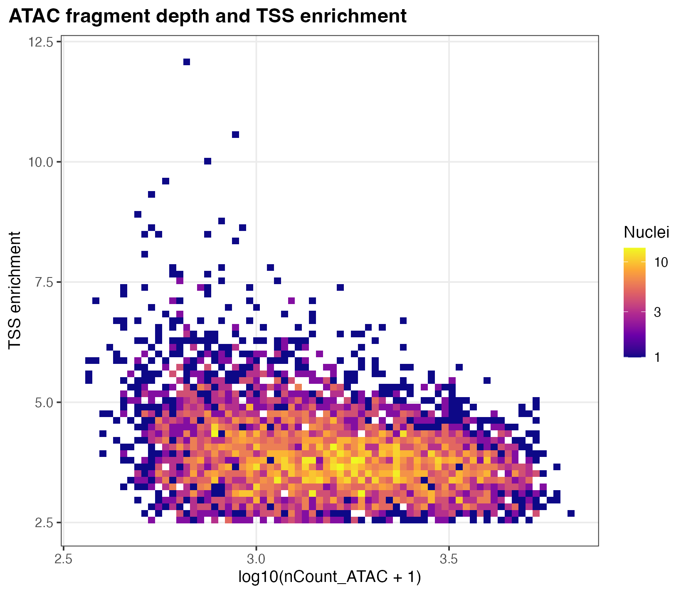\
Relationship between ATAC counts and TSS enrichment. [PDF](figures/00_atac_qc/density_scatter_nCount_TSS.pdf)

### Cell annotations

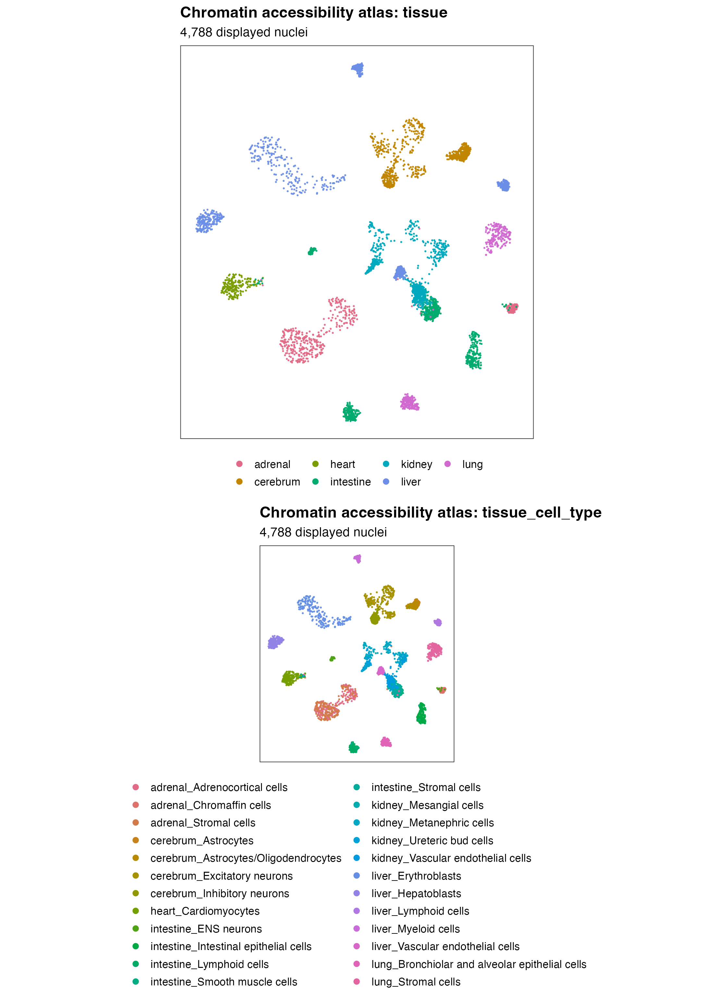\
UMAP of all supplied cells, colored by tissue and tissue–cell-type group. [PDF](figures/UMAP_tissue_and_tissue_cell_type.cellQC.peakQC.pdf)

## Accessibility

### SNP accessibility on UMAP

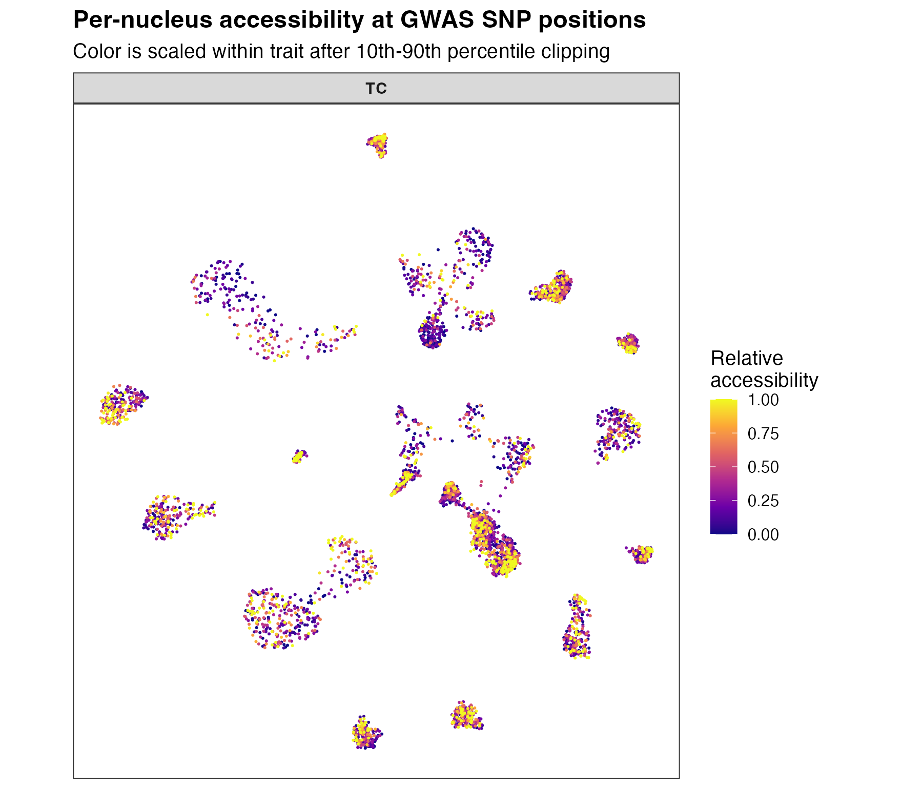\
TC SNP accessibility counts on the cell embedding; colors use the package display scaling. [PDF](figures/all_traits_GWAS_SNP_count_FeaturePlot.pdf)

### Peak accessibility on UMAP

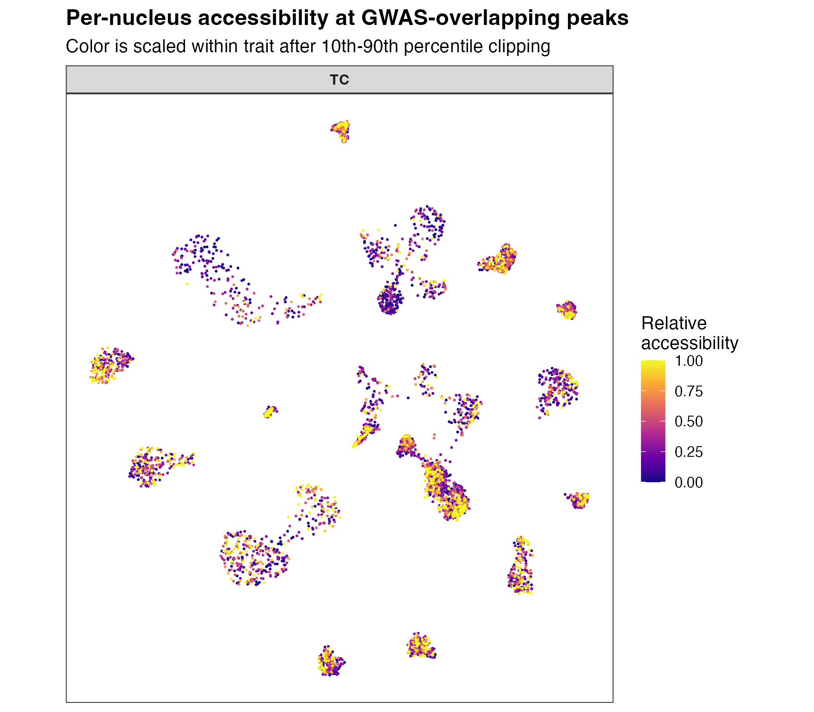\
TC peak accessibility counts on the cell embedding; colors use the package display scaling. [PDF](figures/all_traits_GWAS_peak_count_FeaturePlot.pdf)

## LD

### LD block sizes

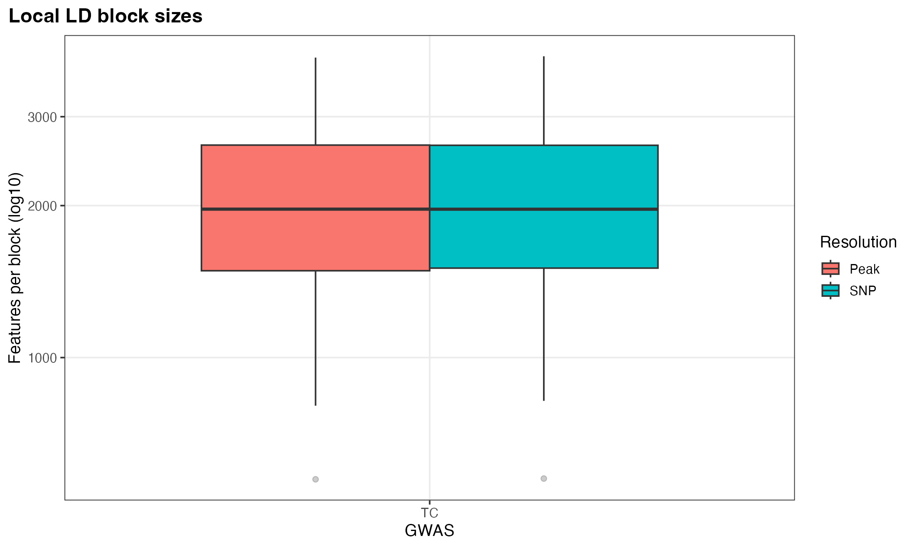\
Sizes of the TC SNP and peak LD components. [PDF](figures/03_ld/ld_block_size_distribution.pdf)

### SNP LD heatmap

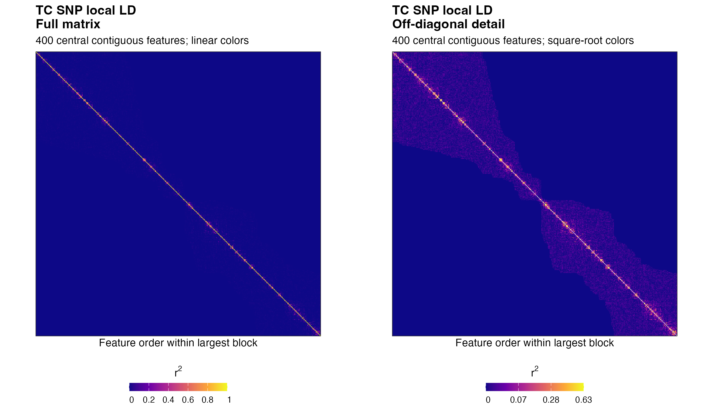\
The same 400 contiguous SNPs, centered in the largest component, are shown in both panels. Left: full r² with linear colors. Right: diagonal masked and square-root colors to reveal off-diagonal structure. The full matrix is used for analysis. [PDF](figures/03_ld/TC.snp_ld_heatmap.pdf)

### Peak covariance heatmap

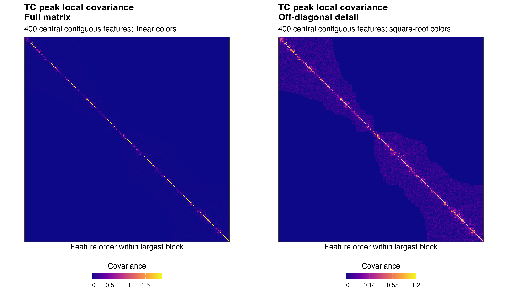\
The same 400 contiguous peaks, centered in the largest component, are shown in both panels. Left: full covariance with linear colors. Right: diagonal masked and square-root colors. The full matrix is used for analysis. [PDF](figures/03_ld/TC.peak_ld_heatmap.pdf)

## WRS

### WRS summary by cell group

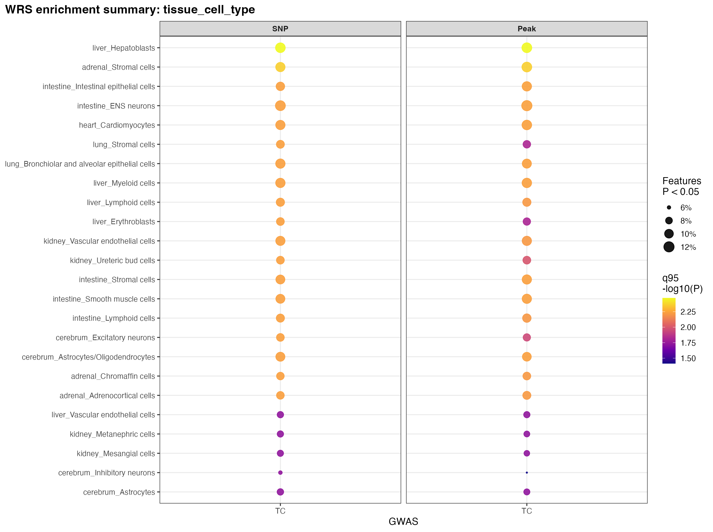\
Point size shows the fraction of features with WRS P \< 0.05; color shows the 95th percentile of −log10(P). [PDF](figures/04_wrs/wrs_group_summary.tissue_cell_type.pdf)

### Top SNP features

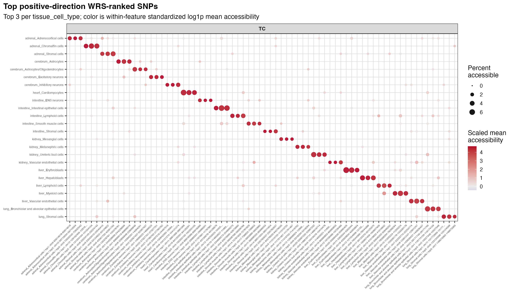\
Accessibility of WRS-ranked SNP features for TC, selecting up to three features per cell group. [PDF](figures/all_traits.top3_per_group_topSNP_wilcoxon_DotPlot.pdf)

### Top peak features

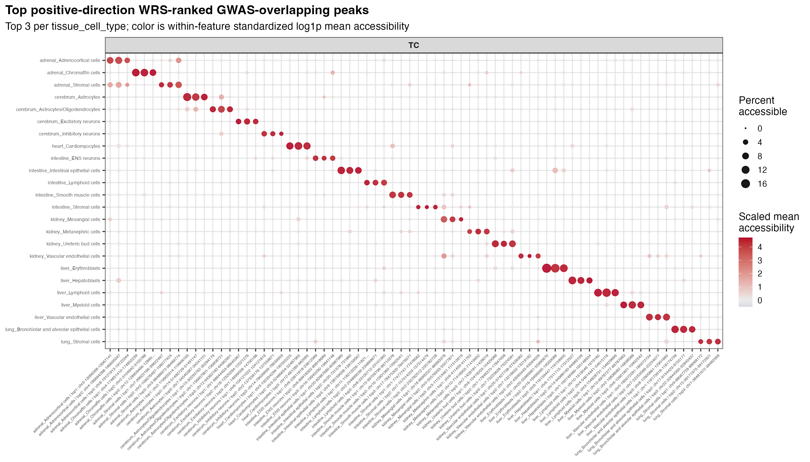\
Accessibility of WRS-ranked peak features for TC, selecting up to three features per cell group. [PDF](figures/all_traits.top3_per_group_topPeak_wilcoxon_DotPlot.pdf)

## Association results

### ACAT associations by cell group

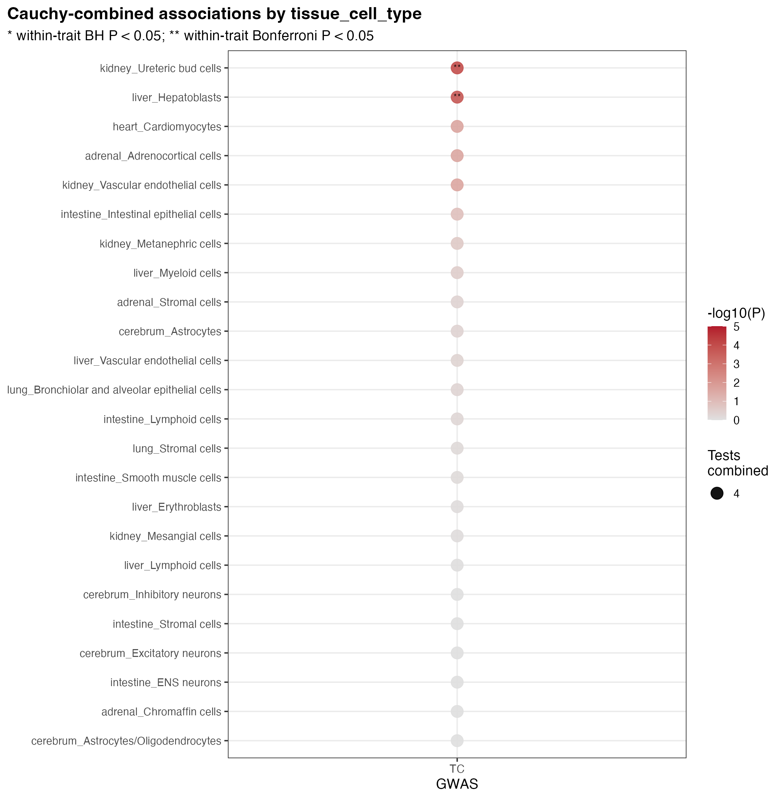\
Color shows nominal −log10(P); point size shows the number of combined tests. \* BH-adjusted P \< 0.05; \*\* Bonferroni-adjusted P \< 0.05. [PDF](figures/05_models/cauchy_tissue_cell_type_dotplot.pdf)

### Nominal component and ACAT tests by cell group

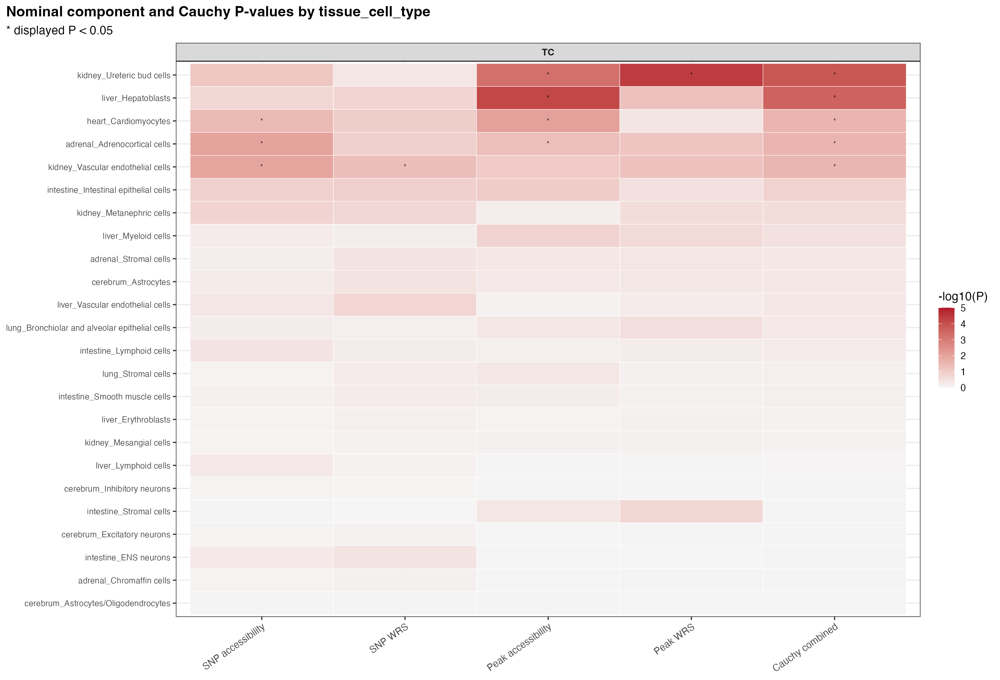\
Nominal P-values for the four components and ACAT; stars indicate displayed P \< 0.05. [PDF](figures/05_models/cauchy_tissue_cell_type_component_heatmap_nominal.pdf)

### BH-adjusted component and ACAT tests by cell group

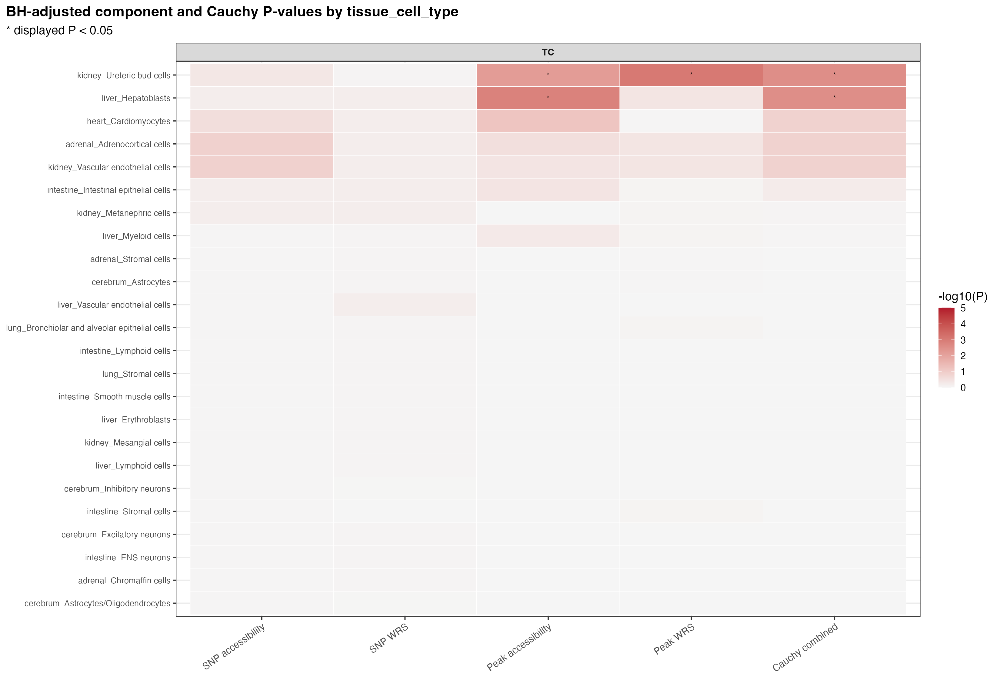\
BH-adjusted P-values for the four components and ACAT; stars indicate displayed P \< 0.05. [PDF](figures/05_models/cauchy_tissue_cell_type_component_heatmap_bh.pdf)

Because this tutorial uses a sampled subset of real scATAC-seq data, with up to 200 cells per tissue–cell-type group, the nominal and BH-adjusted results may differ slightly from the manuscript results obtained using the complete dataset. The main enrichment signals remain consistent.
